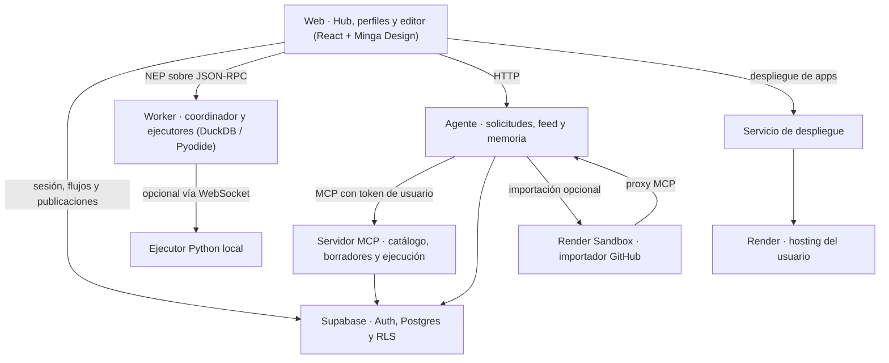

# Nodomics — Concepto de producto

## 1. Visión

> **Nodomics es un ecosistema colaborativo y visual para que profesionales de cualquier disciplina, sepan programar o no, compartan, ejecuten y adapten herramientas de datos.** Combina un editor visual basado en flujos de nodos, ejecución local desacoplada, un Hub comunitario versionado con descubrimiento entre pares, y un agente inteligente que propone y prueba adaptaciones en borradores aislados mediante MCP.

Frase síntesis: *"Análisis de datos que se arma con nodos como LEGO, se comparte como código y lo construye un agente contigo."*

## 2. El problema real

- **Conocimiento atrapado y frágil:** Quienes resuelven problemas analíticos en su oficio (agronomía, educación, salud, energía, finanzas, comercio) suelen depender de planillas de cálculo (Excel/Sheets) complejas y opacas. Son análisis difíciles de auditar, propensos a romperse con una celda movida y casi imposibles de reutilizar por colegas.
- **Brecha de herramientas:** Las suites existentes son de escritorio y con curvas de aprendizaje prohibitivas (KNIME, Orange), costosas y orientadas a enterprise (Alteryx, Dataiku), o chats con IA cuyos resultados no son reproducibles ni auditables paso a paso (ChatGPT, Claude en chat plano).
- **Reinvención continua del trabajo:** La lógica específica de cada sector ("cómo normalizar mediciones de riego", "cómo depurar un registro escolar con valores cero", "cómo calcular el balance de carga") se reinventa desde cero porque no existía un espacio donde inspeccionar la regla exacta, probarla con datos propios y adoptarla con confianza.

## 3. Identidad: Lenguaje de diseño Minga y del Nudo (Musubi)

Nodomics no utiliza conceptos genéricos ni depende de metáforas prestadas de herramientas de diseño. Posee su propio sistema de diseño documentado (**Minga**) y una narrativa visual basada en la tradición comunitaria y el anudado:

- **Símbolo:** Dos aros entrelazados (el nudo), que representan la unión entre personas de oficio y herramientas compartidas.
- **Estados del flujo en el lenguaje del hilo:**
  - *El hilo se cruza:* conexiones y flujo de datos entre nodos.
  - *El hilo se empalma:* unión, fusión y enriquecimiento de fuentes.
  - *El hilo se desenreda:* limpieza, normalización y simplificación de datos.
  - *El hilo se trenza:* composición de flujos dentro de otros flujos.
  - *El hilo se enreda / triza:* advertencias, errores de tipos o discrepancias de validación.
- **Filosofía colaborativa (Minga):** El trabajo compartido no es una transacción abstracta de código, sino una jornada comunitaria donde el conocimiento de uno alivia el trabajo de otro.

## 4. Pilares de la solución

### A. Editor visual y motor desacoplado (NEP)
- **Protocolo propio (NEP - Nodomics Engine Protocol):** La interfaz de usuario habla exclusivamente JSON-RPC tipado contra un motor desacoplado.
- **Ejecución flexible:** Los nodos pueden ejecutarse en memoria en el navegador (DuckDB-WASM y Pyodide) para máxima privacidad y cero costo de servidor, o delegarse a ejecutores locales y en la nube mediante WebSockets sin cambiar la interfaz.
- **Composición total (Flujos como Nodos):** Cualquier flujo funcional con entradas y salidas declaradas se convierte automáticamente en un nodo reutilizable para otros flujos.

### B. Hub comunitario y catálogo de producción
- **Publicaciones con ciclo de vida:** Los flujos se guardan en la cuenta privada del usuario (Supabase con seguridad a nivel de filas, RLS) y se publican con versiones inmutables en el Hub.
- **Bifurcación y adaptación (Forks transparentes):** Cualquier usuario puede explorar el Hub, abrir una copia de un flujo, ver las reglas internas con datos de muestra y adaptarla a su contexto sin alterar el original.
- **Descubrimiento por afinidad (Feed "Para ti"):** Conexión entre perfiles basada en embeddings vectoriales (Voyage AI) que empareja lo que un profesional ofrece con lo que otro busca.

### C. Agente autónomo con MCP y borradores aislados
- **Arquitectura de agente segura:** El asistente de IA no manipula el lienzo a ciegas ni genera respuestas desconectadas del motor.
- **Servidor MCP del motor:** A través de herramientas estándar de Model Context Protocol (MCP), el agente inspecciona el catálogo, prepara cambios sobre un **borrador aislado**, ejecuta el flujo para verificar que no haya errores y genera un informe de propuesta.
- **Control del usuario:** La propuesta muestra un diff claro con evidencia concreta. El usuario decide explícitamente si aplica o descarta las modificaciones.
- **Importación desde repositorios:** Capacidad de conectar repositorios de GitHub en sandboxes aislados de Render para extraer pipelines o lógica y convertirlos en nodos de Nodomics.

## 5. Usuarios y casos de uso por oficio

Nodomics está estructurado alrededor de problemas concretos de dominio documentados en [casos de uso por disciplina](casos-de-uso/README.md):

| Disciplina | Necesidad concreta | Cómo lo resuelve Nodomics |
|---|---|---|
| **Agronomía y Suelos** | Integrar sensores de humedad, clima y dosificación de riego | Flujo que limpia nulos, une series de tiempo y calcula ventana óptima de riego sin programar. |
| **Educación y Docencia** | Auditar asistencia y calificaciones preservando ceros válidos | Flujos transparentes que los estudiantes pueden inspeccionar paso a paso para aprender estadística aplicada. |
| **Energía y Redes** | Balance de consumo eléctrico y detección de anomalías | Nodos de agregación y SQL local sobre DuckDB que alertan sobre picos de demanda. |
| **Salud y Veterinaria** | Seguimiento de tratamientos, inventario y registros clínicos | Adaptación de plantillas comunitarias con datos locales bajo estricta privacidad en el navegador. |
| **Comercio y Pymes** | Conciliación de ventas, pasarelas de pago y stock | Flujos automatizados que consolidan reportes diarios sin depender de software contable cerrado. |

## 6. Arquitectura técnica en producción

## 7. Diferenciación técnica

1. **Auditabilidad paso a paso:** Frente a los "agentes de chat" que entregan números sin respaldo, en Nodomics cada transformación es un nodo con entradas, salidas e historial verificable.
2. **Privacidad por diseño:** Los datos del usuario pueden procesarse 100% en el cliente local mediante DuckDB-WASM y Pyodide; los datos sensibles no viajan a servidores externos obligatoriamente.
3. **Comunidad activa:** La barrera entre consumidor y autor desaparece: crear un flujo útil y empaquetarlo como nodo está al alcance de quien no sabe programar.

---

Para revisar la implementación detallada, contratos de código y pruebas automatizadas:
- [Guía técnica de Nodomics](engineering/guia-tecnica.md)
- [Arquitectura del sistema](engineering/arquitectura.md)
- [Sistema de diseño Minga](design-system/README.md)
- [README principal del proyecto](../README.md)
