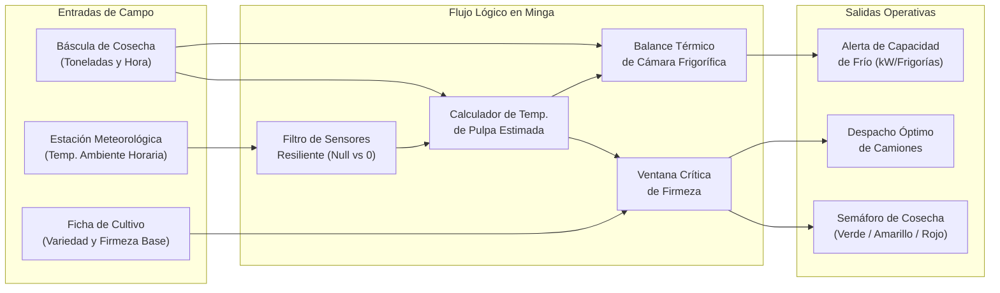

# Caso de Uso 01: Agronomía y Cadena Alimentaria
### Optimización de Cosecha, Cadena de Frío y Resiliencia en Terreno

> **Área:** Agronomía, Agroindustria & Sensores IoT  
> **Relevancia Demo Platanus Hack:** ⭐⭐⭐⭐⭐ *(Caso ancla para el Pitch y demostración en vivo)*

---

## 1. Resumen Ejecutivo para el Jurado y Pitch

En la agroexportación latinoamericana (arándanos, fresas, uva de mesa, cerezas), la rentabilidad de una temporada se juega en horas. Por cada hora que un berry permanece al sol tras ser cosechado, se pierde el equivalente a **un día de vida de anaquel en destino** (Rotterdam o Filadelfia) debido al incremento de la tasa respiratoria ($Q_{10}$).

* **El Problema:** Los productores agrícolas usan planillas de Excel desarticuladas, mensajes de WhatsApp y termómetros manuales. Cuando un sensor falla y reporta un valor vacío o nulo, las fórmulas tradicionales promedian un cero, provocando alertas falsas de congelamiento o arruinando el cronograma de refrigeración.
* **La Solución Minga:** Un flujo visual determinista que calcula en tiempo real la temperatura interna de la pulpa, la ventana de firmeza de la fruta y la demanda frigorífica de la planta.
* **El Momento "¡Ajá!" de la Demo:** La demostración del **Nodo Filtro de Sensores Resiliente (Null vs 0)** y la adaptación transfronteriza instantánea entre Chile y México mediante **Diff de Dominio** y **Smart Merge**.

---

## 2. Nivel 1: Aplicación Completa — Cadena de Frío y Ventana de Cosecha



### 2.1 Persona y Problema del Mundo Real
* **Autora Original:** Camila Vergara (Ingeniera Agrónoma, Administradora de Campo, Curicó, Región del Maule, Chile).
* **El Problema en sus palabras:**  
  *"En plena cosecha de arándanos en enero, tenemos cuadrillas cortando fruta desde las 7 de la mañana. Al mediodía, el termómetro marca 32°C. Si dejamos los bultos de fruta a la sombra del árbol esperando que llegue el camión a las 4 de la tarde, la pulpa del fruto supera los 24°C. Al meter esa fruta caliente a la cámara de frío de la planta, saturamos los compresores, la fruta 'suda' por condensación y en dos días se llena de botrytis (hongo). Pierdo hasta el 25% de la producción de exportación antes de subirla al barco."*

### 2.2 Entradas, Nodos del Flujo y Salidas

#### Entradas (Inputs)
1. **Registro de Cosecha (`toneladas_hora`):** Tabla con timestamps, cuartel del campo, variedad de arándano (`Duke`, `Legacy`) y kilos pesados en romana.
2. **Temperatura Ambiente (`temperatura_ambiente_c`):** Flujo de datos horario desde sensores IoT instalados en el cuartel.
3. **Parámetros de Planta Frigorífica:** Capacidad de extracción térmica del túnel californiano ($Frigor\acute{\imath}as/hora$) y temperatura objetivo de recepción ($1.0^\circ\text{C}$).

#### Nodos del Flujo
1. **`Filtro de Sensores Resiliente` (Nodo Nivel 3):** Sanitiza la serie temporal del termómetro ambiental; descarta ráfagas nulas sin introducir valores cero artificiales.
2. **`Calculador de Temperatura de Pulpa`:** Modelo empírico que estima la inercia térmica de la fruta:
   $$\Delta T_{pulpa} = (T_{ambiente} - T_{pulpa\_anterior}) \times \left(1 - e^{-k \cdot \Delta t}\right)$$
   donde $k$ es el coeficiente de conductividad según diámetro de la baya.
3. **`Ventana Crítica de Firmeza`:** Cuenta regresiva que proyecta las horas de tolerancia máxima antes de que la fruta pierda más de 20 g/mm de firmeza en el durómetro.
4. **`Balance Térmico de Cámara`:** Calcula la energía requerida para abatir la temperatura de la fruta entrante:
   $$Q = m \cdot c_p \cdot (T_{ingreso} - T_{objetivo})$$
   donde $c_p$ es el calor específico de la fruta con 85% de agua ($3.77\text{ kJ/kg}^\circ\text{C}$).
5. **`Alerta de Saturación de Frío`:** Compara la demanda instantánea acumulada contra el límite de los evaporadores de la planta.

#### Salidas (Outputs)
* **Semáforo Operativo para Capataces:**
  * **Verde:** Temperatura de pulpa $\le 18^\circ\text{C}$; transporte seguro en camiones descubiertos dentro de 4 horas.
  * **Amarillo:** Temperatura de pulpa $19^\circ\text{C} - 22^\circ\text{C}$; despacho forzado de camión en $\le 90$ minutos.
  * **Rojo:** Temperatura de pulpa $> 22^\circ\text{C}$; detención de corte en campo o desvío obligatorio a congelado IQF.
* **Cronograma Dinámico de Fletes:** Despacho escalonado de camiones para evitar filas en la entrada de la empacadora.

---

### 2.3 Diff de Dominio: Adaptación Transfronteriza (Chile ➔ México)

* **Adaptadora:** Valeria Morales (Ingeniera Agrónoma, Productora de Fresa en Zamora, Michoacán, México).
* **El Contexto de Valeria:** Valeria descarga el flujo de Camila desde el Hub de Minga. En Zamora cultiva fresa (*Fragaria vesca*), no arándano. La fresa tiene epidermis delgada, no tiene la cutícula cerosa (pruina) del arándano y se pudre el doble de rápido si entra caliente.
* **Interacción con el Agente:**  
  *Valeria:* *"Agente, quiero usar el flujo de Camila pero para mis fresas en Zamora. Aquí a las 11 AM ya estamos a 28°C y la fresa no aguanta ni 2 horas al sol."*

```
┌────────────────────────────────────────────────────────────────────────┐
│                   TARJETA DE DIFF DE DOMINIO                           │
│   Herramienta: "Cadena de Frío y Ventana de Cosecha"                   │
│   De: Camila Vergara (Chile) ➔ A: Valeria Morales (México)             │
├────────────────────────────────────────────────────────────────────────┤
│ 1. Cambio de Cultivo y Fisiología:                                     │
│    - Especie: Arándano (Vaccinium corymbosum) ➔ Fresa (Fragaria vesca)  │
│    - Coeficiente de intercambio calórico (k): 0.35 ➔ 0.58 h⁻¹          │
│                                                                        │
│ 2. Parámetro de Ventana de Firmeza:                                    │
│    - Tolerancia máxima en campo: 4.0 horas ➔ 2.0 horas                │
│    - Razón del oficio: La fresa sufre ablandamiento celular un 100%   │
│      más rápido que el arándano bajo calor.                            │
│                                                                        │
│ 3. Umbral Crítico de Pulpa para Rechazo:                               │
│    - Temperatura máxima admisible: 22.0°C ➔ 18.0°C                     │
│                                                                        │
│ 4. Estado de Nodos:                                                    │
│    - Estructura del grafo: 100% idéntica (sin tocar código).           │
│    - Manifiesto: Validado contra límites de fresa michoacana.          │
└────────────────────────────────────────────────────────────────────────┘
```
Valeria hace clic en **[Aprobar Cambios de Dominio]**. El flujo queda calibrado para el valle de Zamora sin alterar una sola línea de lógica interna.

---

### 2.4 Smart Merge: La Mejora Comunitaria que Vuelve a Todos

* **El Aporte Comunitario:** Don Javier es transportista de carga refrigerada en Ciudad Guzmán, Jalisco. Al ver el flujo de Valeria, nota una omisión crítica:
  *"Ustedes calculan la pulpa en el campo y en la cámara, pero el camión tarda 90 minutos por carretera bacheada. Si la lona del camión no es térmica blanca, el techo de la caja se calienta a 45°C e irradia calor a las cajas superiores."*
* **El Nuevo Nodo:** Don Javier (asistido por su agente) crea el nodo:  
  `Ganancia Térmica en Tránsito (Tipo de Carrocería & Tiempo de Ruta)`.
* **Cómo opera el Smart Merge:**  
  Don Javier publica la mejora en el Hub.
  1. Minga detecta que el flujo original de Camila (Chile) y el derivado de Valeria (México) son compatibles con el nuevo nodo.
  2. El agente notifica a Camila en Curicó:
     > *"Un transportista de la red añadió el nodo de ganancia térmica en tránsito de camiones. ¿Deseas integrarlo entre el pesaje de campo y la entrada de cámara? Tus umbrales de arándanos (4h y 22°C) se mantendrán idénticos."*
  3. Camila acepta: el nodo se inserta limpiamente en el grafo. **Nadie pisó los parámetros de nadie**.

---

## 3. Nivel 2: Módulo Reutilizable — Monitoreo de Microclima y Alerta de Heladas Tardías

### 3.1 Persona y Problema del Mundo Real
* **Autor Original:** Esteban Morales (Vitivinicultor, Valle de Casablanca, Chile).
* **El Problema del Oficio:**  
  *"En octubre, las heladas radiativas de primavera nos matan las yemas brotadas del Chardonnay. El aire frío y seco se asienta en las hondonadas a las 4 de la madrugada. Si encendemos los aspersores anti-heladas cuando el termómetro ya está en 0°C, el agua congela la planta antes de formar la capa protectora de hielo latente. Necesitamos encenderlos cuando el punto de rocío y el gradiente térmico indican que la helada es inminente."*

### 3.2 Lógica del Módulo (Empaquetado como Flujo como Nodo)
* **Puertos de Entrada:**
  * `T_aire` (Escalar °C, tiempo real)
  * `Humedad_Relativa` (Escalar %, tiempo real)
  * `Velocidad_Viento` (Escalar km/h)
* **Sub-Nodos Internos:**
  1. `Calculador de Punto de Rocío (Fórmula Magnus-Tetens)`:
     $$T_d = \frac{b \cdot \alpha(T, RH)}{a - \alpha(T, RH)}$$
  2. `Gradiente de Descenso Térmico Horario`: Analiza la derivada primera del enfriamiento entre las 01:00 y las 04:00 AM.
  3. `Gatillador Preventivo`: Si $T_{aire} - T_d \le 1.5^\circ\text{C}$ y viento $< 3\text{ km/h}$, dispara señal de encendido preventivo de aspersores.
* **Puertos de Salida:**
  * `Alerta_Helada` (Booleano)
  * `Minutos_Estimados_Para_Bajo_Cero` (Entero)

### 3.3 Adaptación (Diff de Dominio)
* **Adaptador:** Horacio (Fruticultor de Manzanos en Cuauhtémoc, Chihuahua, México).
* **Diff:** En manzano durante letargo invernal temprano, las yemas cerradas toleran hasta $-2.5^\circ\text{C}$ sin daño celular. El agente de Horacio modifica el umbral de disparo de $+0.5^\circ\text{C}$ (vid brotada en Chile) a $-2.0^\circ\text{C}$ (manzano en Chihuahua), evitando el desperdicio millonario de combustible en calefactores de huerto.

---

## 4. Nivel 3: Nodo Individual — Filtro de Sensores Resiliente (Null vs 0)
### ⭐ El Caso Estrella de la Demo en Vivo

### 4.1 El Dolor Técnico y de Negocio
En sistemas agrícolas conectados por redes LoRaWAN o telefonía rural 3G:
1. Las baterías de los nodos sensores se agotan al amanecer por el frío.
2. Durante 20 minutos, el sensor transmite paquetes incompletos (`null` o `NaN`).
3. **El Error Fatal de los Sistemas Tradicionales:**  
   Un software común o una fórmula de Excel como `AVERAGE(A1:A4)` donde una celda vacía se convierte en `0` transforma la serie $[21.5^\circ\text{C}, 22.0^\circ\text{C}, \text{null}, 21.0^\circ\text{C}]$ en:
   $$\frac{21.5 + 22.0 + 0.0 + 21.0}{4} = 16.12^\circ\text{C}$$
   ¡El sistema cree que la temperatura cayó de golpe 6°C! Dispara alarmas falsas, apaga los ventiladores de secado o enciende estufas innecesariamente, gastando miles de dólares en gas propano.

### 4.2 Manifiesto del Nodo en Minga (`sensor_resilient_filter.json`)

```json
{
  "id": "node_sensor_resilient_filter",
  "name": "Filtro de Sensores Resiliente",
  "category": "Limpieza & Señal",
  "version": "1.2.0",
  "author": "Red de Estaciones Comunitarias Maule",
  "description": "Descarta lecturas nulas o corruptas sin sustituirlas por cero, preservando el divisor exacto y aplicando imputación por ventana temporal si la brecha es menor a 15 minutos.",
  "inputs": [
    {
      "id": "lecturas_crudas",
      "name": "Lecturas Crudas",
      "type": "Tabla",
      "description": "Serie temporal con columnas [timestamp, sensor_id, valor]"
    }
  ],
  "params": [
    {
      "id": "valor_minimo_fisico",
      "title": "Temperatura Mínima Posible",
      "type": "number",
      "default": -10.0,
      "unit": "°C"
    },
    {
      "id": "valor_maximo_fisico",
      "title": "Temperatura Máxima Posible",
      "type": "number",
      "default": 55.0,
      "unit": "°C"
    },
    {
      "id": "max_tolerancia_nulos_consecutivos",
      "title": "Ventana Máxima de Tolerancia",
      "type": "number",
      "default": 3,
      "unit": "muestras"
    }
  ],
  "outputs": [
    {
      "id": "serie_sanitizada",
      "name": "Serie Sanitizada",
      "type": "Tabla",
      "description": "Tabla filtrada con nulos aislados, promedios reales y marcas de confiabilidad."
    },
    {
      "id": "estado_sensor",
      "name": "Salud del Sensor",
      "type": "Escalar",
      "description": "Porcentaje de disponibilidad operativa del dispositivo (0-100%)."
    }
  ],
  "sqlTemplate": "SELECT timestamp, sensor_id, valor FROM {{inputs.lecturas_crudas}} WHERE valor IS NOT NULL AND valor BETWEEN {{params.valor_minimo_fisico}} AND {{params.valor_maximo_fisico}}"
}
```

### 4.3 Demostración de Ejecución en Vivo

```
ENTRADA CRUDA DEL SENSOR (10:00 a 10:15 AM):
[
  { "hora": "10:00", "temp": 24.2 },
  { "hora": "10:05", "temp": 24.5 },
  { "hora": "10:10", "temp": null },   <-- Sensor perdió paquete de radio
  { "hora": "10:15", "temp": 24.8 }
]

❌ CÁLCULO TRADICIONAL ERRÓNEO (Null como Cero):
   Promedio = (24.2 + 24.5 + 0.0 + 24.8) / 4 = 18.37°C
   ESTADO: ALERTA FALSA (Variación brusca de temperatura)

✅ NODO MINGA FILTRO RESILIENTE:
   Muestras válidas retenidas: 3
   Promedio Real = (24.2 + 24.5 + 24.8) / 3 = 24.50°C
   Sensor Health Score = 75% (Alerta de telemetría de bajo impacto, no de cultivo)
   ESTADO: NORMAL (Seguridad de cosecha garantizada)
```

---

## 5. Ficha del Componente para el Hub de Minga

```json
{
  "id": "flow_cadena_frio_berries_v1",
  "kind": "flow",
  "name": "Calculadora de Ventana de Frío y Cosecha",
  "summary": "Protege la firmeza de berries estimando la temperatura de pulpa y el balance de cámara en tiempo real.",
  "inputs": [
    { "name": "pesaje_romana", "type": "Tabla", "unit": "kg" },
    { "name": "temperatura_campo", "type": "Tabla", "unit": "°C" }
  ],
  "outputs": [
    { "name": "semaforo_cosecha", "type": "Texto" },
    { "name": "carga_frigorifica_requerida", "type": "Escalar", "unit": "kW" }
  ],
  "assumptions": [
    "Fruta expuesta directamente a radiación solar adopta inercia térmica según diámetro de fruto.",
    "La capacidad de la cámara de frío es fija durante el turno de recepción."
  ],
  "context": {
    "domain": "agronomía",
    "crop": "arándano",
    "region": "Maule, Chile"
  },
  "lineage": {
    "author": "camila_vergara",
    "forks_count": 14,
    "stars": 42
  }
}
```

---

## 6. Guía de Ejecución del Pitch de 45 Segundos

1. **Abre el lienzo con el flujo de Camila.** Muestra los nodos conectados: `Entrada Sensor` ➔ `Filtro Resiliente` ➔ `Temperatura de Pulpa` ➔ `Semáforo`.
2. **Desconecta el cable simulando fallo de sensor:** Muestra el dato `null`.
3. **Muestra el comparador en pantalla:**
   * Lado izquierdo (Excel/Script ingenuo): Caída vertical de temperatura a 16°C.
   * Lado derecho (Minga): La curva se mantiene suave a 24.5°C; el nodo de salud se pone ámbar pero la cosecha no se frena.
4. **Haz el Fork en Vivo a México:** Presiona "Clonar para Michoacán", pide al agente *"Cambia a Fresa de Zamora"*, muestra el **Diff de Dominio** instantáneo. ¡Público y jurado convencidos!
