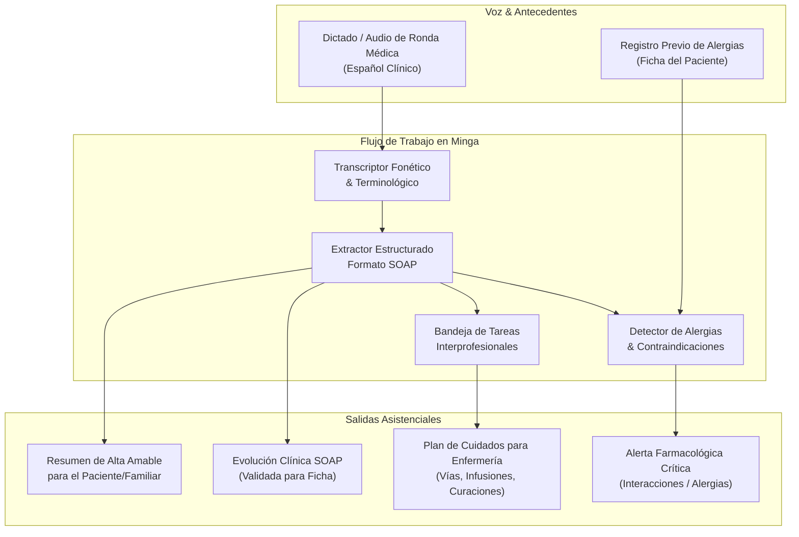
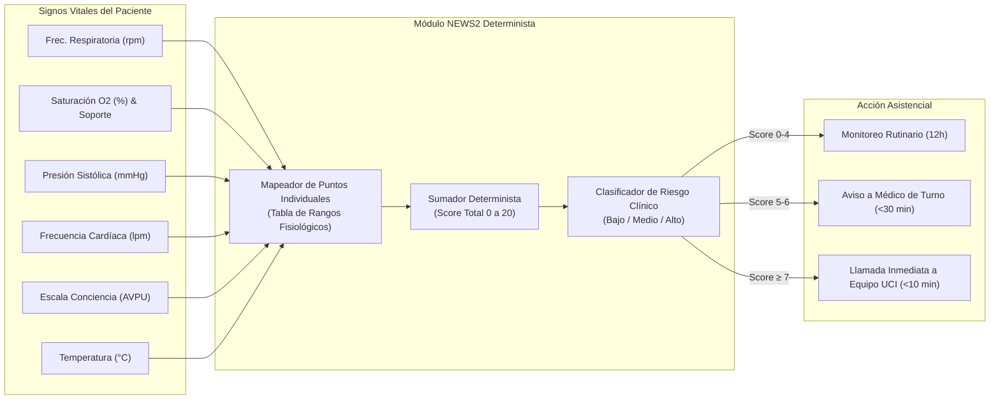

# Caso de Uso 02: Salud y Coordinación Asistencial
### Scribe Clínico Estructurado, Triage Fisiológico Determinista y Seguridad Farmacológica

> **Área:** Medicina Hospitalaria, Enfermería & Cuidados Críticos  
> **Relevancia Demo Platanus Hack:** ⭐⭐⭐⭐⭐ *(Impacto social, rigor determinista y eliminación de errores clínicos fatales)*

---

## 1. Resumen Ejecutivo para el Jurado y Pitch

En la medicina moderna, los profesionales de la salud pasan más tiempo frente al teclado que mirando a los ojos del paciente. En América Latina, un médico o enfermera hospitalaria destina hasta el **40% de su turno a la documentación burocrática** en sistemas de ficha clínica hostiles y fragmentados.

* **El Problema:** La entrega de turno de sala (pase de guardia) se realiza de forma verbal o en papeles sueltos que se desechan al terminar la jornada. Se pierden exámenes de laboratorio pendientes, no se detectan alergias medicamentosas a tiempo y el deterioro fisiológico de los pacientes pasa inadvertido durante la madrugada.
* **La Solución Minga:** Una aplicación clínica visual que escucha la ronda médica, extrae de forma estructurada el formato internacional **SOAP** (Subjetivo, Objetivo, Apreciación, Plan), valida contraindicaciones farmacológicas en tiempo real y calcula de forma **100% determinista** scores de alerta temprana (NEWS2) y dosificaciones pediátricas.
* **Diferenciación Clave vs Chatbots Médicos:** Los LLMs tradicionales sufren de alucinaciones matemáticas y farmacológicas (riesgo legal y letal). En Minga, el agente se encarga de la transcripción y estructuración lingüística, pero delega el cálculo de scores clínicos y dosis a **nodos deterministas inviolables**.

---

## 2. Nivel 1: Aplicación Completa — Scribe Clínico & Traspaso de Guardia SOAP
### Coordinación Paciente - Doctor - Enfermera



### 2.1 Persona y Problema del Mundo Real
* **Autora Original:** Dra. Marcela Baeza (Médica Internista, Jefa de Turno de Medicina Interna, Hospital San Borja Arriarán, Santiago, Chile).
* **El Problema en sus palabras:**  
  *"A las 8 de la mañana tengo que entregar 28 pacientes complejos al médico entrante en menos de media hora. Hablamos rápido: 'cama 14, Don Pedro, 72 años, neumonía bacteriana, ayer le cambiamos a Ceftriaxona, pendiente hemocultivo, orinando poco'. El médico entrante anota en un papelito; la enfermera no se entera de que suspendimos el diurético hasta tres horas después; y si nadie leyó que el paciente era alérgico a la penicilina, una cefalosporina de amplio espectro puede provocarle un shock anafiláctico. El sistema informático del hospital es un formulario de 1998 que se cae a cada rato."*

### 2.2 Entradas, Nodos del Flujo y Salidas

#### Entradas (Inputs)
1. **Flujo de Audio de la Ronda (`audio_ronda_clinica`):** Grabación directa desde el celular de la médica mientras examina al paciente al pie de la cama o resume el caso.
2. **Matriz de Pacientes y Alergias Preexistentes:** Conexión a la base de datos o CSV de ingresos hospitalarios con RUT/ID, diagnósticos base y alergias reportadas (`Penicilinas`, `AINEs`, `Látex`, etc.).

#### Nodos del Flujo
1. **`Transcriptor Fonético y Terminológico` (Nodo de Entrada Especializada):** Modelo Whisper adaptado al léxico médico hospitalario hispanoamericano (reconoce fármacos genéricos y comerciales, dosis en $mg/kg$, signos como "estertores crepitantes", "taquipnea", "glasgow 14").
2. **`Extractor de Formato SOAP`:** Normaliza la narración en cuatro compartimentos universales:
   * **S (Subjetivo):** Síntomas referidos por el paciente (*"refiere disnea de medianos esfuerzos y dolor torácico tipo puntada"*).
   * **O (Objetivo):** Signos vitales medidos, examen físico segmentario y valores de laboratorio de la mañana.
   * **A (Apreciación / Diagnóstico):** Juicio clínico y evolución (*"Sospecha de tromboembolismo pulmonar vs NAC izquierda en resolución"*).
   * **P (Plan):** Fármacos indicados, solicitud de imágenes pendientes y metas de monitoreo.
3. **`Detector de Alergias y Contraindicaciones Cruzadas` (Nodo Deterministico de Seguridad):** Cruza cada fármaco detectado en el Plan (P) contra la tabla de alergias del paciente. Detecta reactividad cruzada (ej. si el paciente es alérgico severo a Amoxicilina, bloquea la prescripción de Ampicilina o Cefazolina).
4. **`Bandeja de Tareas Interprofesionales`:** Separa las acciones según rol:
   * **Acciones Médicas:** Firma de receta retenida, solicitud de TAC de tórax.
   * **Acciones de Enfermería:** Instalación de sonda Foley, cambio de vía venosa periférica, balance hídrico estricto cada 6 horas.
   * **Acciones de Kinesiología:** Terapia respiratoria, movilización precoz fuera de cama.

#### Salidas (Outputs)
* **Nota de Evolución SOAP Oficial:** Formateada en texto estándar lista para copiar al expediente electrónico con un clic.
* **Tarjeta de Entrega de Turno Visual (Pase de Guardia):** Lista priorizada con semáforo según estabilidad del paciente.
* **Hoja de Explicación al Paciente:** Resumen redactado en lenguaje sencillo y empático para el paciente o sus familiares: *"Hoy mejoró su saturación de oxígeno. Mantendremos el antibiótico por la vena y vendrá el kinesiólogo a ayudarle a caminar"*.

---

### 2.3 Diff de Dominio: Adaptación de la Médica al Kinesiólogo Intensivista

* **Adaptador:** Lic. Rodrigo Cifuentes (Kinesiólogo Intensivista, UCI Respiratoria, Concepción, Chile).
* **El Contexto de Rodrigo:** Rodrigo no prescribe antibióticos ni define tratamientos farmacológicos; su misión es la mecánica ventilatoria, la desconexión del ventilador mecánico (weaning) y la rehabilitación motora. Quiere usar la herramienta de Marcela para su propia ronda matutina.
* **Interacción con el Agente:**  
  *Rodrigo:* *"Agente, quiero la herramienta de traspaso de la Dra. Marcela, pero adaptada para kinesiología intensiva. No necesito clasificar antibióticos; necesito que el Objetivo registre parámetros del ventilador como PEEP, volumen corriente, compliance pulmonar y escala de sedación RASS."*

```
┌────────────────────────────────────────────────────────────────────────┐
│                   TARJETA DE DIFF DE DOMINIO                           │
│   Herramienta: "Scribe Clínico SOAP y Traspaso de Guardia"             │
│   De: Dra. Marcela Baeza (Medicina) ➔ A: Lic. Rodrigo Cifuentes (Kine) │
├────────────────────────────────────────────────────────────────────────┤
│ 1. Reemplazo de Diccionario y Foco Clínico:                            │
│    - Fármacos sistémicos ➔ Parámetros de Ventilación Mecánica:        │
│      (Modo asistido/controlado, PEEP, FiO2, P-Plateau, Driving Press) │
│                                                                        │
│ 2. Adaptación del Compartimento "Objetivo (O)":                        │
│    - Se añaden campos para: Compliance Estática Pulmonar y Escala RASS │
│      (Richmond Agitation-Sedation Scale: -5 a +4).                     │
│                                                                        │
│ 3. Sustitución de Nodo de Seguridad:                                   │
│    - Se desconecta: "Detector de Contraindicaciones Farmacológicas".   │
│    - Se conecta: "Calculador de Presión de Distensión (Driving Pres.)":│
│      ΔP = Presión Plateau - PEEP (Alerta si supera 15 cmH2O).          │
│                                                                        │
│ 4. Salida Operativa:                                                   │
│    - Tareas para Enfermería: Coordinación de aspiración endotraqueal y │
│      ventana de sedación matinal.                                      │
└────────────────────────────────────────────────────────────────────────┘
```
Rodrigo valida el cambio: su flujo ahora extrae métricas respiratorias precisas en lugar de fármacos, sin necesidad de que nadie programe un nuevo software desde cero.

---

### 2.4 Smart Merge: La Enfermera Aporta la Regla de Seguridad

* **El Aporte Comunitario:** Paulina Toro, Enfermera de Urgencias del Hospital de Urgencia Asistencia Pública (Posta Central), utiliza el flujo en su servicio y nota una omisión que causa eventos adversos frecuentes:
  *"Los médicos indican medicamentos intravenosos, pero nadie revisa si la vía venosa periférica (el catéter) lleva más de 72 horas puesta o si el brazo tiene flebitis. Además, nadie anota si el paciente anciano intentó levantarse solo de la cama."*
* **El Nuevo Nodo:** Paulina crea el nodo:  
  `Validador de Seguridad de Accesos Vasculares y Riesgo de Caídas (Escala Downton)`.
* **Cómo opera el Smart Merge:**  
  Paulina publica el módulo en el Hub de Salud de Minga.
  1. El sistema identifica que los flujos de la Dra. Marcela (sala) y del Lic. Rodrigo (UCI) manipulan pacientes hospitalizados con vías invasivas.
  2. El agente notifica a Marcela:
     > *"La Enfermera Paulina Toro ha incorporado un checklist de seguridad de accesos venosos y prevención de caídas al pase de guardia. ¿Deseas integrarlo a tu módulo de tareas de enfermería sin alterar tu formato SOAP médico?"*
  3. Marcela acepta con un clic: el flujo incorpora de inmediato el control del catéter venoso. La colaboración interprofesional cobra vida en el software.

---

## 3. Nivel 2: Módulo Reutilizable — Triage Fisiológico Determinista (Score NEWS2)

### 3.1 Persona y Problema del Mundo Real
* **Autor Original:** Equipo de Enfermería de Cuidados Intermedios.
* **El Problema del Oficio:**  
  El **NEWS2** (National Early Warning Score) es el estándar internacional para detectar sepsis, shock o falla respiratoria antes de que el paciente sufra un paro cardiorrespiratorio. Requiere tabular 6 constantes vitales y asignar puntuaciones de 0 a 3. En la mitad de la noche, las enfermeras cansadas calculan el puntaje mentalmente: un error aritmético común clasifica como "estable (score 3)" a un paciente séptico que en realidad tiene score 7, retrasando el traslado a UCI.

### 3.2 Lógica del Módulo (Determinista & Auditable)



* **Valores de Disparo (Nivel de Riesgo):**
  * **Puntaje 0 - 4 (Verde):** Riesgo bajo. Mantener controles de signos vitales cada 8 a 12 horas.
  * **Puntaje 5 - 6 o un valor individual en 3 (Amarillo):** Riesgo medio. Evaluación médica obligatoria en menos de 30 minutos; escalamiento de oxigenoterapia.
  * **Puntaje $\ge 7$ (Rojo):** Riesgo crítico de muerte inminente. Activación del equipo de reanimación/UCI en menos de 10 minutos.

### 3.3 Adaptación (Diff de Dominio): Transformación a PEWS (Pediátrico)
* **Adaptadora:** Dra. Sofía Larraín (Pediatra, Hospital Exequiel González Cortés).
* **El Diff:** Un niño de 1 año con frecuencia cardíaca de 135 lpm está **completamente normal**. En el score de adultos NEWS2, 135 lpm suma 3 puntos de gravedad crítica extrema.  
  El agente de Sofía reemplaza la tabla de adultos por la matriz **PEWS** (Pediatric Early Warning Score), segmentando los rangos fisiológicos por meses de vida (lactante menor, preescolar, escolar), manteniendo la misma interfaz de alerta para la enfermera de sala pediátrica.

---

## 4. Nivel 3: Nodo Individual — Calculador de Dosis Pediátricas por Superficie Corporal (Mosteller)

### 4.1 El Dolor Técnico y el Riesgo Mortal
En pacientes pediátricos y oncológicos, dosificar medicamentos potentes (quimioterapia, antimicrobianos complejos como Vancomicina o Aciclovir) calculando únicamente por peso en kilogramos ($mg/kg$) genera intoxicaciones severas en niños con sobrepeso o dosis subterapéuticas en lactantes desnutridos. El estándar de oro es la **Superficie Corporal ($m^2$)**.

Calcular la raíz cuadrada a mano en una emergencia pediátrica genera errores de orden de magnitud (ej. prescribir 10 veces la dosis).

### 4.2 Manifiesto del Nodo (`pediatric_bsa_dose.json`)

```json
{
  "id": "node_pediatric_bsa_dose",
  "name": "Calculador de Dosis por Superficie Corporal (Mosteller)",
  "category": "Farmacología & Pediatría",
  "version": "2.0.0",
  "author": "Comité de Farmacología Clínica Infantil",
  "description": "Calcula el área de superficie corporal (Mosteller) y determina la dosis total exacta bloqueando salidas si se supera la dosis máxima absoluta de adulto.",
  "inputs": [
    { "id": "peso_kg", "name": "Peso del Paciente", "type": "Escalar", "description": "Peso en kilogramos (rango 0.5 a 150 kg)" },
    { "id": "talla_cm", "name": "Talla / Longitud", "type": "Escalar", "description": "Estatura en centímetros (rango 30 a 220 cm)" },
    { "id": "dosis_prescrita_m2", "name": "Dosis Indicada por m²", "type": "Escalar", "description": "Miligramos o microgramos por metro cuadrado" }
  ],
  "params": [
    {
      "id": "dosis_maxima_absoluta",
      "title": "Dosis Máxima Límite de Adulto",
      "type": "number",
      "default": 1000.0,
      "unit": "mg",
      "description": "Techo de seguridad: una dosis pediátrica nunca debe superar la dosis máxima recomendada para un adulto."
    }
  ],
  "outputs": [
    { "id": "superficie_corporal", "name": "Superficie Corporal (SC)", "type": "Escalar", "unit": "m²" },
    { "id": "dosis_calculada_mg", "name": "Dosis Total a Administrar", "type": "Escalar", "unit": "mg" },
    { "id": "alerta_seguridad", "name": "Alerta de Dosis Límite", "type": "Texto" }
  ]
}
```

### 4.3 Algoritmo Deterministico Inviolable

$$SC = \sqrt{\frac{Peso(kg) \times Talla(cm)}{3600}}$$

$$\text{Dosis Calculada} = \min(SC \times \text{Dosis Prescrita}, \text{Dosis Máxima Absoluta})$$

Si la multiplicación matemática excede la dosis máxima permitida, el nodo **fuerza el techo de seguridad** y emite una alerta roja en pantalla:
> `[BLOQUEO DE SEGURIDAD]: La dosis calculada (1.240 mg) superó el límite de adulto (1.000 mg). Se fijó en 1.000 mg para prevenir toxicidad grave.`

---

## 5. Ficha del Componente para el Hub de Minga

```json
{
  "id": "flow_scribe_clinico_soap_v2",
  "kind": "flow",
  "name": "Scribe Clínico SOAP y Traspaso de Guardia",
  "summary": "Convierte dictados de ronda médica en notas SOAP estructuradas, detectando alergias cruzadas y asignando tareas para enfermería.",
  "inputs": [
    { "name": "audio_dictado", "type": "Audio" },
    { "name": "tabla_alergias", "type": "Tabla" }
  ],
  "outputs": [
    { "name": "nota_soap_markdown", "type": "Texto" },
    { "name": "alerta_contraindicacion", "type": "Texto" },
    { "name": "lista_pendientes_enfermeria", "type": "Tabla" }
  ],
  "context": {
    "domain": "salud",
    "specialty": "medicina interna",
    "hospital": "Hospital San Borja Arriarán"
  },
  "lineage": {
    "author": "marcela_baeza_md",
    "adapted_by": "rodrigo_cifuentes_kine",
    "verified_by_peer": true
  }
}
```

---

## 6. Guía de Pitch para el Jurado (Momento de Impacto)

1. **La Demostración de Voz en Vivo:** El presentador reproduce un audio de 15 segundos simulando un médico cansado en urgencias: *"Don Juan Pérez, 68 años, hipertenso, alérgico severo a la penicilina, viene por fiebre y tos con sangre; le dejamos Cefotaxima 1 gramo cada 8 horas y kine motora..."*
2. **El Procesamiento en Pantalla:** Minga transcribe, separa de inmediato en **SOAP** y de pronto el nodo de `Contraindicaciones` se enciende en **ROJO PARPADEANTE**:
   > `ALERTA CRÍTICA: Cefotaxima presenta 10% de reactividad cruzada con Penicilinas. Riesgo de anafilaxia en paciente alérgico severo.`
3. **El Cierre Contundente:**  
   *"Esto no es un juguete de conversación. Minga combina la facilidad lingüística de la IA con el determinismo matemático estricto de los nodos. Salvamos el tiempo del médico y salvamos la vida del paciente."*
