# Caso de Uso 03: Educación y Docencia STEM
### Laboratorio Escolar de Eficiencia Energética, Huella de Carbono y Analítica Didáctica

> **Área:** Educación Secundaria, Ciencias Naturales & Alfabetización de Datos  
> **Relevancia Demo Platanus Hack:** ⭐⭐⭐⭐ *(Democratización del pensamiento analítico sin barreras de programación)*

---

## 1. Resumen Ejecutivo para el Jurado y Pitch

En las escuelas secundarias de América Latina, los planes educativos exigen enseñar ciencia de datos, sostenibilidad ambiental y física aplicada. Sin embargo, los docentes se enfrentan a un muro infranqueable: **una hora de clase dura entre 45 y 60 minutos**. Enseñar Python, librerías de pandas o fórmulas complejas de hojas de cálculo consume semanas enteras, frustrando a profesores y alumnos antes de que puedan analizar un solo dato real.

* **El Problema:** Las escuelas generan gigabytes de datos reales (medidores inteligentes de electricidad, estaciones meteorológicas escolares, consumo de agua), pero esos datos duermen en correos del personal de mantenimiento. Mientras tanto, las clases de ciencias siguen usando tablas ficticias de libros de texto de hace 20 años.
* **La Solución Minga:** Una plataforma donde el profesor comparte un lienzo visual pre-configurado tipo "caja de arena" (sandbox didáctico). Los estudiantes cargan los datos de su propio colegio, conectan bloques de análisis, detectan el "consumo vampiro" nocturno de su edificio y proponen medidas reales de ahorro para la dirección.
* **El Poder de la Comunidad:** Un módulo creado para un colegio con bloques de 45 minutos en Chile se adapta en 30 segundos a un colegio con bloques de 60 minutos y tarifas en pesos mexicanos en Puebla, enriquecido por mejoras creadas por los mismos estudiantes.

---

## 2. Nivel 1: Aplicación Completa — Laboratorio de Análisis de Consumo Eléctrico Escolar

```mermaid
flowchart TD
    subgraph Fuentes["Datos Escolares"]
        F1["Medidor Inteligente de la Escuela\n(CSV con Potencia kW cada 15 min)"]
        F2["Pliego Tarifario Eléctrico\n(Tarifa Punta vs Valle / Moneda Local)"]
    end

    subgraph Flujo["Flujo de Trabajo del Laboratorio en Minga"]
        N1["Lector & Normalizador CSV Escolar"]
        N2["Agrupador Temporal por Bloques Académicos\n(Campana Escolar: Clases vs Recreos)"]
        N3["Detector Robusto de Anomalías (MAD)"]
        N4["Calculador de Consumo Vampiro Nocturno"]
        N5["Conversor a Costo Económico & Huella CO2"]
    end

    subgraph Salidas["Salidas Didácticas & de Gestión"]
        S1["Histograma de Consumo por Bloque de Clase"]
        S2["Semáforo de Fugas Eléctricas Nocturnas"]
        S3["Reporte Escolar de Huella de Carbono para Dirección"]
    end

    F1 --> N1
    N1 --> N2
    N2 --> N3
    N3 --> N4
    N4 --> N5
    F2 --> N5
    N2 --> S1
    N3 --> S2
    N5 --> S3
```



### 2.1 Persona y Problema del Mundo Real
* **Autor Original:** Prof. Andrés Navarro (Profesor de Física y Ciencias Naturales, Liceo Bicentenario de Temuco, Región de La Araucanía, Chile).
* **El Problema en sus palabras:**  
  *"En el colegio la cuenta de electricidad mensual supera los 2.5 millones de pesos. El director me pidió organizar un proyecto de eficiencia energética con los alumnos de tercero medio. La compañía eléctrica nos habilitó el acceso a las lecturas del medidor digital que registra la potencia cada 15 minutos. Cuando intenté que los estudiantes abrieran el archivo de 35.000 filas en Excel, las computadoras viejas de la sala de enlaces se congelaron. Intentar enseñarles sintaxis de código en Python o SQL en un bloque de 45 minutos fue imposible: nos pasamos 40 minutos lidiando con errores de comas e indentación. Necesitamos que los chicos vean la física y el impacto ambiental del consumo eléctrico, no que se frustren con la sintaxis de un script."*

### 2.2 Entradas, Nodos del Flujo y Salidas

#### Entradas (Inputs)
1. **Archivo CSV del Medidor Inteligente (`consumo_electricidad_liceo.csv`):** Columnas con fecha/hora (`timestamp`), potencia activa instantánea en kilovatios (`kW`) y factor de potencia.
2. **Parámetro Tarifario y Ambiental:** Tarifa por kilovatio-hora según distribuidora (Enel/Frontel: cargo punta vs normal en CLP) y factor de emisión de la matriz energética chilena ($0.28\text{ kg } CO_2/kWh$).

#### Nodos del Flujo
1. **`Lector y Normalizador CSV Escolar`:** Identifica automáticamente separadores (punto y coma vs coma) y valida tipos de datos sin arrojar errores fatales crípticos.
2. **`Agrupador Temporal por Bloques Académicos` (Módulo Nivel 2):** Agrupa los timestamps en la estructura real de la jornada escolar:
   * Bloque 1 (08:00 - 09:30), Recreo 1 (09:30 - 09:45), Bloque 2 (09:45 - 11:15), Almuerzo (13:00 - 14:00), Tarde (14:00 - 17:00), Noche / Escuela Cerrada (17:00 - 07:59).
3. **`Detector Robusto de Anomalías (MAD)` (Nodo Nivel 3):** Descarta errores de medición y resalta picos de consumo inesperados durante horarios sin alumnos.
4. **`Calculador de Consumo Base (Vampiro)`:** Calcula la línea base de potencia consumida cuando el liceo está vacío (madrugadas y domingos). Muestra qué porcentaje del gasto corresponde a artefactos que nadie apagó.
5. **`Conversor de Costo y Huella Ambiental`:** Transforma kilovatios-hora a pesos chilenos y a kilogramos equivalentes de dióxido de carbono ($CO_2$).

#### Salidas (Outputs)
* **Visualizador Didáctico de Barras:** Muestra claramente cómo el consumo pasa de $8\text{ kW}$ en la noche a $45\text{ kW}$ durante los bloques de clase, y evidencia si en los recreos alguien dejó luces o calefactores encendidos.
* **Ficha de Ahorro para el Consejo Escolar:** Un reporte PDF que los alumnos firman y entregan al Director: *"Si apagamos las impresoras y pantallas de la sala de cómputo los fines de semana, el colegio ahorra $420.000 CLP al mes y evita emitir 1.2 toneladas de CO₂"*.

---

### 2.3 Diff de Dominio: Adaptación Escolar Internacional (Chile ➔ México)

* **Adaptadora:** Mtra. Guadalupe Rendón (Profesora de Ciencias y Tecnología, Escuela Secundaria Técnica N° 12, Puebla, México).
* **El Contexto de Lupita:** Lupita encuentra el flujo del profesor Andrés en el Hub de Educación de Minga. Quiere aplicarlo con sus alumnos de segundo grado en Puebla.
  * En Puebla, las clases no duran 45 minutos ni 90 minutos: el colegio funciona en **bloques de 50 minutos con módulos de 100 minutos**.
  * La energía no se factura en pesos chilenos con Enel, sino en pesos mexicanos ($MXN$) con la **Comisión Federal de Electricidad (CFE)** bajo la tarifa comercial `GDMTO` (Gran Demanda Media Tensión Ordinaria).
  * El factor de emisión de la matriz eléctrica mexicana es de aprox. $0.435\text{ kg } CO_2/kWh$ (mayor dependencia de centrales de gas y combustóleo).
* **Interacción con el Agente:**  
  *Lupita:* *"Agente, adáptame el laboratorio del profesor Andrés para mi secundaria en Puebla: las clases son de 50 minutos, la tarifa es de CFE en pesos mexicanos y el factor de contaminación es el de México."*

```
┌────────────────────────────────────────────────────────────────────────┐
│                   TARJETA DE DIFF DE DOMINIO                           │
│   Herramienta: "Laboratorio Escolar de Eficiencia Energética"          │
│   De: Prof. Andrés Navarro (Chile) ➔ A: Mtra. Guadalupe Rendón (México)│
├────────────────────────────────────────────────────────────────────────┤
│ 1. Ajuste de Calendario y Campana Escolar:                             │
│    - Duración de bloque estándar: 45 min ➔ 50 min                      │
│    - Recreo intermedio: 15 min ➔ 20 min (receso matutino)              │
│    - Horario de cierre: 17:00 h ➔ 15:30 h (turno matutino mexicano)    │
│                                                                        │
│ 2. Parámetros Económicos y Moneda:                                     │
│    - Moneda base: CLP (Pesos Chilenos) ➔ MXN (Pesos Mexicanos)         │
│    - Esquema tarifario: Cargo Enel Chile ➔ Tarifa CFE GDMTO            │
│      (Costo promedio: $2.45 MXN por kWh consumido)                     │
│                                                                        │
│ 3. Factor de Impacto Ecológico:                                        │
│    - Intensidad de carbono de la red: 0.28 ➔ 0.435 kg CO₂ / kWh       │
│                                                                        │
│ 4. Verificación de Integridad:                                         │
│    - La lógica del detector de anomalías MAD y el cálculo de consumo   │
│      vampiro se preservan al 100%.                                     │
└────────────────────────────────────────────────────────────────────────┘
```
La maestra Lupita aprueba los cambios. En menos de 2 minutos tiene su laboratorio listo para proyectarlo en el aula de cómputo.

---

### 2.4 Smart Merge: El Alumno de 16 Años Aporta un Parche Comunitario

* **El Descubrimiento de Lucas (Alumno en Temuco):** Lucas, un estudiante curioso de 16 años del liceo de Andrés, nota que cuando hubo un temporal de lluvia en Temuco, se cortó la luz durante 3 horas. En los datos del medidor aparecieron registros vacíos y saltos temporales que rompían la continuidad del gráfico de barras.
* **El Nodo de Lucas:** Con ayuda de su propio agente escolar, Lucas crea el nodo:  
  `Normalizador de Cortes de Suministro y Apagones de Red`.  
  El nodo detecta vacíos en el timestamp, inserta una bandera de "Corte de Suministro" y pinta una franja gris translúcida en la gráfica, evitando que el promedio de consumo del día se calcule incorrectamente a la baja.
* **El Smart Merge en Puebla:**  
  Lucas publica el nodo como mejora vinculada al flujo matriz en el Hub de Minga.
  El agente de la maestra Lupita en Puebla le envía un aviso:
  > *"Un estudiante de la comunidad educativa añadió una regla para identificar cortes y apagones de luz sin distorsionar el cálculo semanal. ¿Deseas sumarlo a tu laboratorio escolar? Tus horarios de Puebla y tarifas de CFE no sufrirán ningún cambio."*
  Lupita presiona **[Aceptar Mejora]**. Los alumnos de México ahora cuentan con la protección de apagones creada por un estudiante chileno a 6.000 kilómetros de distancia.

---

## 3. Nivel 2: Módulo Reutilizable — Agrupador Temporal por Bloques Académicos

### 3.1 El Valor Pedagógico
Los gráficos con eje horizontal de 24 horas continuas (00:00 a 23:59) son confusos para un alumno de secundaria. No conectan los números con su vivencia cotidiana.  
El **Agrupador por Bloques Académicos** traduce la serie temporal a los eventos del colegio:
* ¿Cuánta luz gastamos en el **Taller de Tecnología**?
* ¿Por qué el consumo sigue alto en el **Recreo del Almuerzo**?
* ¿Quién dejó los equipos encendidos en la **Noche**?

### 3.2 Lógica del Módulo
* **Inputs:**
  * `timestamp_medicion` (Fecha y Hora)
  * `potencia_kw` (Numérico)
  * `tabla_horarios_colegio` (Parámetro configurable: nombre del bloque, hora inicio, hora fin)
* **Transformación Interna:** Clasificación determinista mediante rangos de tiempo cerrados `[inicio, fin)`.
* **Outputs:** Tabla agregada con:
  * `Bloque_Nombre` (Texto: "Clase 1", "Recreo 1", "Clase 2", etc.)
  * `Consumo_Promedio_kW` (Numérico)
  * `Porcentaje_Uso_Total_Dia` (Numérico %)

---

## 4. Nivel 3: Nodo Individual — Detector Robusto de Anomalías por Desviación Mediana (MAD)

### 4.1 El Dolor Estadístico con Datos de Estudiantes
En los colegios, los estudiantes a menudo manipulan o ingresan datos a mano:
* Un alumno tipea accidentalmente `150.0 kW` en vez de `15.0 kW`.
* Si se utiliza el método clásico de la media y la desviación estándar ($Z$-Score tradicional: $Z = \frac{x - \mu}{\sigma}$), **un solo valor atípico extremo sesga la media ($\mu$) y ensancha enormemente la desviación ($\sigma$)**, haciendo que el resto de las anomalías reales no sean detectadas.

### 4.2 Manifiesto del Nodo (`student_mad_anomaly_detector.json`)

```json
{
  "id": "node_student_mad_anomaly_detector",
  "name": "Detector Robusto de Anomalías (MAD)",
  "category": "Estadística Didáctica",
  "version": "1.1.0",
  "author": "Laboratorio de Ciencias Temuco",
  "description": "Identifica mediciones imposibles o picos anómalos usando la Desviación Mediana Absoluta (MAD), insensible a errores extremos de digitación.",
  "inputs": [
    { "id": "serie_valores", "name": "Valores Medidos", "type": "Tabla", "description": "Serie numérica a evaluar" }
  ],
  "params": [
    {
      "id": "umbral_tolerancia_mad",
      "title": "Sensibilidad de Detección",
      "type": "number",
      "default": 3.5,
      "description": "Multiplicador de dispersión. Valores > 3.5 se consideran anomalías certeras."
    }
  ],
  "outputs": [
    { "id": "datos_filtrados", "name": "Datos Limpios", "type": "Tabla" },
    { "id": "lista_anomalias", "name": "Anomalías Detectadas", "type": "Tabla" }
  ]
}
```

### 4.3 Formulación Matemática Inmune a Outliers

1. Calcula la **mediana** de la muestra ($\tilde{X}$), que no se altera ante valores disparatados.
2. Calcula la **Desviación Mediana Absoluta (MAD)**:
   $$MAD = \text{mediana}\left(\left|X_i - \tilde{X}\right|\right)$$
3. Computa el **Z-Score Modificado de Boris Iglewicz & David Hoaglin**:
   $$M_i = \frac{0.6745 \cdot \left(X_i - \tilde{X}\right)}{MAD}$$
4. Si $|M_i| > 3.5$, el punto se aísla automáticamente y se colorea de rojo en la visualización, explicando en texto:  
   *"Esta lectura de 150 kW se desvía 12 veces la mediana de la escuela; probablemente se debió a un error de tipeo o a una falla momentánea del sensor."*

---

## 5. Ficha del Componente para el Hub de Minga

```json
{
  "id": "flow_laboratorio_energia_escolar_v1",
  "kind": "flow",
  "name": "Laboratorio Escolar de Eficiencia Energética",
  "summary": "Analiza consumos de medidores escolares, detecta fugas nocturnas y calcula la huella de carbono escolar sin programar.",
  "inputs": [
    { "name": "archivo_medidor_csv", "type": "Tabla" }
  ],
  "outputs": [
    { "name": "grafico_barras_bloques", "type": "Gráfico" },
    { "name": "reporte_ahorro_pdf", "type": "Documento" }
  ],
  "context": {
    "domain": "educación",
    "level": "secundaria",
    "subject": "física y medioambiente"
  },
  "lineage": {
    "author": "andres_navarro_temuco",
    "adapted_by": "guadalupe_rendon_puebla",
    "contributor": "lucas_estudiante"
  }
}
```

---

## 6. Guía de Pitch para el Jurado (La Voz de los Estudiantes)

* **El Gancho Inicial:** *"Imaginen una sala con 35 adolescentes de 15 años. Si abren una terminal de Python, a los 5 minutos la mitad está en TikTok y la otra mitad peleando con un `SyntaxError: unexpected indent`."*
* **La Experiencia Minga:** *"Con Minga, el profesor Andrés arrastra el archivo de su liceo. En la pantalla aparece el gráfico interactivo organizado por la campana de su propio colegio. Los alumnos ven de inmediato que a las 3 de la mañana la escuela sigue consumiendo 12 kilovatios porque los hervidores de la sala de profesores se quedaron enchufados."*
* **El Cierre Educativo:** *"Minga no sólo democratiza el software para empresas; forma a la próxima generación de científicos y ciudadanos de América Latina empoderándolos para resolver problemas reales de sus propias comunidades."*
