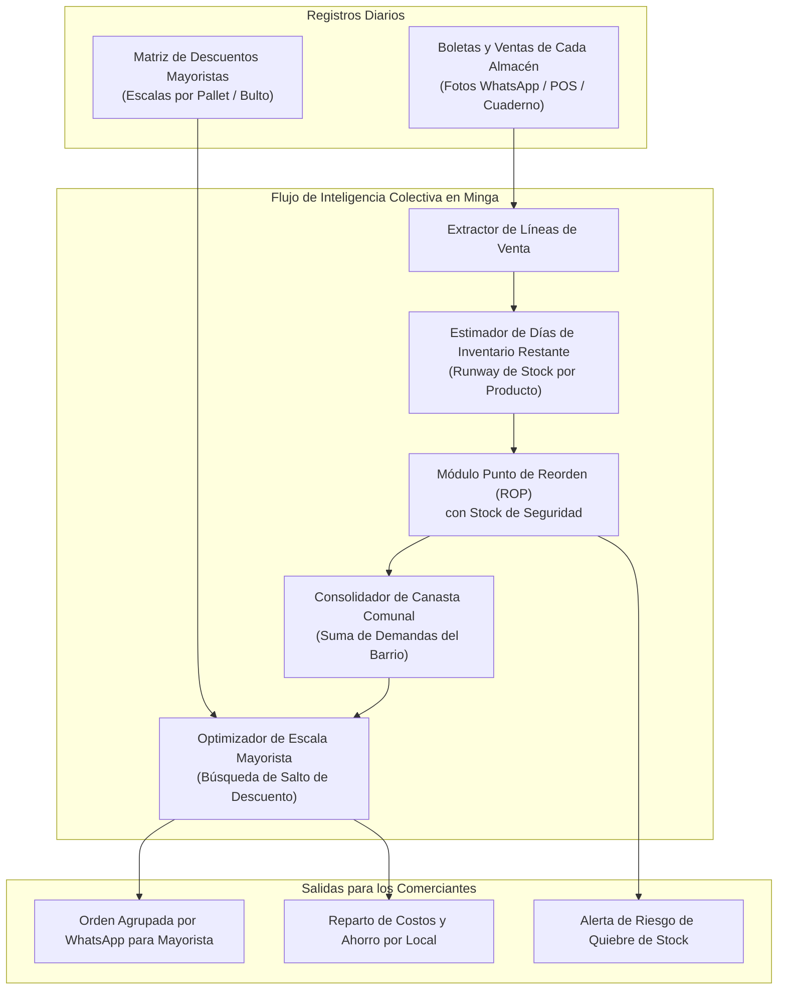

# Caso de Uso 04: Ventas, Pymes y Comercio de Barrio
### Radar de Demanda, Compras Colectivas Agrupadas y Margen Tributario Real

> **Área:** Comercio Minorista, Almacenes de Barrio, Abarrotes & Micro-logística  
> **Relevancia Demo Platanus Hack:** ⭐⭐⭐⭐⭐ *(Economía real de base, poder de negociación colectiva y números que salvan negocios familiares)*

---

## 1. Resumen Ejecutivo para el Jurado y Pitch

En América Latina, más del **50% de las ventas de alimentos y abarrotes ocurren en almacenes de barrio, tienditas y colmados**. Son el corazón de la economía popular. Sin embargo, su rentabilidad está constantemente estrangulada por dos factores estructurales:
1. **Compran solos y compran caro:** Cada almacenero pide semanalmente 4 o 5 bultos por su cuenta, pagando precio minorista inflado a los camiones distribuidores.
2. **La ilusión óptica del margen bruto:** Muchos comerciantes confunden margen de venta con utilidad neta; al fijar precios no consideran el impacto del IVA descontado del precio final ni las comisiones de los terminales de cobro digital (POS), perdiendo dinero sin saberlo.

* **La Solución Minga:** Una red colaborativa de flujos donde los almacenes vecinos integran sus registros de ventas diarias, proyectan con precisión su punto de reorden y consolidan pedidos masivos por WhatsApp para negociar descuentos por volumen de escala mayorista (hasta 25% de ahorro).
* **El Foco Técnico:** Nodos deterministas para inventario de seguridad y un validador estricto de margen neto tributario que protege el flujo de caja del comerciante.

---

## 2. Nivel 1: Aplicación Completa — Radar de Demanda y Canasta Colectiva de Barrio



### 2.1 Persona y Problema del Mundo Real
* **Autor Original:** Matías Pinto (Dueño de "Almacén El Mirador" y coordinador de la Red Vecinal de Almacenes de Cerro Alegre y Playa Ancha, Valparaíso, Chile).
* **El Problema en sus palabras:**  
  *"En los cerros de Valparaíso habemos 10 almaceneros amigos. Todos los martes viene el camión de la distribuidora de aceite, azúcar y harina. Yo le compro 4 cajas de aceite vegetal a $1.250 pesos el litro; la señora Carmen en la otra esquina le compra 3 cajas; y Don Tito compra 5 cajas. El vendedor nos cobra precio de consumidor final. Si nos juntáramos y le pidiéramos un pallet cerrado de 50 cajas, el litro nos bajaría a $960 pesos: eso es casi $300 pesos de ganancia limpia por botella. Pero coordinarnos es un infierno: nadie tiene tiempo de llamar a los demás, la gente se confunde con los pedidos y siempre terminamos comprando por separado."*

### 2.2 Entradas, Nodos del Flujo y Salidas

#### Entradas (Inputs)
1. **Flujo de Ventas Diarias de los Almacenes Participantes:** Fotografías de cuadernos de fiado/ventas procesadas por OCR o resúmenes de boletas del terminal POS.
2. **Matriz de Precios y Escalas del Proveedor:** Tabla que define los saltos de precio:
   * 1 a 9 cajas: $1.250 CLP / unidad.
   * 10 a 29 cajas: $1.100 CLP / unidad (-12%).
   * $\ge 30$ cajas (pallet cerrado): $960 CLP / unidad (-23.2%).

#### Nodos del Flujo
1. **`Extractor y Normalizador de Ventas`:** Parsea las descripciones coloquiales de los almaceneros (*"aceite maravilla 1L"*, *"ac. 1000cc"*, *"aceite de freír"*) y las homologa al SKU maestro del distribuidor.
2. **`Estimador de Días de Inventario Restante`:** Divide el stock reportado por el promedio móvil ponderado de ventas de los últimos 14 días.
3. **`Punto de Reorden con Stock de Seguridad` (Módulo Nivel 2):** Calcula la fecha exacta en que cada almacén se quedará sin mercadería.
4. **`Consolidador de Canasta Comunal`:** Suma la demanda proyectada de los 10 almacenes para los próximos 7 días.
5. **`Optimizador de Escala Mayorista`:** Evalúa si agregar 2 o 3 bultos extra permite cruzar el umbral del tramo de descuento más conveniente:
   *"Si Don Tito y Doña Carmen compran 2 cajas más hoy, todo el grupo salta al escalón mayorista y todos ahorran $14.000 pesos adicionales."*

#### Salidas (Outputs)
* **Mensaje Consolidado de Compra para WhatsApp:** Texto pre-formateado listo para enviar al agente de ventas del mayorista:
  > *"Distribuidora Mayorista del Puerto: La Agrupación de Cerro Alegre confirma orden N° 84 por 1 Pallet (48 cajas) de Aceite Maravilla 1L @ $960 CLP/u. Entrega única programada para el jueves 09:00 AM en Calle Templeman."*
* **Desglose Individual de Reparto y Cobranza:** Hoja de rendición que dice exactamente cuánto debe transferir cada almacenero y cuánto dinero ahorró respecto a su compra individual.

---

### 2.3 Diff de Dominio: De Abarrotes Secos en Valparaíso a Taquerías en Guadalajara

* **Adaptador:** Don Gonzalo Méndez (Representante de la Unión de Taqueros y Puestos de Comida de Guadalajara, Jalisco, México).
* **El Contexto de Don Gonzalo:** Don Gonzalo coordina a 8 puestos de tacos en la zona metropolitana de Guadalajara. Quiere agrupar compras para insumos críticos, pero sus productos no son cajas de aceite sellado que duran dos años: son **insumos frescos perecederos** (aguacate Hass de Michoacán, jitomate guajillo, cilantro fresco y carne de cerdo para trompo de pastor).
* **Interacción con el Agente:**  
  *Don Gonzalo:* *"Agente, el flujo del compañero chileno es genial para agrupar compras, pero nosotros compramos perecederos. El aguacate no puede estar guardado 14 días porque se madura y se pudre en el calor de Guadalajara. Necesito que el cálculo sea para 3 días máximo y que descuente un porcentaje de merma por maduración."*

```
┌────────────────────────────────────────────────────────────────────────┐
│                   TARJETA DE DIFF DE DOMINIO                           │
│   Herramienta: "Radar de Compras Colectivas y Reorden"                 │
│   De: Matías Pinto (Chile) ➔ A: Gonzalo Méndez (Guadalajara, México)   │
├────────────────────────────────────────────────────────────────────────┤
│ 1. Cambio de Horizonte de Inventario:                                  │
│    - Días de cobertura objetivo: 14 días ➔ 3 días (perecederos frescos)│
│                                                                        │
│ 2. Factor de Merma Fisiológica / Desperdicio:                          │
│    - Factor de pérdida por almacenamiento: 0% (seco) ➔ 8.5% (fresco)   │
│    - Razón de dominio: Compensar la descomposición de frutas y verduras│
│                                                                        │
│ 3. Unidad y Tipo de Producto:                                          │
│    - SKU: Abarrotes en caja ➔ Cajas de 20 kg de Aguacate Hass en mallas│
│                                                                        │
│ 4. Moneda y Proveedor:                                                 │
│    - CLP (Pesos Chilenos) ➔ MXN (Pesos Mexicanos)                     │
│    - Distribuidor: Central de Abastos de Guadalajara                   │
└────────────────────────────────────────────────────────────────────────┘
```
El agente reconfigura el flujo. Ahora los taqueros de Guadalajara consolidan pedidos de aguacate y carne cada lunes y jueves, reduciendo mermas y consiguiendo precio de la Central de Abastos.

---

### 2.4 Smart Merge: El Comparador Financiero de Factura a 30 Días

* **El Aporte Comunitario:** Don Hernán, almacenero y tesorero de una cooperativa en Buin (Chile), introduce una práctica financiera clave:
  *"A veces el mayorista ofrece 2% de descuento por pagar en efectivo al contado, pero el almacenero no tiene la plata en la caja y recurre a la tarjeta de crédito o al sobregiro bancario que le cobra 3.5% mensual de interés. Al final, por ahorrarse el 2% termina perdiendo plata."*
* **El Nuevo Nodo:** Don Hernán crea el nodo:  
  `Comparador de Costo Financiero (Contado vs Crédito a 30 Días)`.  
  Calcula el costo anualizado de la deuda vs el descuento comercial y aconseja si conviene pagar hoy o usar el plazo del proveedor.
* **El Smart Merge en la Red:**  
  Don Hernán publica el nodo en el Hub de Pymes de Minga.
  El agente de Matías en Valparaíso y el de Don Gonzalo en Guadalajara reciben la actualización:
  > *"La Cooperativa de Buin incorporó un comparador de costo financiero entre pagar al contado o a plazo comercial. ¿Deseas sumarlo a la orden de compra? Tus productos y fórmulas de consumo se conservarán intactos."*
  Ambos aceptan: la herramienta colectiva se vuelve más sofisticada financieramente para todos los miembros de la red sin perder su facilidad de uso.

---

## 3. Nivel 2: Módulo Reutilizable — Punto de Reorden (ROP) con Stock de Seguridad Dinámico

### 3.1 La Lógica del Oficio
No quedarse sin mercadería (quiebre de stock) es la primera ley del almacenero: un cliente que no encuentra azúcar en un negocio, se cruza a la vereda de enfrente y no vuelve más. Pero sobrecomprar mercadería congela capital escaso y llena la bodega de bultos estorbosos.

### 3.2 Formulación Matemática Determinista

$$ROP = (\bar{d} \times L) + SS$$

Donde:
* $\bar{d}$ = Demanda promedio diaria vendida (unidades/día).
* $L$ = Tiempo de entrega del proveedor (*lead time* en días).
* $SS$ = Stock de seguridad ante fluctuaciones de ventas:
  $$SS = Z_{\alpha} \times \sqrt{L \cdot \sigma_d^2 + \bar{d}^2 \cdot \sigma_L^2}$$
  *(Con nivel de servicio comercial del 95%: $Z_{\alpha} = 1.645$)*.

### 3.3 Puertos del Módulo
* **Entradas:** `demanda_diaria_tabla`, `dias_demora_proveedor` (Escalar), `nivel_servicio_deseado` (%).
* **Salidas:** `umbral_reorden_unidades` (Escalar), `cantidad_sugerida_compra` (Escalar), `fecha_limite_pedido` (Fecha).

---

## 4. Nivel 3: Nodo Individual — Validador de Margen Neto Tributario (IVA y Comisiones)

### 4.1 La Trampa Financiera Mortal del Comerciante
Muchos comerciantes fijan sus precios sumando un porcentaje intuitivo sobre el costo neto y luego cobrando con terminal bancario:
* Compran un producto a **$1.000 CLP** sin IVA.
* Lo ponen a la venta en vitrina a **$1.300 CLP** (con IVA incluido).
* Creen falsamente que su margen es de **$300 CLP (30%)**.
* **La Realidad Oculta:**
  1. Al precio de venta ($1.300) hay que quitarle el 19% de IVA: el precio neto real de venta es $\frac{1.300}{1.19} = \$1.092,44\text{ CLP}$.
  2. La ganancia bruta antes de gastos es apenas de **$92,44 CLP** (un 9.2% real, no un 30%).
  3. Si el cliente paga con tarjeta de débito/crédito, la empresa del terminal POS cobra una comisión del **2.5%** sobre el total bruto ($32,50 CLP$).
  4. La ganancia real de bolsillo del almacenero queda en **$59,94 CLP (menos del 6%)**. Si a eso se le suma la luz del refrigerador, el negocio está vendiendo a pérdida.

### 4.2 Manifiesto del Nodo (`net_tax_margin_validator.json`)

```json
{
  "id": "node_net_tax_margin_validator",
  "name": "Validador de Margen Neto Tributario y Financiero",
  "category": "Precios & Tributaria",
  "version": "1.0.0",
  "author": "Red de Almacenes Valparaíso",
  "description": "Calcula el margen neto real de venta descontando el débito fiscal de IVA y las tarifas de procesamiento electrónico (POS), alertando ante márgenes bajo el umbral de supervivencia.",
  "inputs": [
    { "id": "costo_compra_neto", "name": "Costo de Compra (Neto sin IVA)", "type": "Escalar", "description": "Precio pagado al distribuidor por unidad" },
    { "id": "precio_venta_bruto", "name": "Precio de Venta Público (Bruto con IVA)", "type": "Escalar", "description": "Precio visible en la etiqueta del local" }
  ],
  "params": [
    {
      "id": "tasa_iva_porcentaje",
      "title": "Tasa de IVA del País",
      "type": "number",
      "default": 19.0,
      "unit": "%"
    },
    {
      "id": "comision_pos_porcentaje",
      "title": "Comisión por Pago con Tarjeta",
      "type": "number",
      "default": 2.2,
      "unit": "%"
    },
    {
      "id": "margen_minimo_tolerable",
      "title": "Margen Neto Mínimo Deseado",
      "type": "number",
      "default": 18.0,
      "unit": "%"
    }
  ],
  "outputs": [
    { "id": "margen_neto_pesos", "name": "Ganancia Neta Real", "type": "Escalar", "unit": "moneda" },
    { "id": "margen_neto_porcentaje", "name": "Porcentaje de Margen Neto", "type": "Escalar", "unit": "%" },
    { "id": "precio_venta_sugerido", "name": "Precio Recomendado al Público", "type": "Escalar", "unit": "moneda" },
    { "id": "estado_rentabilidad", "name": "Semáforo de Rentabilidad", "type": "Texto" }
  ]
}
```

### 4.3 Fórmulas Internas Inalterables

$$\text{Precio Venta Neto} = \frac{\text{Precio Venta Bruto}}{1 + \frac{\text{Tasa IVA}}{100}}$$

$$\text{Costo Comisión POS} = \text{Precio Venta Bruto} \times \frac{\text{Comisión POS}}{100}$$

$$\text{Utilidad Neta Real} = \text{Precio Venta Neto} - \text{Costo Compra Neto} - \text{Costo Comisión POS}$$

$$\text{Margen Neto Real \%} = \frac{\text{Utilidad Neta Real}}{\text{Precio Venta Neto}} \times 100$$

Si el **Margen Neto Real \%** es menor que el `margen_minimo_tolerable` (ej. 18%), el nodo devuelve:
* `estado_rentabilidad`: `"PELIGRO: Margen Neto Real de 5.8% es insuficiente. Se recomienda fijar precio bruto en $1.490 CLP para alcanzar 20% de rentabilidad."`

---

## 5. Ficha del Componente para el Hub de Minga

```json
{
  "id": "flow_radar_compras_almacenes_v1",
  "kind": "flow",
  "name": "Radar de Demanda y Compras Agrupadas de Barrio",
  "summary": "Agrupa ventas diarias de comercios vecinos, proyecta puntos de reorden y consolida órdenes de compra con descuento mayorista.",
  "inputs": [
    { "name": "tabla_ventas_diarias", "type": "Tabla" },
    { "name": "escalas_mayorista", "type": "Tabla" }
  ],
  "outputs": [
    { "name": "orden_whatsapp_consolidada", "type": "Texto" },
    { "name": "ahorro_colectivo_total", "type": "Escalar" }
  ],
  "context": {
    "domain": "comercio minorista",
    "business_type": "almacenes de barrio y tienditas",
    "region": "Valparaíso, Chile"
  },
  "lineage": {
    "author": "matias_pinto_valpo",
    "adapted_by": "gonzalo_mendez_gdl",
    "contributor": "hernan_buin"
  }
}
```

---

## 6. Guía de Pitch para el Jurado (El Impacto en el Bolsillo Familiar)

* **El Relato Humano:** *"Les presentamos a Matías y a Don Tito en el Cerro Alegre de Valparaíso. Trabajan 14 horas diarias detrás de un mostrador. Todos los meses el distribuidor se queda con su margen porque les vende caro."*
* **La Demostración en Vivo:**
  1. Cargamos el flujo de compras colectivas.
  2. Conectamos los pedidos de 5 almacenes vecinos.
  3. La pantalla muestra cómo la demanda agregada cruza las 30 cajas: **el precio unitario cae de $1.250 a $960 CLP**.
  4. Mostramos el nodo de **Margen Neto Tributario**: desenmascaramos cómo el almacenero creía ganar 30% y en realidad ganaba 6%, corrigiendo el precio en pantalla con un solo clic.
* **El Cierre:** *"Minga le da a los almacenes familiares de América Latina el mismo poder de analítica de datos y negociación que antes sólo tenían Walmart o Cencosud."*
