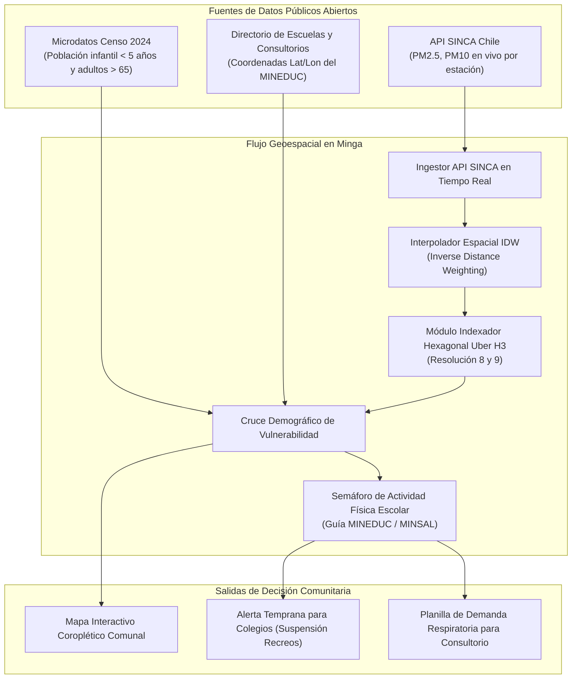

# Caso de Uso 05: Datos Públicos e Infraestructura Urbana
### Observatorio Comunal de Calidad del Aire (SINCA), Vulnerabilidad Escolar y Grilla Uber H3

> **Área:** Urbanismo, Salud Ambiental, Sensores Públicos & Geo-Analítica  
> **Relevancia Demo Platanus Hack:** ⭐⭐⭐⭐⭐ *(Datos gubernamentales reales en vivo de Chile y México, computación geoespacial en el navegador)*

---

## 1. Resumen Ejecutivo para el Jurado y Pitch

En las grandes urbes de América Latina (Santiago, Monterrey, Lima, Ciudad de México, Temuco), la contaminación atmosférica por material particulado fino ($PM_{2.5}$ y $PM_{10}$) representa una de las mayores crisis de salud pública, causando miles de hospitalizaciones infantiles por bronquitis y neumonía cada invierno.

* **El Problema:** Las alertas ambientales gubernamentales se decretan a nivel de **macrozona** ("Toda la Región Metropolitana entra en Alerta"). Sin embargo, la geografía y las fuentes emisoras son hiperlocales: mientras en una comuna residencial el aire puede ser respirable, en una comuna periférica o cercana a zonas industriales la concentración de humo supera con creces el límite de emergencia. Los directores de escuelas públicas y médicos de consultorios (CESFAM) no tienen cómo saber si sus alumnos están respirando aire tóxico en el patio.
* **La Solución Minga:** Un observatorio comunal que consume en tiempo real la **API pública real del SINCA (Ministerio del Medio Ambiente de Chile)**, interpola la dispersión de humo, discretiza la ciudad en la grilla hexagonal global **Uber H3** y cruza los datos con la población infantil vulnerable del **Censo Nacional**.
* **La Hazaña Técnica:** Todo el procesamiento geoespacial e interpolación espacial corre directamente en el navegador del usuario utilizando **DuckDB y operaciones tabulares sobre índices H3**, sin requerir servidores SIG pesados ni licencias corporativas de ArcGIS.

---

## 2. Nivel 1: Aplicación Completa — Observatorio Comunal de Calidad del Aire y Vulnerabilidad Escolar



### 2.1 Persona y Problema del Mundo Real
* **Autora Original:** Dra. Pamela Smith (Geógrafa Urbana e Investigadora de Clima y Justicia Ambiental, Santiago, Chile).
* **El Problema en sus palabras:**  
  *"El Ministerio del Medio Ambiente decreta preemergencia para los 7 millones de habitantes de Santiago. Pero en comunas del poniente como Cerro Navia o Pudahuel, el material particulado PM2.5 llega a 110 microgramos por metro cúbico por el humo de quemas y la falta de áreas verdes, mientras que en Las Condes está en 28 microgramos. Los directores de escuelas rurales y colegios públicos no tienen tiempo de aprender a usar QGIS ni de programar scripts geoespaciales. Necesitan abrir un enlace en la mañana y ver si el patio de su escuela está en rojo para suspender la clase de educación física antes de que los niños se enfermen de bronquitis."*

### 2.2 Entradas, Nodos del Flujo y Salidas

#### Entradas (Inputs con Datos Reales)
1. **API Pública SINCA (Sistema de Información Nacional de Calidad del Aire de Chile):**  
   * Endpoint oficial del MMA: `https://sinca.mma.gob.cl/index.php/json/listadomapa2k19/`
   * Muestra horaria: `id_estacion`, `nombre_estacion`, `latitud`, `longitud`, `PM25_registrado_ug_m3`, `calidad_aire_categoria`.
2. **Censo Nacional de Población y Vivienda (Microdatos Geoespaciales):**  
   * Polígonos de manzanas censales con conteo de niños menores a 5 años y adultos mayores de 65 años.
3. **Padrón Oficial de Establecimientos Educacionales y de Salud:**  
   * Catálogo con RUT escolar, nombre del colegio y coordenadas exactas.

#### Nodos del Flujo
1. **`Ingestor API SINCA en Tiempo Real`:** Descarga los registros horarios de las estaciones activas de monitoreo (Cerro Navia, Pudahuel, Parque O'Higgins, La Florida, Puente Alto, etc.).
2. **`Interpolador Espacial IDW (Ponderación Inversa a la Distancia)`:** Estima la concentración continua de contaminante en puntos no monitoreados de la malla territorial:
   $$\hat{Z}(x_0) = \frac{\sum_{i=1}^{n} \frac{Z(x_i)}{d(x_0, x_i)^p}}{\sum_{i=1}^{n} \frac{1}{d(x_0, x_i)^p}}$$
   donde $d(x_0, x_i)$ es la distancia geodésica y $p = 2$ es el factor de atenuación.
3. **`Módulo Indexador Hexagonal Uber H3` (Nivel 2):** Convierte las ubicaciones a identificadores de celdas hexagonales regulares H3 (Resolución 8, diámetro aproximado de 800 metros).
4. **`Cruce Censal de Población Vulnerable`:** Asigna a cada celda H3 el número total de niños y ancianos expuestos a ese nivel de toxicidad aérea.
5. **`Semáforo de Actividad Física Escolar`:** Aplica la normativa oficial sanitaria:
   * **Verde ($< 50\,\mu g/m^3$):** Actividad deportiva normal en exterior.
   * **Amarillo ($50 - 79\,\mu g/m^3$):** Clases al aire libre de baja intensidad; exención para alumnos asmáticos.
   * **Rojo ($80 - 109\,\mu g/m^3$ - Alerta):** Suspensión total de deportes y recreos en patios abiertos; reubicación en aulas cerradas.
   * **Morado ($\ge 110\,\mu g/m^3$ - Preemergencia / Emergencia):** Prohibición estricta de esfuerzo físico y recomendación de mascarilla KN95 en traslados.

#### Salidas (Outputs)
* **Mapa Hexagonal Comunal Interactivo:** Renderizado ultrarrápido en el navegador con gradiente de color según riesgo y clics informativos por barrio.
* **Boletín Matinal para Directores de Escuela:** Alerta de mensajería enviada a las 07:15 AM antes del toque de timbre escolar.

---

### 2.3 Diff de Dominio: De Santiago de Chile a Monterrey, México

* **Adaptador:** Dr. Alejandro Ramos (Investigador Ambiental, Colectivo "Aire Limpio Monterrey", Nuevo León, México).
* **El Contexto de Alejandro:** La Zona Metropolitana de Monterrey es una de las cuencas atmosféricas más complejas de México debido a las emisiones de la Refinería de Pemex en Cadereyta, las pedreras de Santa Catarina y el tráfico pesado de tráileres. Alejandro encuentra el flujo de la Dra. Pamela en el Hub de Minga.
* **Interacción con el Agente:**  
  *Alejandro:* *"Agente, quiero clonar el observatorio de Pamela para Monterrey. Necesito cambiar la fuente del SINCA de Chile por la API del SIMA (Sistema Integral de Monitoreo Ambiental de Nuevo León), conectar las manzanas censales del INEGI mexicano y usar la norma de salud mexicana (NOM-025-SSA1-2021) en lugar de la chilena."*

```
┌────────────────────────────────────────────────────────────────────────┐
│                   TARJETA DE DIFF DE DOMINIO                           │
│   Herramienta: "Observatorio Comunal de Calidad del Aire"              │
│   De: Dra. Pamela Smith (Chile) ➔ A: Dr. Alejandro Ramos (México)      │
├────────────────────────────────────────────────────────────────────────┤
│ 1. Fuente de Telemetría Ambiental:                                     │
│    - API SINCA (MMA Chile) ➔ API Abierta SIMA (Nuevo León, México)     │
│    - Estaciones conectadas: San Pedro, Obispado, Cadereyta, Apodaca.   │
│                                                                        │
│ 2. Capa Demográfica y Cartografía Base:                                │
│    - Manzanas Censo INE Chile ➔ AGEBs Urbanas INEGI México             │
│    - Coordenadas geográficas: Valle Central Chile ➔ Cuenca Monterrey   │
│                                                                        │
│ 3. Umbrales Regulatorios de Salud:                                     │
│    - Norma Chilena DS 12/2011 ➔ Norma Oficial Mexicana NOM-025-SSA1    │
│    - Umbral de advertencia para escuelas: 80 µg/m³ ➔ 75 µg/m³ (NOM)    │
│                                                                        │
│ 4. Conservación de Infraestructura:                                    │
│    - La grilla H3 de Uber, el interpolador IDW y el generador de mapas  │
│      permanecen idénticos, ejecutándose en el navegador del usuario.   │
└────────────────────────────────────────────────────────────────────────┘
```
Alejandro valida los cambios con un clic. En cuestión de minutos, la comunidad regiomontana cuenta con su propio observatorio ciudadano de contaminación.

---

### 2.4 Smart Merge: El Meteorólogo de Temuco Aporta la Inversión Térmica

* **El Aporte Comunitario:** Felipe Troncoso, meteorólogo en Temuco (ciudad del sur de Chile famosa por la humareda invernal producto del uso intensivo de leña húmeda para calefacción), nota un fenómeno físico que el interpolador lineal no capta:
  *"En invierno, cuando hay inversión térmica de subsidencia, el aire frío queda atrapado en el fondo del valle como una olla a presión. Si la temperatura en la cima del cerro es 3°C más alta que en el centro de la ciudad, el humo no se dispersa horizontalmente por viento: se acumula a 2 metros del suelo exactamente a las 18:30 horas cuando la gente prende las estufas."*
* **El Nuevo Nodo:** Felipe crea el nodo:  
  `Factor de Retención por Inversión Térmica de Valle`.  
  Calcula el gradiente vertical de temperatura entre estaciones de altura y de fondo de cuenca, aplicando un factor de concentración de humo para las horas vespertinas.
* **El Smart Merge Transnacional:**  
  Felipe publica la mejora en el Hub.
  1. Minga detecta que los observatorios de Santiago (Pamela) y Monterrey (Alejandro) operan en valles rodeados de cordones montañosos (la Cordillera de los Andes en Santiago y la Sierra Madre Oriental en Monterrey).
  2. El agente notifica a Alejandro en México:
     > *"Un meteorólogo de Temuco añadió un nodo que modela el atrapamiento de contaminantes por inversión térmica en valles montañosos. ¿Deseas incorporarlo a la proyección de Monterrey? Tus estaciones de SIMA y censos de INEGI se conservarán intactos."*
  3. Alejandro acepta: Monterrey ahora predice las tardes de contingencia con una precisión física sin precedentes.

---

## 3. Nivel 2: Módulo Reutilizable — Indexador Espacial Hexagonal Uber H3

### 3.1 La Ventaja Arquitectónica de H3 en el Navegador
En la analítica de datos tradicional, cruzar coordenadas GPS con límites barriales requiere operaciones poligonales geométricas pesadas (*Point-in-Polygon* en PostGIS o librerías Shapely/GEOS en Python). Esto requiere servidores costosos y es inviable de correr en el navegador web de un usuario común.

El sistema de indexación espacial **Uber H3** discretiza la superficie terrestre en hexágonos continuos y asigna a cada hexágono un **entero de 64 bits único**.
* **El Milagro del Rendimiento:** El cruce espacial entre 50.000 lecturas de contaminación y 100.000 hogares se transforma en un simple `JOIN` de tablas sobre una columna entera en DuckDB en milisegundos.

```
       / \     / \     / \
      /   \   /   \   /   \
     | 884 | | 885 | | 886 |   <-- Índices Hexagonales H3 (Res 8)
      \   /   \   /   \   /
       \ /     \ /     \ /
```

### 3.2 Puertos y Manifiesto del Módulo
* **Inputs:** `tabla_puntos_lat_lon`, `resolucion_h3` (Número entero, típicamente 8 o 9).
* **Outputs:** `tabla_indexada_h3` con columna agregada `h3_index` y geometría lista para visualización rápida con Deck.gl / MapLibre.

---

## 4. Nivel 3: Nodo Individual — Calculador de Isla de Calor Urbano (NDVI vs LST)

### 4.1 El Problema Urbano de la Desigualdad Térmica
En los barrios con escasa vegetación y exceso de pavimento y calaminas, las temperaturas del suelo en verano superan los $48^\circ\text{C}$, provocando descompensaciones en adultos mayores y acelerando la formación de ozono troposférico ($O_3$). El índice cruza datos satelitales abiertos de radiometría térmica con cobertura vegetal.

### 4.2 Manifiesto del Nodo (`urban_heat_island_index.json`)

```json
{
  "id": "node_urban_heat_island_index",
  "name": "Calculador de Isla de Calor Urbano (NDVI vs LST)",
  "category": "Sensores Satelitales & Clima",
  "version": "1.0.0",
  "author": "Laboratorio Clima Urbano U. de Chile",
  "description": "Cruza el Índice de Vegetación de Diferencia Normalizada (NDVI) con la Temperatura Superficial Terrestre (LST) satelital para identificar microislas de calor críticas en manzanas residenciales.",
  "inputs": [
    { "id": "datos_satelitales", "name": "Bandas Satelitales / Muestra", "type": "Tabla", "description": "Tabla con reflectancia NIR, Red y Banda Térmica TIR" }
  ],
  "params": [
    {
      "id": "umbral_cobertura_vegetal_critico",
      "title": "Umbral Crítico de Cobertura Vegetal",
      "type": "number",
      "default": 0.15,
      "description": "Valores de NDVI inferiores a este nivel denotan ausencia casi total de árboles y vegetación."
    },
    {
      "id": "temperatura_anomala_delta",
      "title": "Delta Térmico de Alerta",
      "type": "number",
      "default": 4.5,
      "unit": "°C",
      "description": "Diferencia de temperatura respecto al promedio de la ciudad para clasificar como isla de calor severa."
    }
  ],
  "outputs": [
    { "id": "clasificacion_manzanas", "name": "Vulnerabilidad Térmica por Manzana", "type": "Tabla" },
    { "id": "areas_prioritarias_arbolado", "name": "Polígonos de Reforestación Urgente", "type": "GeoTabla" }
  ]
}
```

### 4.3 Formulación Matemática Determinista

1. **NDVI (Normalized Difference Vegetation Index):**
   $$NDVI = \frac{\text{NIR} - \text{Red}}{\text{NIR} + \text{Red}}$$
2. **Identificación de Isla de Calor Severa:**
   $$\text{Es\_Isla\_Calor} = \left(NDVI < \text{umbral\_vegetal}\right) \;\land\; \left(LST - LST_{media\_urbana} \ge \Delta T_{alerta}\right)$$
   Permite a municipios asignar presupuestos de arborización donde el calor amenaza vidas.

---

## 5. Ficha del Componente para el Hub de Minga

```json
{
  "id": "flow_observatorio_aire_sinca_v1",
  "kind": "flow",
  "name": "Observatorio Comunal de Calidad del Aire (SINCA & H3)",
  "summary": "Descarga datos de calidad del aire en vivo, interpola con IDW, indexa con Uber H3 y cruza con población vulnerable escolar.",
  "inputs": [
    { "name": "api_sinca_chile", "type": "API" },
    { "name": "censo_vulnerabilidad_censo", "type": "Tabla" }
  ],
  "outputs": [
    { "name": "mapa_hexagonal_interactivo", "type": "Vista" },
    { "name": "alertas_colegios_lista", "type": "Tabla" }
  ],
  "context": {
    "domain": "medio ambiente y salud pública",
    "spatial_resolution": "H3_res_8",
    "country": "Chile"
  },
  "lineage": {
    "author": "pamela_smith_geografa",
    "forks": [
      { "by": "alejandro_ramos_mty", "region": "Monterrey, México" }
    ]
  }
}
```

---

## 6. Guía de Pitch para el Jurado (La Fuerza de los Datos Reales en Vivo)

* **El Asombro Tecnológico:** *"Señores del jurado, abran sus celulares. Lo que están viendo en pantalla no es una maqueta estática de Figma. Es un flujo de Minga conectado en este segundo a la API pública del Ministerio de Medio Ambiente de Chile."*
* **La Ejecución:** *"El flujo descarga las lecturas de PM2.5, calcula la dispersión en una malla hexagonal de Uber H3 y cruza los datos con las escuelas de la comuna. Todo corre localmente en el navegador a 60 cuadros por segundo gracias a DuckDB."*
* **El Cierre Comunitario:** *"Cuando Alejandro en Monterrey necesitó hacer lo mismo para defender a los niños de su ciudad, no gastó $100.000 dólares en una consultoría de software: tomó el flujo de Pamela, su agente lo adaptó a la API mexicana en 3 minutos y hoy ambas ciudades comparten un escudo ambiental común."*
