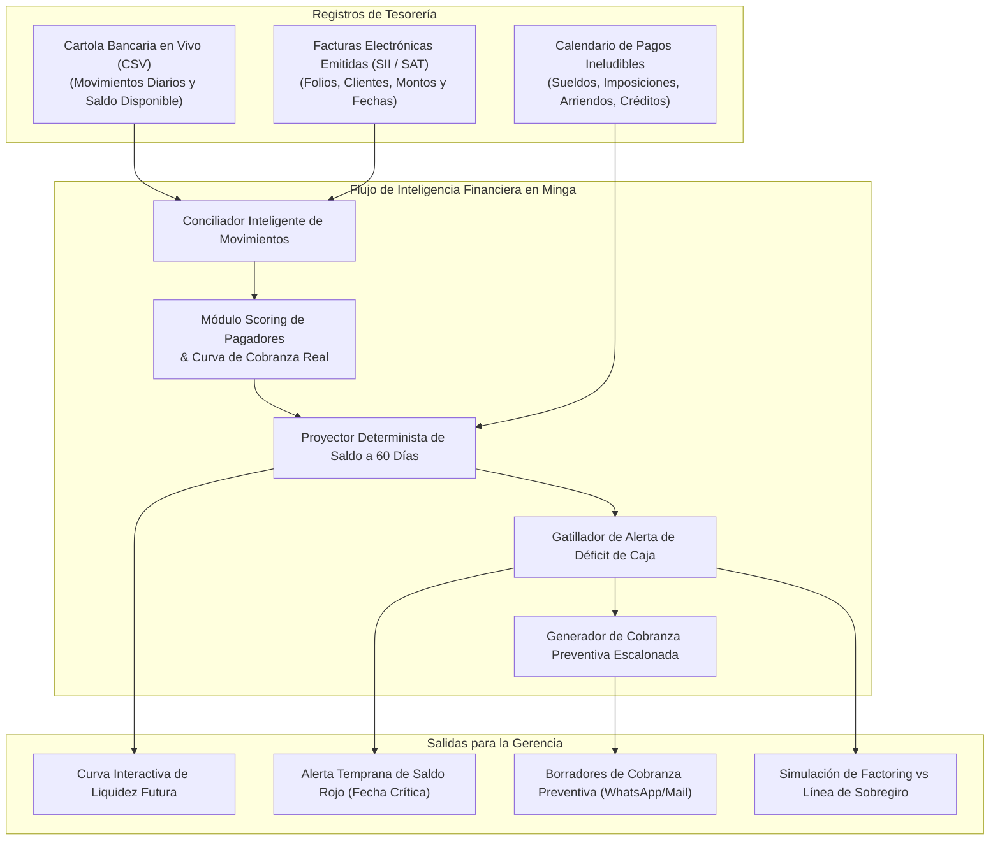
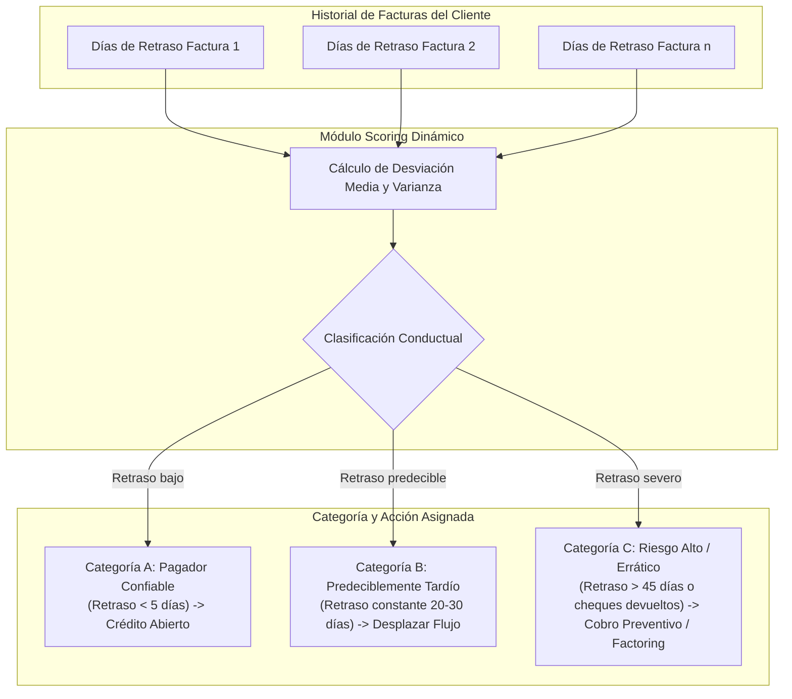

# Caso de Uso 06: Finanzas y Gestión de Flujo de Caja
### Centinela de Flujo de Caja Predictivo, Cobranza Real y Morosidad Legal

> **Área:** Finanzas Corporativas, Pymes, Tesorería & Gestión de Liquidez  
> **Relevancia Demo Platanus Hack:** ⭐⭐⭐⭐⭐ *(La causa N°1 de muerte de empresas en Latinoamérica resuelta con analítica determinista)*

---

## 1. Resumen Ejecutivo para el Jurado y Pitch

En América Latina, el **82% de las pequeñas y medianas empresas que quiebran durante sus primeros tres años mueren por asfixia de liquidez en su flujo de caja**, no por falta de ventas. Son negocios rentables en el papel, con clientes satisfechos y facturas millonarias emitidas, pero que se quedan sin un peso en la cuenta corriente el día 30 del mes para pagar los sueldos de sus trabajadores.

* **El Autoengaño de los Sistemas Contables Tradicionales:** Los sistemas ERP y planillas de contabilidad registran la **fecha de vencimiento formal** estipulada en la factura (ej. *"Vencimiento a 30 días"*). Sin embargo, en la economía real los grandes clientes corporativos pagan sistemáticamente a los 55, 70 o 90 días tras decenas de llamadas de cobranza. Confiar en la fecha de la factura para proyectar la caja es una sentencia de muerte.
* **La Solución Minga:** Un sistema de alerta temprana determinista que concilia cartolas bancarias reales, calcula la **curva de atraso histórico real por cliente**, proyecta la disponibilidad de caja día por día a 60 días vista y anticipa con semanas de margen el momento exacto en que la empresa tocará saldo negativo.
* **El Foco Técnico:** Nodos deterministas para conciliación bancaria, cálculo de interés moratorio legal diario compuesto y simulación del costo de factoraje vs crédito bancario.

---

## 2. Nivel 1: Aplicación Completa — Centinela de Flujo de Caja Predictivo y Cobranza Preventiva



### 2.1 Persona y Problema del Mundo Real
* **Autor Original:** Carlos Henríquez (Director Financiero de una Pyme de Servicios de Mantenimiento Metalmecánico para Celulosas y Puertos, Talcahuano / Concepción, Chile).
* **El Problema en sus palabras:**  
  *"Tengo 45 trabajadores contratados. El último día hábil de cada mes tengo que desembolsar $42 millones de pesos en remuneraciones y leyes sociales sin falta; si me atraso un día, la Dirección del Trabajo me multa y el banco me congela las cuentas. Mis clientes son gigantes forestales: me reciben las órdenes de compra y dicen que pagan a 30 días, pero en la realidad el departamento de finanzas de la empresa grande tramita los pagos cuando quiere: el Cliente A paga religiosamente al día 58, y el Cliente B no paga antes del día 75. Mi planilla de Excel tiene 14 pestañas cruzadas con macros que nadie más entiende. Vivo con un nudo en la garganta todos los meses porque no sé si el próximo jueves voy a tener la plata en la cuenta o si el banco me va a protestar los cheques."*

### 2.2 Entradas, Nodos del Flujo y Salidas

#### Entradas (Inputs)
1. **Cartola Bancaria (`cartola_bancaria.csv`):** Fecha de movimiento, glosa/descripción del depósito o cargo, cargo, abono y saldo final disponible.
2. **Registro de Ventas y Facturas Electrónicas:** Exportación del Servicio de Impuestos Internos (SII Chile) o software de facturación con Folio, RUT Receptor, Razón Social, Monto Neto, IVA y Monto Total.
3. **Matriz de Gastos Fijos y Obligaciones:** Calendario recurrente de egresos inflexibles (nómina de sueldos el día 28, cotizaciones previsionales el día 10, arriendo de galpón el día 5, cuotas de leasing).

#### Nodos del Flujo
1. **`Conciliador Inteligente de Movimientos Bancarios`:** Cruza los abonos bancarios contra las facturas abiertas mediante el identificador tributario (RUT) y el monto total, cerrando los folios saldados.
2. **`Scoring Dinámico y Curva Real de Cobranza` (Módulo Nivel 2):** Calcula el tiempo promedio real de pago de cada cliente ($\Delta t = \text{Fecha Depósito} - \text{Fecha Emisión}$) en lugar de la fecha teórica.
3. **`Proyector Determinista de Saldo Diario a 60 Días`:** Simula el saldo bancario para cada uno de los siguientes 60 días:
   $$\text{Saldo}_{d+1} = \text{Saldo}_d + \sum \text{Ingresos\_Reales\_Esperados}_d - \sum \text{Egresos\_Ineludibles}_d$$
4. **`Gatillador de Alerta de Déficit de Caja`:** Analiza la trayectoria del saldo y detecta si en algún día $d$ el saldo proyectado desciende por debajo del colchón de seguridad de la empresa (ej. menos de $3.000.000 CLP).
5. **`Generador de Cobranza Preventiva Escalonada`:** Si el cliente tiene un atraso típico de 20 días, prepara una secuencia de recordatorios amables pero formales antes de que se cumpla su ventana habitual de pago.

#### Salidas (Outputs)
* **Gráfico de Liquidez Proyectada:** Curva temporal con línea roja que alerta: *"Déficit proyectado de -$8.450.000 CLP el viernes 27 de junio por concentración de sueldos"*.
* **Semáforo de Pagadores por Cliente:** Tabla dinámica que expone qué clientes subsidian su capital de trabajo a costa de la pyme.
* **Propuesta de Mitigación de Liquidez:** Sugiere exactamente qué 2 facturas conviene anticipar vía factoraje para cubrir la brecha con el menor costo de comisión posible.

---

### 2.3 Diff de Dominio: De Concepción (Chile) a Bogotá (Colombia)

* **Adaptadora:** Dra. Camila Restrepo (Gerente de Operaciones de una Consultora de Ingeniería Ambiental, Bogotá, Colombia).
* **El Contexto de Camila:** Camila adopta la herramienta de Carlos en Concepción. En Colombia el ecosistema tributario y comercial introduce las temidas **Retenciones en la Fuente** (**ReteFuente**, **ReteICA**, **ReteIVA**).
  * Cuando una empresa colombiana emite una factura por **$10.000.000 COP**, el cliente no le deposita $10.000.000 COP: le retiene un 4% de ReteFuente ($400.000 COP$), un 0.966% de ReteICA Bogotá ($96.600 COP$) y el 15% del IVA facturado.
  * Por ende, el conciliador bancario de Chile (que busca depósitos por el 100% del total de la factura) **falla por completo en Colombia**.
* **Interacción con el Agente:**  
  *Camila:* *"Agente, adapta el centinela de flujo de caja para Colombia: aquí los clientes descuentan retenciones obligatorias de ReteFuente y ReteICA antes de transferirnos, por lo que el depósito en Bancolombia es siempre un 7% u 8% menor que el valor facial de la factura."*

```
┌────────────────────────────────────────────────────────────────────────┐
│                   TARJETA DE DIFF DE DOMINIO                           │
│   Herramienta: "Centinela de Flujo de Caja y Cobranza Predictiva"      │
│   De: Carlos Henríquez (Chile) ➔ A: Camila Restrepo (Colombia)         │
├────────────────────────────────────────────────────────────────────────┤
│ 1. Ajuste de Conciliación Bancaria y Retenciones:                      │
│    - Conciliación por monto facial ➔ Conciliación con Matriz de        │
│      Retenciones Colombianas:                                          │
│      Monto Depositado = Total Factura - ReteFuente (4%) - ReteICA      │
│                                                                        │
│ 2. Moneda y Calendario Impositivo:                                     │
│    - CLP (Pesos Chilenos) ➔ COP (Pesos Colombianos)                   │
│    - Fecha tributaria mensual: Pago F29 (Día 20) ➔ Calendario de la    │
│      DIAN por último dígito del NIT.                                   │
│                                                                        │
│ 3. Umbrales de Caja Mínima:                                            │
│    - Colchón de seguridad: $5.000.000 CLP ➔ $25.000.000 COP            │
│                                                                        │
│ 4. Conservación de Lógica:                                             │
│    - El motor de scoring de morosidad real y la proyección temporal de  │
│      liquidez a 60 días se conservan al 100%.                          │
└────────────────────────────────────────────────────────────────────────┘
```
Camila autoriza el Diff de Dominio: su flujo en Bogotá ahora concilia las facturas deduciendo las retenciones exactas de la DIAN sin rechazos erróneos.

---

### 2.4 Smart Merge: El Simulador de Factoring vs Sobregiro Bancario

* **El Aporte Comunitario:** Don Manuel Gallardo, contador auditor y asesor de empresas pesqueras en Puerto Montt (Chile), identifica la decisión más difícil cuando la alerta roja de déficit de caja se enciende:
  *"Cuando el flujo de caja avisa que faltan $10 millones para el viernes, el empresario entra en pánico y toma la primera opción que tiene a mano: o cede facturas a una empresa de factoring que le cobra una comisión usurera del 3.8% más gastos operacionales, o sobregira la cuenta corriente bancaria pagando interés diario de línea de crédito. Nadie calcula cuál de las dos alternativas le cuesta menos dinero."*
* **El Nuevo Nodo:** Don Manuel crea el nodo:  
  `Simulador Comparativo de Factoring vs Sobregiro Bancario`.  
  Compara el costo financiero efectivo total (tasa de cesión, gastos notariales, retención de aforo) contra el costo de endeudamiento a corto plazo en la línea de crédito según los días proyectados de recuperación.
* **El Smart Merge en la Red:**  
  Don Manuel publica el nodo en el Hub Financiero de Minga.
  El agente de Carlos en Concepción y el de Camila en Bogotá les presentan la sugerencia:
  > *"Un asesor financiero comunitario ha creado un simulador para evaluar si conviene anticipar facturas con factoring o recurrir a la línea bancaria cuando hay déficit de liquidez. ¿Deseas vincularlo a tu salida de alerta de caja? Tus calendarios de pago y reglas de retención tributaria se mantendrán intactos."*
  Ambos aceptan. Ahora, ante una alerta de saldo rojo, la herramienta no sólo advierte del peligro, sino que entrega la solución financiera más económica para cubrir la brecha.

---

## 3. Nivel 2: Módulo Reutilizable — Scoring Dinámico de Pagadores y Curva Real de Cobranza

### 3.1 La Realidad del Comportamiento de Pago
Los clientes no pagan cuando vence la factura, sino según sus propias políticas internas de tesorería y poder de mercado.  
El módulo analiza la varianza y la mediana de retraso de cada cliente en los últimos 6 meses:



### 3.2 Puertos del Módulo
* **Inputs:** `historial_facturas_cliente` (Tabla con columnas `cliente_id`, `fecha_emision`, `fecha_vencimiento`, `fecha_pago_real`, `monto`).
* **Outputs:** `scoring_clientes` (Tabla con `categoria`, `retraso_mediano_dias`, `factor_confiabilidad_porcentaje`).

---

## 4. Nivel 3: Nodo Individual — Calculador de Interés Moratorio Legal Diario

### 4.1 La Base Jurídica y Financiera
Cuando un cliente incumple el plazo contractual o la Ley de Pago a 30 Días (Ley 21.131 en Chile o Ley 2024 en Colombia), la empresa acreedora tiene el derecho legal indiscutible de cobrar un interés moratorio diario.  
Sin embargo, las pymes nunca lo liquidan porque:
1. No saben qué tasa aplicar (la Tasa de Interés Máxima Convencional regulada).
2. Temen cometer el delito de **usura** si aplican un porcentaje superior al legal.

### 4.2 Manifiesto del Nodo (`legal_moratorium_interest.json`)

```json
{
  "id": "node_legal_moratorium_interest",
  "name": "Calculador de Interés Moratorio Legal Diario",
  "category": "Finanzas & Legal",
  "version": "1.1.0",
  "author": "Asociación de Pymes del Biobío",
  "description": "Calcula el interés moratorio exacto devengado por día de atraso aplicando la Tasa Máxima Convencional fijada por el regulador financiero oficial.",
  "inputs": [
    { "id": "monto_factura_insoluto", "name": "Saldo Pendiente de Cobro", "type": "Escalar", "description": "Capital insoluto de la factura vencida" },
    { "id": "fecha_vencimiento_factura", "name": "Fecha Límite Contractual", "type": "Fecha" },
    { "id": "fecha_corte_liquidacion", "name": "Fecha de Liquidación / Cobro", "type": "Fecha" }
  ],
  "params": [
    {
      "id": "tasa_anual_maxima_legal",
      "title": "Tasa Máxima Convencional Anual (TIMC)",
      "type": "number",
      "default": 28.5,
      "unit": "%",
      "description": "Tasa límite anual vigente publicada por la CMF o Banco Central."
    },
    {
      "id": "comision_recuperacion_fija",
      "title": "Comisión Fija Legal por Cobranza",
      "type": "number",
      "default": 0.05,
      "unit": "%",
      "description": "Porcentaje legal por costos de gestión de cobranza (Ley 21.131 fija 1% a 5%)."
    }
  ],
  "outputs": [
    { "id": "dias_atraso_totales", "name": "Días Corridos de Mora", "type": "Escalar" },
    { "id": "interes_moratorio_acumulado", "name": "Interés Moratorio Devengado", "type": "Escalar", "unit": "moneda" },
    { "id": "monto_total_reclamable", "name": "Total Liquidado a Cobrar", "type": "Escalar", "unit": "moneda" },
    { "id": "anexo_liquidacion_texto", "name": "Texto Legal para Anexo de Factura", "type": "Texto" }
  ]
}
```

### 4.3 Fórmulas Deterministas Inapelables

$$\text{Días de Mora} = \max(0, \text{Fecha Liquidación} - \text{Fecha Vencimiento})$$

$$\text{Factor Diario} = \left(1 + \frac{\text{TIMC}}{100}\right)^{\frac{1}{365}} - 1$$

$$\text{Interés Moratorio} = \text{Saldo Insoluto} \times \left[(1 + \text{Factor Diario})^{\text{Días de Mora}} - 1\right]$$

$$\text{Total Exigible} = \text{Saldo Insoluto} + \text{Interés Moratorio} + \text{Gasto Cobranza Legal}$$

El nodo genera además una minuta legal formal lista para adjuntar a la carta de cobranza:
> *"Conforme a la legislación vigente sobre plazos justos de pago, se deja constancia de un retraso de 42 días en la factura Folio N° 3410. Se liquida un interés devengado a la fecha de $418.920 CLP, más $150.000 CLP por concepto de costos de cobranza prejudicial."*

---

## 5. Ficha del Componente para el Hub de Minga

```json
{
  "id": "flow_centinela_flujo_caja_v1",
  "kind": "flow",
  "name": "Centinela de Flujo de Caja y Cobranza Preventiva",
  "summary": "Concilia bancos y facturas, proyecta la liquidez real a 60 días con la morosidad empírica de cada cliente y previene la quiebra técnica.",
  "inputs": [
    { "name": "cartola_bancaria_csv", "type": "Tabla" },
    { "name": "registro_facturas_sii", "type": "Tabla" }
  ],
  "outputs": [
    { "name": "curva_saldo_diario", "type": "Gráfico" },
    { "name": "alertas_deficit_caja", "type": "Tabla" }
  ],
  "context": {
    "domain": "finanzas corporativas",
    "subdomain": "tesorería y cobranza pyme",
    "country": "Chile"
  },
  "lineage": {
    "author": "carlos_henriquez_biobio",
    "adapted_by": "camila_restrepo_bogota",
    "contributor": "manuel_gallardo_puerto_montt"
  }
}
```

---

## 6. Guía de Pitch para el Jurado (La Salvación de las Pymes)

* **El Problema Real:** *"El 80% de los emprendedores de este país no duerme los jueves a fin de mes. Tienen un cliente gigante que les debe $50 millones, pero el banco les pide los $15 millones de la nómina de sueldos mañana a las 2 de la tarde."*
* **La Solución Minga:**
  1. Mostramos la pantalla de Carlos en Concepción: el software tradicional dice que las facturas vencen el día 30 y que la caja está perfecta.
  2. Encendemos el nodo **Scoring de Cobranza Real**: la curva de caja se desploma en la semana 4, mostrando un saldo rojo de -$8 millones el día de los sueldos.
  3. Mostramos la solución integrada: el nodo de **Factoring Inteligente** selecciona con precisión quirúrgica las 2 facturas con menor tasa de comisión para descontar y mantener la empresa a flote.
* **El Cierre Final:** *"Minga le da a la pequeña empresa el poder predictivo de un banco de inversión, armado sin escribir una sola línea de código."*
