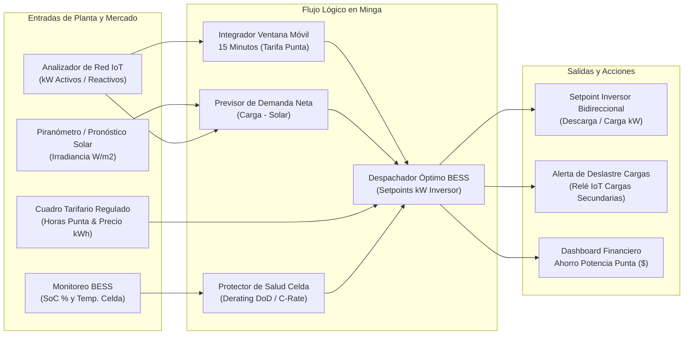

# Caso de Uso 07: Energía y Microredes
### Arbitraje Tarifario en Horas Punta, Microredes Solares y Despacho Óptimo de Baterías (BESS)

> **Área:** Gestión Energética, Energías Renovables & Sistemas BESS  
> **Relevancia Demo Platanus Hack:** ⭐⭐⭐⭐⭐ *(Impacto financiero inmediato en pymes agroindustriales e industriales)*

---

## 1. Resumen Ejecutivo para el Jurado y Pitch

En Chile y Latinoamérica, la factura eléctrica de una mediana empresa o agroindustria (packing de fruta, bodegas vinícolas, plantas lecheras) está fuertemente castigada por el cargo de **Potencia Máxima Leída en Horas Punta** (período de invierno de 18:00 a 22:00 horas, según normativas SEC / Enel / CGE en Chile, o tarifas GDMTH / CFE en México). Si un motor de 50 kW o una línea de frío arranca durante 15 minutos en ese bloque, la empresa queda "amarrada" a pagar un sobrecargo de potencia punta durante los siguientes 12 meses, lo que puede significar pérdidas de entre $8.000 y $25.000 USD al año.

* **El Problema:** Los administradores intentan gestionar baterías y paneles solares con temporizadores ciegos, pantallas aisladas de inversores y planillas de cálculo. Si un día nublado la batería no cargó suficiente energía o si el consumo salta imprevistamente a las 19:15, el sistema tradicional no modula la descarga y la red eléctrica pública factura el pico instantáneo.
* **La Solución Minga:** Un flujo visual determinista que cruza telemetría de analizadores de red (kW instantáneos), pronóstico solar y estado de carga de batería (SoC) para despachar la batería en modo *Peak Shaving* (afeitado de picos), garantizando que la demanda de la red jamás cruce el umbral de penalización.
* **El Momento "¡Ajá!" de la Demo:** El **Nodo Calculador de Potencia de Facturación con Ventana Móvil de 15 Minutos**, que predice el promedio del bloque de facturación antes de que la distribuidora cierre el intervalo, modulando la descarga en segundos.

---

## 2. Nivel 1: Aplicación Completa — Gestor Inteligente de Despacho BESS y Arbitraje Tarifario



### 2.1 Persona y Problema del Mundo Real
* **Autor Original:** Ignacio Retamal (Ingeniero Eléctrico y Administrador de Planta en Agrícola Paine, Buin, Región Metropolitana, Chile).
* **El Problema en sus palabras:**  
  *"Operamos con tarifa AT4.3 de CGE. Entre abril y septiembre, de 18:00 a 22:00 horas, cada kilowatt de potencia máxima leída nos cuesta $15.800 CLP extra. Si a las 19:30 se enciende la bomba de pozo profundo de 40 kW mientras el packing está operando, ese solo arranque de 15 minutos nos cuesta casi $650.000 CLP en la cuenta de ese mes, y eleva la base de facturación del año completo. Instalamos un banco de baterías de litio (LFP) de 100 kWh y 50 kW de potencia para mitigar esto, pero el software comercial vino cerrado: no entiende las tarifas chilenas, descargaba la batería a las 16:00 cuando la energía aún era barata y a las 20:00 ya estaba vacía."*

### 2.2 Entradas, Nodos del Flujo y Salidas

#### Entradas (Inputs)
1. **Telemetría de Potencia Instantánea (`analizador_red_kw`):** Mediciones cada 10 segundos desde medidor Modbus TCP en el transformador de empalme.
2. **Estado del Banco BESS (`telemetria_bateria`):** Estado de carga ($SoC \in [0, 100\%]$), temperatura media de celdas (°C) y tensión de bus DC.
3. **Generación Solar Local (`generacion_fv_kw`):** Inversores fotovoltaicos conectados al tablero general.
4. **Calendario y Tarifa Eléctrica (`tarifa_regimen`):** Umbral contratado ($P_{contratada} = 120\text{ kW}$), horario punta oficial (18:00 a 22:00) y costo por kW leída ($/kW).

#### Nodos del Flujo
1. **`Integrador Ventana Móvil 15 Minutos` (Nodo Nivel 3):** Simula el algoritmo exacto del medidor de la compañía distribuidora: calcula la potencia promedio acumulada en la ventana deslizante actual de 15 minutos:
   $$P_{15min}(t) = \frac{1}{90} \sum_{i=0}^{89} P(t - i \cdot 10\text{s})$$
2. **`Previsor de Demanda Neta`:** Modela la curva de carga neta restando la producción solar proyectada:
   $$P_{neta}(t) = P_{consumo}(t) - P_{fv}(t)$$
3. **`Protector de Salud de Celda (Derating)`:** Limita la potencia máxima de descarga si la temperatura del banco supera los $35^\circ\text{C}$ o si el $SoC$ desciende del $15\%$ para proteger la degradación química.
4. **`Despachador Óptimo BESS`:** Si la hora está dentro de la ventana de punta y $P_{15min}$ proyectada excede el umbral objetivo ($110\text{ kW}$), calcula el setpoint de inyección:
   $$P_{bateria\_cmd} = \min\left(P_{neta} - P_{target}, P_{bess\_max}\right)$$
5. **`Gatillador de Deslastre Preventivo`:** Si el banco alcanza $SoC \le 10\%$ durante la hora punta y la potencia sigue sobre el límite, envía comando a contactor IoT para cortar el circuito de climatización y bombas de acumulación de agua.

#### Salidas (Outputs)
* **Comando Modbus / SunSpec al Inversor:** Setpoint en kW de descarga activa en milisegundos.
* **Señal de Relé de Deslastre:** Activación/desactivación de cargas secundarias.
* **Indicador en Tiempo Real:** Potencia de red resultante vs. umbral seguro, con contador de ahorro acumulado en moneda local.

---

### 2.3 Diff de Dominio: Adaptación a Tarifas Industriales en México (Chile ➔ México)

* **Adaptadora:** Mariana Cossío (Ingeniera en Energías Renovables, Consultora de Gestión Energética en San Juan del Río, Querétaro, México).
* **El Contexto de Mariana:** Mariana atiende una planta de inyección de plásticos con tarifa **GDMTH (Gran Demanda en Media Tensión Horaria)** de la CFE. En México, el período de punta varía según la división tarifaria (Bajío: 20:00 a 22:00 horas en horario de verano de lunes a viernes), y la facturación penaliza tanto el consumo de energía en punta ($/kWh) como la demanda máxima en cualquier horario ($/kW mes), además del factor de potencia ($\cos \phi < 0.95$).
* **Interacción con el Agente:**  
  *Mariana:* *"Agente, quiero tomar el flujo chileno de Ignacio pero para la tarifa GDMTH de CFE en el Bajío. Las baterías son de fosfato de hierro y litio (LFP) nuevas de alta tasa (1C) y el horario punta aquí arranca a las 20:00 y dura 2 horas, no 4 horas."*

```
┌────────────────────────────────────────────────────────────────────────┐
│                   TARJETA DE DIFF DE DOMINIO                           │
│   Herramienta: "Gestor Inteligente de Despacho BESS & Horas Punta"     │
│   De: Ignacio Retamal (Chile) ➔ A: Mariana Cossío (México)             │
├────────────────────────────────────────────────────────────────────────┤
│ 1. Estructura y Horario de Punta:                                      │
│    - Ventana horaria: 18:00 - 22:00 (Chile) ➔ 20:00 - 22:00 (CFE Bajío)│
│    - Razón de oficio: La curva de demanda nacional del CENACE sitúa    │
│      el pico industrial mexicano dos horas más tarde que en Chile.     │
│                                                                        │
│ 2. Tecnología y Parámetros de Batería:                                 │
│    - Química: NMC (Cobalto) ➔ LFP (Fosfato de Hierro y Litio)          │
│    - Profundidad de descarga segura (DoD): 80% (SoC min 20%) ➔ 90%     │
│    - Tasa de descarga continua (C-Rate): 0.5C ➔ 1.0C                  │
│    - Razón: Celdas LFP toleran descargas más profundas y agresivas en  │
│      la ventana concentrada de 2 horas de CFE.                         │
│                                                                        │
│ 3. Umbral de Integración de Potencia:                                  │
│    - Intervalo de ventana medidor: 15 minutos continuos (mismo estándar│
│      de medidores Elster / Schneider en ambos países).                 │
│                                                                        │
│ 4. Estado de Nodos:                                                    │
│    - Grafo lógico: Idéntico. Se actualizaron constantes de tarifa y     │
│      curva de derating por temperatura ambiente mexicana (hasta 38°C). │
└────────────────────────────────────────────────────────────────────────┘
```
Mariana valida la tarjeta con un clic. Su sistema de baterías en Querétaro queda sincronizado con el CENACE y CFE.

---

### 2.4 Smart Merge: La Mejora Comunitaria que Vuelve a Todos

* **El Aporte Comunitario:** Rodrigo Valdés, instalador de microredes solares en Copiapó (norte de Chile), detecta un problema con las distribuidoras:
  *"Cuando las baterías se están cargando con energía solar a las 13:00 hrs y de pronto se detiene una máquina grande, el exceso de energía solar intenta inyectarse a la red pública. Si el transformador local de distribución está saturado o si la planta no tiene permiso TE-4 definitivo de inyección (Ley 21.118 Net Billing), el medidor bidireccional registra inyección no autorizada o salta la protección anti-isla, desconectando toda la planta."*
* **El Nuevo Nodo Creado por Rodrigo:**  
  `Limitador Dinámico de Inyección Cero (Zero Export Control en <200ms)`.
* **Cómo opera el Smart Merge:**  
  Rodrigo publica el nodo en el Hub de Minga.
  1. Minga analiza los flujos de Ignacio (Paine) y Mariana (Querétaro). Detecta que ambos usan inversores acoplados a solar y red.
  2. El agente notifica a Ignacio:
     > *"Un especialista en Atacama publicó el nodo de control de inyección cero para evitar disparos por protecciones de red. ¿Deseas insertarlo en el lazo de modulación solar antes del inversor? Tus umbrales de horario punta de 18:00 a 22:00 y tu límite de 110 kW quedan intactos."*
  3. Ignacio acepta: el control de exportación se acopla inmediatamente al sistema sin romper la lógica tarifaria previa.

---

## 3. Nivel 2: Módulo Reutilizable — Optimizador de Vida Útil de Batería por Control de Ciclos y Temperatura (SoH)

### 3.1 Persona y Problema del Mundo Real
* **Autor Original:** Matías Larraín (Ingeniero de Almacenamiento Energético, Parque Fotovoltaico Chañaral, Chile).
* **El Problema del Oficio:**  
  *"Una batería industrial de litio cuesta cientos de miles de dólares. Si la ciclas a alta potencia cuando la celda está a más de 40°C o la dejas parada al 100% de carga bajo el sol del desierto, pierde el 20% de su capacidad en 2 años (degradación prematura por crecimiento de la capa SEI). Necesitamos un módulo desacoplado que actúe como gobernador de salud de cualquier batería, independientemente de qué software de despacho la esté llamando."*

### 3.2 Lógica del Módulo (Empaquetado como Flujo como Nodo - ADR 0016)
* **Puertos de Entrada:**
  * `SoC_actual` (Escalar %, $0-100$)
  * `Temp_Celdas` (Escalar °C)
  * `Potencia_Solicitada_kW` (Escalar kW con signo: $+ =$ descarga, $- =$ carga)
  * `Ciclos_Acumulados_Equivalentes` (Escalar entero)
* **Sub-Nodos Internos:**
  1. `Calculador de Derating Térmico`: Si $T_{celda} > 35^\circ\text{C}$, reduce la potencia admisible linealmente hasta $0\text{ kW}$ a los $48^\circ\text{C}$.
  2. `Restricción de Estado Extremo`: Bloquea carga si $SoC \ge 95\%$ y bloquea descarga si $SoC \le 10\%$.
  3. `Contador Rainflow de Fatiga Electroquímica`: Calcula el desgaste incremental según la profundidad del ciclo parcial.
* **Puertos de Salida:**
  * `Potencia_Admisible_kW` (Escalar kW recortado de forma segura)
  * `Indice_Degradacion_Incremental` (Escalar ppm de SoH)
  * `Bandera_Alerta_Refrigeracion` (Booleano para HVAC de contenedor)

### 3.3 Adaptación (Diff de Dominio)
* **Adaptador:** Germán (Técnico en Microredes Aisladas en Isla Caguach, Chiloé, Chile).
* **Diff:** Germán no usa celdas de litio, sino un banco antiguo de baterías de plomo-ácido tubular OPzS para una escuela isleña. El agente de Germán ajusta el voltaje de corte, restringe el DoD máximo al $50\%$ (en lugar del $90\%$ de litio) y añade un ciclo semanal de ecualización a $2.4\text{ V/celda}$ para desulfatar las placas de plomo.

---

## 4. Nivel 3: Nodo Individual — Calculador de Potencia de Facturación con Ventana Móvil de 15 Minutos
### ⭐ El Caso Clave de Dominio Energético

### 4.1 El Dolor Técnico y de Negocio
Las distribuidoras eléctricas no facturan el consumo instantáneo ni el pico de 1 segundo; facturan la energía acumulada en bloques de 15 minutos dividida por 0.25 horas:
$$P_{facturable} = \frac{\int_{t_0}^{t_0 + 15\text{ min}} p(\tau)\,d\tau}{0.25\text{ h}}$$
* **El Error Común en Sistemas Caseros:** Un script básico toma el promedio simple de las lecturas que van en el minuto o reacciona recién cuando la potencia ya subió a 140 kW. Cuando intenta reaccionar en el minuto 13, la integral ya acumuló suficiente energía para que el promedio del bloque supere el límite de contrato.
* **La Regla del Nodo Minga:** Mantiene un buffer circular en DuckDB con las lecturas de los últimos 15 minutos, proyecta la energía acumulada al cierre del bloque actual y calcula los kW exactos que la batería debe aportar para que la media no supere la consigna fijada por el usuario.

### 4.2 Manifiesto del Nodo en Minga (`energy_rolling_15min_demand.json`)

```json
{
  "id": "node_energy_rolling_15min_demand",
  "name": "Calculador de Ventana Móvil 15 Minutos",
  "category": "Energía & Tarifas",
  "version": "1.1.0",
  "author": "Comunidad Técnica de Gestión Energética Chile",
  "description": "Calcula la potencia promedio integrada en ventana móvil de 15 minutos y estima el déficit instantáneo para cumplir el umbral contratado de potencia punta.",
  "inputs": [
    {
      "id": "potencia_instantanea",
      "name": "Lectura Analizador Red",
      "type": "Tabla",
      "description": "Serie temporal [timestamp, kw_red]"
    }
  ],
  "params": [
    {
      "id": "potencia_limite_contratada",
      "title": "Potencia Límite de Tarifa Punta",
      "type": "number",
      "default": 110.0,
      "unit": "kW"
    },
    {
      "id": "intervalo_muestreo_segundos",
      "title": "Frecuencia de Lecturas",
      "type": "number",
      "default": 10,
      "unit": "s"
    }
  ],
  "outputs": [
    {
      "id": "potencia_media_15m",
      "name": "Potencia Media Integrada",
      "type": "Escalar",
      "description": "Promedio ponderado en los últimos 900 segundos (kW)."
    },
    {
      "id": "kw_inyeccion_requerida",
      "name": "kW Requeridos de Batería",
      "type": "Escalar",
      "description": "Potencia inmediata que debe inyectar el BESS para amortiguar el bloque."
    },
    {
      "id": "alarma_exceso",
      "name": "Riesgo de Exceso",
      "type": "Booleano",
      "description": "Verdadero si la proyección del bloque supera la potencia contratada."
    }
  ],
  "sqlTemplate": "WITH ventana AS (SELECT AVG(kw_red) as p_avg, COUNT(*) as muestras FROM {{inputs.potencia_instantanea}} WHERE timestamp >= NOW() - INTERVAL '15 minutes') SELECT p_avg as potencia_media_15m, GREATEST(0.0, p_avg - {{params.potencia_limite_contratada}}) as kw_inyeccion_requerida, CASE WHEN p_avg > {{params.potencia_limite_contratada}} THEN true ELSE false END as alarma_exceso FROM ventana"
}
```

### 4.3 Demostración de Ejecución en Vivo

```
ESCENARIO: Packing de uva a las 19:10 hrs (Umbral Punta Máximo = 110 kW)
Lecturas del analizador en los primeros 10 minutos: Promedio = 95 kW
A las 19:10 arranca compresor de refrigeración: Demanda salta a 145 kW

❌ CONTROL CIEGO TRADICIONAL (Sin cálculo de ventana móvil):
   El inversor mide 145 kW a las 19:10. Espera a que termine el intervalo.
   A las 19:15 el medidor de la distribuidora liquida el bloque de 15 min:
   Potencia Integrada = (95 kW * 10 min + 145 kW * 5 min) / 15 min = 111.66 kW
   RESULTADO: PENALIZACIÓN DE POTENCIA PUNTA ACTIVADA (> 110 kW)
   Costo adicional en la factura mensual: $680.000 CLP.

✅ NODO MINGA INTEGRACIÓN 15 MIN:
   A los 30 segundos del salto (19:10:30), el nodo recalcula la trayectoria:
   "Al ritmo actual de 145 kW, el bloque promediará 111.7 kW".
   Calcula la inyección requerida: 35.0 kW de batería durante los 5 min restantes.
   Potencia final absorbida de la red: 100.0 kW promedio en el bloque.
   RESULTADO: PICO MITIGADO. Facturación de potencia punta se mantiene en 100 kW.
   Ahorro neto protegido: $680.000 CLP.
```

---

## 5. Ficha del Componente para el Hub de Minga

```json
{
  "id": "flow_bess_peak_shaving_v1",
  "kind": "flow",
  "name": "Gestor Inteligente de Despacho BESS y Horas Punta",
  "summary": "Protege a pymes e industrias de cobros millonarios por potencia punta mediante control predictivo de baterías en ventanas de 15 minutos.",
  "inputs": [
    { "name": "kw_red_analizador", "type": "Tabla", "unit": "kW" },
    { "name": "soc_bateria", "type": "Escalar", "unit": "%" },
    { "name": "generacion_solar", "type": "Tabla", "unit": "kW" }
  ],
  "outputs": [
    { "name": "setpoint_inversor", "type": "Escalar", "unit": "kW" },
    { "name": "ahorro_estimado_diario", "type": "Escalar", "unit": "CLP/MXN" }
  ],
  "assumptions": [
    "Medidor de la compañía calcula potencia activa media en intervalos deslizantes o fijos de 15 minutos.",
    "El banco de baterías cuenta con inversor compatible con consignas SunSpec o Modbus TCP."
  ],
  "context": {
    "domain": "energía",
    "market": "tarifas reguladas / peak shaving",
    "region": "Latinoamérica (Chile / México)"
  },
  "lineage": {
    "author": "ignacio_retamal",
    "forks_count": 9,
    "stars": 34
  }
}
```

---

## 6. Guía de Ejecución del Pitch de 45 Segundos

1. **Abre el lienzo con el flujo de Ignacio en Buin.** Muestra el gráfico en vivo: la línea azul de consumo se acerca a las 18:00 hrs (hora punta).
2. **Simula el arranque de un motor de 40 kW.** La aguja salta a 145 kW.
3. **Muestra el comparador:**
   * Sin Minga: El medidor de CGE cierra el bloque a 111.7 kW ($650.000 CLP de sobrecosto garantizado este mes).
   * Con Minga: El nodo *Calculador de Ventana Móvil* despacha 35 kW de la batería en 3 segundos; la curva de red se aplana por debajo de los 100 kW seguros.
4. **Haz el Fork en Vivo a CFE México:** Presiona "Clonar para Querétaro", cambia la tarifa a GDMTH con ayuda del agente. Muestra el **Diff de Dominio** automático (horario 20:00 a 22:00, química LFP). ¡Demostración de retorno de inversión inmediato!
