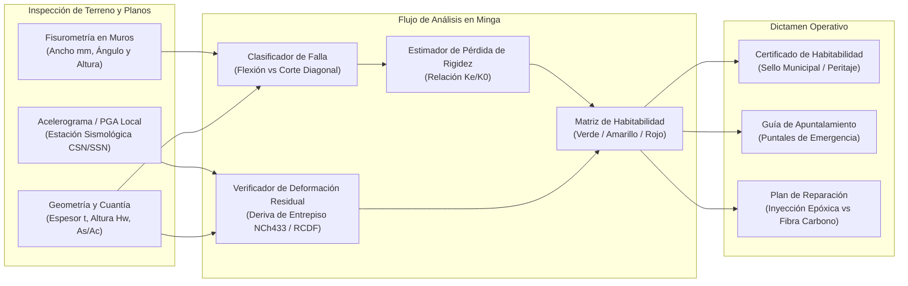

# Caso de Uso 08: Ingeniería Civil y Estructuras
### Evaluación Post-Sismo de Edificaciones, Asentamiento de Fundaciones y Cubicación Resiliente de Hormigón

> **Área:** Ingeniería Estructural, Geotecnia & Gestión de Obras  
> **Relevancia Demo Platanus Hack:** ⭐⭐⭐⭐⭐ *(Seguridad de vidas humanas y resiliencia sísmica en la Franja del Pacífico)*

---

## 1. Resumen Ejecutivo para el Jurado y Pitch

Chile, México, Perú y Colombia forman parte del Cinturón de Fuego del Pacífico, las regiones con mayor amenaza sísmica del planeta. Cuando ocurre un terremoto Mw 7.0+, las cuadrillas municipales y los peritos estructurales deben inspeccionar cientos de edificios en pocas horas para dictaminar si los residentes pueden volver a dormir a sus hogares o deben ser evacuados de emergencia.

* **El Problema:** Las evaluaciones de campo se hacen en fichas de papel arrugadas, con notas de WhatsApp y criterios dispersos. No hay herramientas que crucen en terreno la fisurometría (ancho y orientación de grietas), el desplazamiento relativo del edificio y la degradación de rigidez lateral del hormigón armado. Asimismo, en faenas de construcción, el cálculo de hormigón en planillas manuales suele omitir la dilatación de moldajes y la merma en manguera de bombeo, provocando "juntas frías" imprevistas que comprometen la resistencia sísmica de los nudos estructurales.
* **La Solución Minga:** Un flujo técnico que clasifica mecanismos de falla en muros estructurales (flexión vs. corte diagonal vs. pandeo de armadura según ACI 318 / NCh433), calcula la pérdida de rigidez lateral y emite dictámenes de habitabilidad inmediatos y trazables.
* **El Momento "¡Ajá!" de la Demo:** La demostración del **Nodo Cubicador de Hormigón con Compensación por Bombeo y Deformación de Moldaje**, que evita fallas de llenado y juntas frías en vigas y losas críticas.

---

## 2. Nivel 1: Aplicación Completa — Evaluador Post-Sismo de Vulnerabilidad y Daño Estructural



### 2.1 Persona y Problema del Mundo Real
* **Autor Original:** Rodrigo Sanhueza (Ingeniero Civil Estructural, Revisor de Proyectos en Concepción, Región del Biobío, Chile).
* **El Problema en sus palabras:**  
  *"En Concepción vivimos el 27F en 2010. Cuando la tierra se sacude, te llaman administradores de comunidades en pánico porque ven una grieta en la caja de escala o en el subterráneo. Un conserje no distingue entre una fisura superficial de estuco por retracción térmica de 0.2 mm y una grieta en X a 45 grados por esfuerzo de corte con aplastamiento de talón en un muro de hormigón armado de 20 cm. Si evacuamos por error un edificio seguro, colapsamos los albergues; pero si autorizamos habitar un edificio con pandeo de barras longitudinales que ya perdió el 60% de su rigidez lateral, la réplica de 6.5 Mw lo bota al suelo. Necesitamos una herramienta que aplique el criterio técnico de ingeniería sísmica en terreno sin esperar 3 semanas a correr un modelo de elementos finitos en ETABS."*

### 2.2 Entradas, Nodos del Flujo y Salidas

#### Entradas (Inputs)
1. **Inspección de Fisuras (`fisurometria_tabla`):** Tabla con ID de elemento, nivel/piso, ancho de grieta medido con comparador óptico ($w\text{ en mm}$), ángulo de inclinación ($\theta$), presencia de desprendimiento de recubrimiento (*spalling*) y exposición de armadura.
2. **Registro Sísmico de Estación Cercana (`pga_aceleracion_g`):** Aceleración máxima del suelo (PGA en $g$) y espectro de respuesta elástica reportado por el Centro Sismológico Nacional (CSN).
3. **Ficha Estructural del Muro (`geometria_muro`):** Espesor del muro ($t_w\text{ en cm}$), longitud horizontal ($L_w$), altura libre de piso ($H_w$) y cuantía de refuerzo longitudinal y transversal ($\rho_v, \rho_h$).

#### Nodos del Flujo
1. **`Clasificador de Mecanismo de Falla` (Nodo Nivel 3):** Determina el modo predominante de daño:
   * **Flexión pura:** Fisuras horizontales en la base del muro ($\theta \approx 0^\circ - 15^\circ$), $w \le 1.0\text{ mm}$.
   * **Corte diagonal / Tracción diagonal:** Fisuras en cruz o diagonales ($\theta \approx 35^\circ - 55^\circ$), cruzan el alma del muro.
   * **Aplastamiento de talón / Confinamiento reventado:** Desprendimiento de hormigón en los extremos con barras de refuerzo pandeadas.
2. **`Estimador de Pérdida de Rigidez Lateral`:** Calcula la rigidez residual relativa según el índice de daño de Park-Ang modificado:
   $$\frac{K_{eff}}{K_0} = \exp\left(-\beta \cdot \frac{w_{max}}{w_{lim}}\right) \cdot (1 - \text{factor\_spalling})$$
3. **`Verificador de Deriva Residual`:** Evalúa la distorsión angular de entrepiso residual ($\gamma_{res} = \frac{\Delta_{techo} - \Delta_{piso}}{H_w}$). Si $\gamma_{res} > 0.005$ ($0.5\%$), el muro ha superado su límite plástico y no puede garantizar estabilidad ante una réplica.
4. **`Matriz de Habitabilidad y Riesgo`:**
   * **Verde (Inspeccionado - Habitable):** Solo daño cosmético o flexión incipiente ($w < 0.5\text{ mm}$, sin pandeo).
   * **Amarillo (Acceso Restringido):** Daño por corte moderado ($w < 2.0\text{ mm}$), requiere apuntalamiento temporal en pisos inferiores antes de reingresar.
   * **Rojo (Inseguro - Evacuación Inmediata):** Aplastamiento de talón, armadura expuesta con pandeo o pérdida de rigidez $> 50\%$.

#### Salidas (Outputs)
* **Certificado Técnico de Habitabilidad:** Ficha normalizada con firma digital para la Dirección de Obras Municipales (DOM).
* **Esquema de Apuntalamiento:** Número y capacidad de alzaprimas metálicas requeridas por metro lineal de muro comprometido.
* **Presupuesto Estimado de Rehabilitación:** Metros lineales de inyección de resina epóxica de alta adherencia vs. metros cuadrados de encamisado con polímeros reforzados con fibra de carbono (CFRP).

---

### 2.3 Diff de Dominio: De Terremotos Chilenos de Subducción a Suelos Blandos de CDMX (Chile ➔ México)

* **Adaptadora:** Sofía Delgado (Ingeniera Civil Estructural, Perito en Seguridad Estructural en Benito Juárez, Ciudad de México).
* **El Contexto de Sofía:** En la Ciudad de México, el riesgo sísmico está condicionado por la cuenca lacustre de suelos blandos (arcillas del lago con contenidos de agua superiores al 300%). Los sismos costeros (Guerrero/Oaxaca) o intraplaca profunda (como el del 19S de 2017) provocan una enorme amplificación armónica en periodos largos ($T_s \approx 1.5 - 2.5\text{ s}$). Los edificios dañados típicamente no son muros de corte rígidos chilenos, sino **marcos de concreto armado con muros de mampostería confinada o muros de relleno de tabique hueco**, propensos a falla por piso blando y golpeteo entre edificios colindantes.
* **Interacción con el Agente:**  
  *Sofía:* *"Agente, quiero clonar el flujo de Rodrigo de Concepción, pero adaptarlo a la normativa del RCDF (Reglamento de Construcciones del DF) y a las Normas Técnicas Complementarias de Concreto 2023. En CDMX tenemos que evaluar columnas de esquina y golpeteo con el edificio vecino, no solo muros de corte puros."*

```
┌────────────────────────────────────────────────────────────────────────┐
│                   TARJETA DE DIFF DE DOMINIO                           │
│   Herramienta: "Evaluador Post-Sismo de Vulnerabilidad y Daño"         │
│   De: Rodrigo Sanhueza (Chile) ➔ A: Sofía Delgado (México)             │
├────────────────────────────────────────────────────────────────────────┤
│ 1. Tipología Estructural Evaluada:                                     │
│    - Chile: Muros de hormigón armado de ductilidad limitada (NCh433).   │
│    - CDMX: Marcos dúctiles de concreto con relleno de mampostería       │
│      (NTC-Concreto / NTC-Mampostería RCDF).                            │
│                                                                        │
│ 2. Criterios de Falla y Límites Normativos:                            │
│    - Umbral de deriva de entrepiso máxima elástica:                    │
│      Chile: 0.002 (0.2% en NCh433) ➔ CDMX: 0.012 (1.2% NTC-Sismo)    │
│    - Mecanismo crítico prioritario:                                    │
│      Chile: Aplastamiento de talón en muro ➔                           │
│      CDMX: Falla frágil por cortante en columna corta y piso blando.   │
│                                                                        │
│ 3. Factor de Entorno Urbano:                                           │
│    - Parámetro añadido: Separación a colindancia (holgura sísmica).    │
│    - Razón: Alerta roja automática si el desplome del edificio supera │
│      la junta de separación con la estructura vecina (riesgo golpeteo).│
│                                                                        │
│ 4. Estado de Nodos:                                                    │
│    - Módulo de fisurometría: Reutilizado al 100%.                      │
│    - Clasificador de falla: Adaptado para columnas con estribos de     │
│      confinamiento según RCDF.                                         │
└────────────────────────────────────────────────────────────────────────┘
```
Sofía presiona **[Aceptar Adaptación RCDF]**. El evaluador queda listo para inspeccionar los edificios del corredor Roma-Condesa y Benito Juárez.

---

### 2.4 Smart Merge: La Mejora Comunitaria que Vuelve a Todos

* **El Aporte Comunitario:** Marcelo Vidal, patólogo de estructuras en Viña del Mar, aporta una variable que la norma sísmica tradicional suele olvidar:
  *"Una fisura de 0.8 mm en un muro post-sismo puede no amenazar el colapso inmediato hoy. Pero si el edificio está a menos de 1.000 metros de la costa marina, la brisa marina cargada de iones cloruro penetra por la fisura abierta. En 18 meses, las barras de acero de 16 mm se corroen, se expanden por óxido férrico, revientan el núcleo y dejan el edificio en ruinas silenciosas."*
* **El Nuevo Nodo:**  
  `Riesgo de Corrosión Acelerada por Cloruros en Fisuras Estructurales Activas`.
* **Cómo opera el Smart Merge:**  
  Marcelo publica el nodo en el Hub.
  1. Minga detecta que los flujos de Rodrigo (Concepción) y Sofía (CDMX) manipulan tablas de fisurometría con anchos de abertura.
  2. El agente notifica a Rodrigo en Concepción:
     > *"Un colega de la costa de Valparaíso aportó un evaluador de corrosión marina en fisuras post-sismo. ¿Deseas agregarlo como salida complementaria de durabilidad para edificios en la bahía de San Vicente o Talcahuano? Tus criterios de habitabilidad sísmica inmediata no se verán alterados."*
  3. Rodrigo aprueba la inserción. El flujo ahora emite un plan de sellado urgente con inhibidor de corrosión para estructuras costeras.

---

## 3. Nivel 2: Módulo Reutilizable — Calculador de Asentamiento Inmediato y por Consolidación Primaria (Terzaghi & Skempton)

### 3.1 Persona y Problema del Mundo Real
* **Autor Original:** Esteban Arratia (Ingeniero Geotécnico, Laboratorio de Mecánica de Suelos, San Bernardo, Chile).
* **El Problema del Oficio:**  
  *"Cuando diseñas una zapata para un galpón o edificio sobre un suelo arcilloso o limo saturado, el peso de la estructura exprime el agua de los poros microscópicos del suelo a lo largo de meses o años (consolidación). Si calculas solo el asentamiento elástico inmediato y olvidas la consolidación primaria, el edificio se asienta 7 centímetros en 3 años, las puertas no cierran, las cañerías de agua se cortan y las paredes se rajan. Necesitamos un módulo determinista que reciba la estratigrafía del sondaje y entregue la curva tiempo-asentamiento sin tener que abrir pesados softwares geotécnicos de escritorio."*

### 3.2 Lógica del Módulo (Empaquetado como Flujo como Nodo - ADR 0016)
* **Puertos de Entrada:**
  * `Carga_Zapata_P` (Escalar kN)
  * `Dimensiones_Zapata` (Ancho $B$, Largo $L$ en metros)
  * `Estratigrafia_Suelo` (Tabla con espesor de estrato $H_i$, peso unitario $\gamma$, índice de vacíos inicial $e_0$, índice de compresión $C_c$, índice de recompresión $C_r$, esfuerzo de preconsolidación $\sigma'_p$, coeficiente de consolidación $c_v$)
* **Sub-Nodos Internos:**
  1. `Distribución de Esfuerzos en Profundidad (Boussinesq 2:1)`:
     $$\Delta \sigma_z(z) = \frac{P}{(B + z)(L + z)}$$
  2. `Clasificador de Arcilla (Normalmente Consolidada vs Sobreconsolidada)`:
     Verifica si $\sigma'_{v0} + \Delta \sigma_z > \sigma'_p$.
  3. `Integrador de Asentamiento por Consolidación Primaria (Terzaghi)`:
     $$S_c = \sum \frac{C_c \cdot H_i}{1 + e_0} \log_{10}\left(\frac{\sigma'_{v0} + \Delta \sigma_z}{\sigma'_{v0}}\right)$$
  4. `Estimador de Asentamiento Diferencial y Distorsión Angular`:
     Calcula $\beta = \frac{\Delta S}{L_{vano}}$. Compara contra el umbral seguro de agrietamiento arquitectónico ($\beta \le 1/500$).
* **Puertos de Salida:**
  * `Asentamiento_Total_cm` (Escalar cm)
  * `Tiempo_Consolidacion_90_dias` (Escalar días, basado en $T_v = 0.848$)
  * `Semaforo_Distorsion_Angular` (Texto: Aceptable / Daño Cosmético / Falla Estructural)

### 3.3 Adaptación (Diff de Dominio)
* **Adaptador:** Gonzalo (Geotécnico en Puerto Varas / Osorno, Chile).
* **Diff:** Gonzalo trabaja sobre **suelos trumaos (cenizas volcánicas recientes)** del sur de Chile. Los trumaos tienen una estructura porosa extremadamente frágil con índice de vacíos $e_0 > 2.5$ y sufren colapso estructural si se rompe la cementación natural por sobrecarga. El agente de Gonzalo ajusta la ecuación con un umbral de esfuerzo de colapso de estructura piroclástica, evitando asentamientos catastróficos no lineales.

---

## 4. Nivel 3: Nodo Individual — Cubicador de Hormigón con Compensación por Bombeo y Flecha de Moldaje
### ⭐ El Caso Clave en Control de Obra

### 4.1 El Dolor Técnico y de Negocio
En faenas de hormigonado de losas, zapatas y vigas, la cubicación teórica geométrica ($V = L \times B \times H$) en Excel **siempre falla**:
1. **Presión Hidrostática y Flecha del Moldaje:** El hormigón fluido ($\rho \approx 2.400\text{ kg/m}^3$) deforma los tableros de terciado y alzaprimas entre un $2\%$ y un $4\%$ de sobreespesor.
2. **Volumen Muerto en Bomba y Tubería:** El camión pluma retiene entre $0.3\text{ m}^3$ y $0.5\text{ m}^3$ en la tolva y manguerote que no entran a la estructura.
3. **Pérdida por Pegado en Mixer y Rebote:** Un $1.5\%$ queda en las aspas del camión.
* **La Catástrofe en Obra:** Si pides exactamente $18.0\text{ m}^3$ según la planilla de Excel y se te acaban las tolvas a las 17:30 hrs cuando falta $0.8\text{ m}^3$ para sellar la viga maestra, la faena se para. El hormigón empieza a fraguar y se genera una **junta fría no planificada** en zona de máximo esfuerzo de corte. La viga pierde su monolitismo y el calculista rechaza la recepción municipal, obligando a demoler con martillo percutor a un costo de miles de dólares.

### 4.2 Manifiesto del Nodo en Minga (`civil_concrete_pouring_calculator.json`)

```json
{
  "id": "node_civil_concrete_pouring_calculator",
  "name": "Cubicador de Hormigón con Pérdidas de Faena",
  "category": "Construcción & Obras",
  "version": "1.2.0",
  "author": "Asociación de Constructores y Calculistas del Sur",
  "description": "Calcula el volumen real de hormigón premezclado requerido para faenas de llenado, considerando deformación de moldajes, mermas de transporte y volumen muerto de bomba pluma.",
  "inputs": [
    {
      "id": "elementos_a_llenar",
      "name": "Geometría Teórica de Elementos",
      "type": "Tabla",
      "description": "Lista de piezas [id, tipo_elemento, largo_m, ancho_m, espesor_m, cantidad]"
    }
  ],
  "params": [
    {
      "id": "tipo_moldaje",
      "title": "Rigidez del Moldaje",
      "type": "string",
      "default": "madera_terciado_estandar",
      "enum": ["metalico_pesado", "madera_terciado_estandar", "artesanal_tabla"]
    },
    {
      "id": "metodo_colocacion",
      "title": "Método de Vaciado",
      "type": "string",
      "default": "bomba_pluma",
      "enum": ["capacho_grua", "bomba_pluma", "bomba_estacionaria_larga"]
    },
    {
      "id": "redondeo_mixer_m3",
      "title": "Capacidad Típica de Camión Mixer",
      "type": "number",
      "default": 8.0,
      "unit": "m3"
    }
  ],
  "outputs": [
    {
      "id": "volumen_teorico_m3",
      "name": "Volumen Geométrico Neto",
      "type": "Escalar",
      "description": "Suma pura de volumen de planos (m3)."
    },
    {
      "id": "volumen_pedido_real_m3",
      "name": "Volumen Total a Pedir a Planta",
      "type": "Escalar",
      "description": "Volumen compensado con mermas y volumen residual de bomba (m3)."
    },
    {
      "id": "camiones_sugeridos",
      "name": "Despacho de Mixers Sugerido",
      "type": "Tabla",
      "description": "Cronograma de camiones con despacho final de ajuste."
    }
  ],
  "sqlTemplate": "WITH calculo_base AS (SELECT SUM(largo_m * ancho_m * espesor_m * cantidad) as v_neto FROM {{inputs.elementos_a_llenar}}), factores AS (SELECT CASE WHEN '{{params.tipo_moldaje}}' = 'artesanal_tabla' THEN 1.05 WHEN '{{params.tipo_moldaje}}' = 'madera_terciado_estandar' THEN 1.03 ELSE 1.01 END as f_moldaje, CASE WHEN '{{params.metodo_colocacion}}' = 'bomba_pluma' THEN 0.40 WHEN '{{params.metodo_colocacion}}' = 'bomba_estacionaria_larga' THEN 0.70 ELSE 0.15 END as v_muerto_bomba) SELECT v_neto as volumen_teorico_m3, ROUND((v_neto * f_moldaje * 1.015) + v_muerto_bomba, 1) as volumen_pedido_real_m3 FROM calculo_base, factores"
}
```

### 4.3 Demostración de Ejecución en Vivo

```
ELEMENTO A HORMIGONAR: Losa de fundación de 12.0m x 8.0m x 0.20m
Vaciado con Camión Bomba Pluma de 28m y moldaje de terciado 18mm.

❌ CÁLCULO TRADICIONAL EN PLANILLA INGENUA:
   Volumen = 12.0 * 8.0 * 0.20 = 19.2 m3
   Pedido a la planta de hormigón: 19.5 m3 (3 mixers de 6.5 m3).
   RESULTADO EN OBRA:
   - Deformación de moldaje absorbe +0.6 m3
   - Línea de bomba retiene en tolva y tubería +0.4 m3
   - Hormigón real colocado: 18.5 m3
   ¡FALTO HORMIGÓN EN EL ÚLTIMO CUADRANTE DE LA LOSA!
   Junta fría obligatoria a las 18:00 hrs. Demolición y atraso de 1 semana.

✅ NODO MINGA CUBICADOR CON FACTOR DE MERMA Y BOMBA:
   Volumen geométrico puro: 19.20 m3
   Factor de deformación de moldaje (3%): +0.58 m3
   Pérdida en pared de mixer (1.5%): +0.30 m3
   Volumen retenido en bomba pluma: +0.40 m3
   VOLUMEN PEDIDO SUGERIDO: 20.5 m3
   Cronograma: 2 camiones de 8.0 m3 + 1 camión de remate de 4.5 m3.
   RESULTADO: Losa terminada al 100%, junta fría evitada, estructura monolítica aprobada.
```

---

## 5. Ficha del Componente para el Hub de Minga

```json
{
  "id": "flow_post_seismic_damage_assessment_v1",
  "kind": "flow",
  "name": "Evaluador Post-Sismo de Vulnerabilidad y Daño Estructural",
  "summary": "Dictamina habitabilidad, pérdida de rigidez y medidas de apuntalamiento en muros de hormigón armado tras sismos severos.",
  "inputs": [
    { "name": "fisurometria_campo", "type": "Tabla" },
    { "name": "geometria_estructural", "type": "Tabla" },
    { "name": "pga_sismico", "type": "Escalar", "unit": "g" }
  ],
  "outputs": [
    { "name": "dictamen_habitabilidad", "type": "Texto" },
    { "name": "rigidez_residual_porcentaje", "type": "Escalar", "unit": "%" },
    { "name": "puntales_requeridos", "type": "Escalar" }
  ],
  "assumptions": [
    "Estructura basada en muros de hormigón armado diseñados bajo normativa sismorresistente.",
    "El ancho de fisura se mide en el concreto estructural, no en estucos desprendibles."
  ],
  "context": {
    "domain": "ingeniería civil",
    "discipline": "estructuras & sismo",
    "region": "Cinturón de Fuego del Pacífico (Chile / México)"
  },
  "lineage": {
    "author": "rodrigo_sanhueza",
    "forks_count": 11,
    "stars": 48
  }
}
```

---

## 6. Guía de Ejecución del Pitch de 45 Segundos

1. **Abre el flujo de Rodrigo en Concepción tras un sismo 6.9 Mw.**
2. **Ingresa los datos de inspección:** Muro en piso 1 con grieta en cruz a 45° de 1.8 mm y leve desprendimiento.
3. **Muestra el veredicto en tiempo real:**
   * El sistema calcula una pérdida de rigidez del $38\%$ y deriva el semáforo a **Amarillo (Acceso Restringido)** con orden inmediata de apuntalamiento de 4 puntales telescópicos antes de autorizar el retiro de pertenencias.
4. **Haz el Fork en Vivo a CDMX:** Presiona "Clonar para Benito Juárez, CDMX", ajusta a la normativa RCDF con ayuda del agente. Muestra el **Diff de Dominio** adaptado a columnas y golpeteo de edificios. ¡Ingeniería de vida o muerte al alcance de cualquier perito en terreno!
