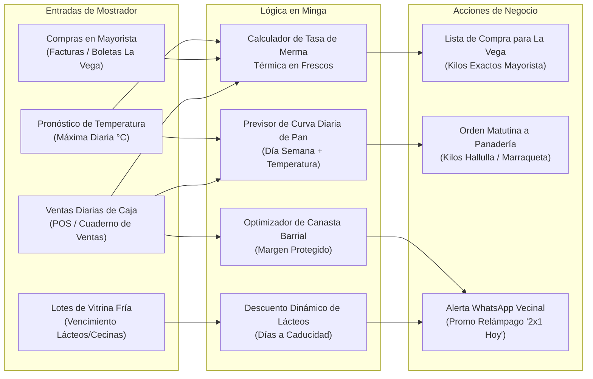

# Caso de Uso 09: Tiendas de Abarrotes y Almacenes de Barrio
### Control de Merma de Frescos, Reposición de Pan y Canastas Barriales de Alta Rotación

> **Área:** Comercio Minorista de Barrio, Gestión de Mermas & Micro-Inventarios  
> **Relevancia Demo Platanus Hack:** ⭐⭐⭐⭐⭐ *(Impacto en la subsistencia de cientos de miles de almacenes familiares en toda Latinoamérica)*

---

## 1. Resumen Ejecutivo para el Jurado y Pitch

En América Latina, más del $50\%$ de los alimentos básicos no se venden en grandes cadenas de supermercados, sino en los más de 2.5 millones de pequeños almacenes de barrio, tienditas de la esquina y bodegas familiares. Estos comerciantes operan con márgenes delgados ($15\%$ al $22\%$) y capital de trabajo sumamente limitado.

* **El Problema:** La merma de productos frescos (tomates, plátanos, verduras de hoja, pan recién horneado y lácteos) representa pérdidas de entre el $10\%$ y el $25\%$ de las compras semanales. Si hace calor, el tomate madura y se pudre en 48 horas en el cajón de madera; si el almacenero no calcula bien, a las 19:00 hrs le sobran 12 kilos de pan que termina rematando a pérdida para pan rallado, o se queda sin cecinas ni quesos el fin de semana perdiendo la venta completa.
* **La Solución Minga:** Una herramienta visual intuitiva donde el almacenero registra sus ventas por teclado rápido o fotos de cuadernos, monitorea el impacto de la temperatura en la vida útil de frutas y verduras, y activa promociones relámpago comunitarias por WhatsApp antes de que la comida se eche a perder.
* **El Momento "¡Ajá!" de la Demo:** El **Nodo de Descuento Dinámico por Vida Útil Residual**, que rescata el $85\%$ del valor de lácteos y fiambrería a punto de expirar mediante liquidaciones automáticas escalonadas.

---

## 2. Nivel 1: Aplicación Completa — Centinela de Merma de Frescos y Reposición Diaria



### 2.1 Persona y Problema del Mundo Real
* **Autora Original:** Doña Rosa Huenteo (Dueña de "Almacén Doña Rosa" en Maipú, Santiago, Chile).
* **El Problema en sus palabras:**  
  *"Me levanto a las 5:30 AM los martes y viernes para ir a La Vega Central a comprar frutas y verduras. En verano, cuando en Santiago hacen 33°C, el tomate y la lechuga no aguantan: el jueves ya tengo que botar medio cajón de tomates blandos y las lechugas se queman en las puntas. En el pan es peor: el panadero me pide a las 7 de la mañana cuántos kilos de marraqueta y hallulla quiero para la tarde. Si pido de más porque es un día de lluvia y la gente se queda en casa haciendo sopaipillas, me quedan 15 kilos fríos que al día siguiente nadie quiere comprar a precio normal. Pierdo más de $200.000 pesos al mes solo en comida que termina en el basurero."*

### 2.2 Entradas, Nodos del Flujo y Salidas

#### Entradas (Inputs)
1. **Registro de Ventas Diarias (`ventas_mostrador`):** Tabla con ítems, kilos o unidades vendidas y timestamp (obtenido de caja registradora, software punto de venta básico o planilla rápida).
2. **Boleta de Recepción de Mercadería (`compras_frescos`):** Kilos ingresados de tomate, papa, cebolla, palta, lechuga y fecha/hora de llegada.
3. **Pronóstico Meteorológico Comunal (`temperatura_maxima_c`):** Temperatura ambiente pico esperada para la jornada.
4. **Vencimientos de Cecinas y Lácteos (`inventario_perecibles`):** Fecha de expiración impresa en envase de yogures, leches, queso laminado y jamón.

#### Nodos del Flujo
1. **`Calculador de Tasa de Merma Térmica en Frescos` (Nodo Nivel 3):** Modela la aceleración de degradación de hortalizas y frutas climatéricas por respiración celular ($Q_{10}$):
   $$\text{Vida\_Util\_Ajustada} = \text{Vida\_Base} \times 2^{-\left(\frac{T_{max} - 20^\circ\text{C}}{10}\right)}$$
   Si la temperatura salta de $20^\circ\text{C}$ a $30^\circ\text{C}$, la vida en vitrina se reduce a la mitad.
2. **`Previsor de Demanda Diaria de Pan`:** Cruza el día de la semana (viernes y sábado venden $35\%$ más), efecto lluvia/frío (los días fríos sube el consumo de pan batido/hallulla) y stock remanente de la mañana.
3. **`Descuento Dinámico por Caducidad`:** Si a un queso o yogurt le quedan $\le 3$ días de vida, asigna un descuento progresivo ($20\%$, $40\%$, $60\%$) para asegurar su rotación antes del día cero.
4. **`Optimizador de Canasta de Compra Mayorista`:** Ajusta la orden de compra en La Vega o Lo Valledor para mantener un stock de seguridad que no supere los días de vida útil térmica del producto.

#### Salidas (Outputs)
* **Lista de Compras Mayoristas en el Celular:** Kilos exactos por producto para no sobrecomprar en La Vega.
* **Mensaje Automático al Panadero:** "Don Juan, para hoy requerimos: 24 kg Hallulla, 18 kg Marraqueta, 6 kg Coliza".
* **Plantilla de Difusión por WhatsApp Vecinal:** Mensaje formateado listo para reenviar al grupo de vecinos:  
  *🛒 ¡Vecinas de Maipú! Hoy en Almacén Doña Rosa tenemos el tomate larga vida a $890 el kilo y promo 2x1 en yogures hasta agotar stock de la tarde.*

---

### 2.3 Diff de Dominio: De Maipú a una Tiendita de Abarrotes en Coyoacán (Chile ➔ México)

* **Adaptador:** Don Ramiro Torres (Dueño de "Abarrotes La Esquina", Coyoacán, Ciudad de México).
* **El Contexto de Don Ramiro:** En la Ciudad de México, el pan de mesa tradicional no es marraqueta o hallulla, sino el **bolillo, telera y pan dulce**. Además, el producto básico que no puede faltar dos veces al día es la **tortilla de maíz nixtamalizado** caliente (comprada a la tortillería local a las 11:00 AM y a las 14:00 PM para la hora de la comida). En frutas y verduras, los productos críticos de rápida merma son el **jitomate saladette, aguacate Hass, chile serrano y cilantro**.
* **Interacción con el Agente:**  
  *Don Ramiro:* *"Agente, me gusta cómo la señora Rosa cuida que no se le pudran las cosas, pero aquí en México vendemos tortillas dos veces al día para la comida familiar y bolillo calientito. Y si el jitomate o el aguacate se me pasan de maduros en el calor de mayo, ya nadie los quiere ni para la salsa."*

```
┌────────────────────────────────────────────────────────────────────────┐
│                   TARJETA DE DIFF DE DOMINIO                           │
│   Herramienta: "Centinela de Merma de Frescos & Panadería"             │
│   De: Doña Rosa (Chile) ➔ A: Don Ramiro (México)                       │
├────────────────────────────────────────────────────────────────────────┤
│ 1. Adaptación de Productos Básicos de Panadería a Tortillería:         │
│    - Chile: Marraqueta y Hallulla (1 compra matutina al panificador).  │
│    - México: Bolillo/Telera + Tortilla de Maíz (2 turnos: comida y cena)│
│    - Parámetro de rotación: Horas pico a las 13:30 (hora de comida en   │
│      CDMX) y 19:30 (merienda con pan dulce).                            │
│                                                                        │
│ 2. Catálogo de Frescos Críticos y Resistencia Térmica:                 │
│    - Se reemplaza Papa y Lechuga ➔ Jitomate Saladette, Chile Serrano,  │
│      Cilantro y Aguacate Hass.                                         │
│    - Factor etilénico del Aguacate: Cuando T > 26°C, la ventana de      │
│      firmeza de 'en su punto' cae de 4 días a 36 horas.                 │
│                                                                        │
│ 3. Unidad y Moneda:                                                    │
│    - CLP ($/kg) ➔ MXN ($/kg). Formato de mensaje WhatsApp adaptado al   │
│      léxico local ('Marchanta', 'Vecinos de Coyoacán').                │
│                                                                        │
│ 4. Estado de Nodos:                                                    │
│    - Estructura del grafo: 100% reutilizada.                           │
│    - Lógica de liquidación dinámica por fecha de caducidad: Intacta.   │
└────────────────────────────────────────────────────────────────────────┘
```
Don Ramiro aprueba el cambio. La tiendita en Coyoacán ahora predice la masa de tortillas y remata aguacates maduros para guacamole vecinal antes de que se oscurezcan.

---

### 2.4 Smart Merge: La Mejora Comunitaria que Vuelve a Todos

* **El Aporte Comunitario:** Señora Gladys, dueña de un minimarket en Quinta Normal (Santiago), nota un patrón crucial:
  *"Ustedes calculan la comida por día de la semana, pero se olvidan del día del mes. En Chile, los días 1 y 15 cuando se pagan los sueldos y se carga el 'Bolsillo Familiar Electrónico' del Estado, los vecinos compran el doble de abarrotes pesados (sacos de 5 kg de arroz, bidones de aceite de 5 litros, legumbres). Si solo miramos el promedio de la semana anterior, esos días quebramos stock al mediodía y la gente se va al supermercado grande."*
* **El Nuevo Nodo:**  
  `Multiplicador de Días de Pago Quincenal y Subsidios Estatales`.
* **Cómo opera el Smart Merge:**  
  Gladys publica el nodo en el Hub.
  1. Minga detecta que Doña Rosa (Chile) y Don Ramiro (México) gestionan compras periódicas de abarrotes.
  2. El agente notifica a Don Ramiro en Coyoacán:
     > *"Una colega de Santiago creó un nodo que amplifica las órdenes de compra para los días de pago de nómina quincenal (días 15 y 30) y programas sociales. ¿Deseas incluirlo en tu previsión de arroz, frijol y aceite? Tus reglas de tortillas y aguacates permanecerán intactas."*
  3. Don Ramiro acepta. El agente sincroniza los días 15 y último de mes de la quincena mexicana, protegiendo el inventario en los días de mayor circulación de efectivo.

---

## 3. Nivel 2: Módulo Reutilizable — Generador de Canasta de Compra Barrial por Afinidad (Market Basket Association)

### 3.1 Persona y Problema del Mundo Real
* **Autor Original:** Matías Pinto (Red de Almaceneros de Valparaíso, Chile).
* **El Problema del Oficio:**  
  *"El vecino entra por un paquete de fideos, pero si no ve la salsa de tomate y el queso rallado al lado de la caja, no los compra o los compra en otro lado. Si armamos combos barriales inteligentes ('El Pack Almuerzo Familiar' o 'La Once Completa') con un pequeño descuento del 5%, aumentamos el ticket promedio de $3.200 a $6.800 CLP sin sacrificar margen."*

### 3.2 Lógica del Módulo (Empaquetado como Flujo como Nodo - ADR 0016)
* **Puertos de Entrada:**
  * `Boletas_Transacciones` (Tabla de ventas con transacciones y líneas de producto)
  * `Margen_Minimo_Admisible` (Escalar %, por defecto $20\%$)
* **Sub-Nodos Internos:**
  1. `Minero de Reglas de Asociación (Algoritmo Apriori Ligero)`: Identifica pares de productos con alta correlación:
     $$\text{Support}(A \cap B) = \frac{\text{Boletas con } A \text{ y } B}{\text{Total Boletas}}, \quad \text{Lift} = \frac{P(A \cap B)}{P(A) \cdot P(B)}$$
  2. `Filtro de Lift Significativo`: Descarta combinaciones aleatorias y retiene aquellas con $\text{Lift} > 1.8$ (alta afinidad barrial).
  3. `Calculador de Precio Combo`: Suma costos de reposición, aplica margen del $22\%$ y genera precio de oferta atractivo con terminación en $90.
* **Puertos de Salida:**
  * `Top_Combos_Sugeridos` (Tabla: Producto A, Producto B, Precio Individual, Precio Combo, Margen %)
  * `Cartel_Para_Pizarrón` (Texto formateado para tiza o afiche de cartulina en la puerta del almacén)

### 3.3 Adaptación (Diff de Dominio)
* **Adaptadora:** Lupita (Abarrotes en Puebla, México).
* **Diff:** Lupita reemplaza la canasta chilena de la "Once" (pan + cecina + té) por la canasta de "Desayuno / Almuerzo Poblano" (huevo fresco + frijol negro refrito + paquete de tortillas + chile jalapeño). El módulo calcula automáticamente la rentabilidad del paquete protegido.

---

## 4. Nivel 3: Nodo Individual — Regla de Descuento Dinámico por Vida Útil Residual de Fiambrería y Lácteos
### ⭐ La Clave para Eliminar la Merma en Vitrina

### 4.1 El Dolor Técnico y de Negocio
En cecinas laminadas al vacío, quesos y lácteos:
* Si el producto llega a su fecha de vencimiento impresa (Día 0), por normativa de salud pública (SEREMI de Salud en Chile o COFEPRIS en México) **debe ser desnaturalizado y arrojado a la basura**. La pérdida es del $100\%$ del costo.
* **El Error Común del Comerciante:** No mira la fecha hasta que el cliente en la caja le dice: *"Señora, este yogurt vence hoy"*. El almacenero intenta venderlo a precio completo hasta el último minuto por miedo a perder dinero, terminando por no venderlo y botándolo.
* **La Regla del Nodo Minga:** Aplica una función escalonada determinista basada en el porcentaje de vida residual:
  * Si $\text{días\_restantes} = 3$: Descuento del $20\%$ (recupera costo y margen parcial).
  * Si $\text{días\_restantes} = 2$: Descuento del $35\%$ (recupera costo neto de reposición).
  * Si $\text{días\_restantes} = 1$: Descuento del $55\%$ (recupera capital circulante; mejor recibir $45\%$ que $0\%$).

### 4.2 Manifiesto del Nodo en Minga (`grocery_shelf_life_dynamic_discount.json`)

```json
{
  "id": "node_grocery_shelf_life_dynamic_discount",
  "name": "Descuento Dinámico por Vida Útil Residual",
  "category": "Comercio & Almacén",
  "version": "1.0.0",
  "author": "Red Comunitaria de Almacenes de Barrio",
  "description": "Calcula el precio de liquidación escalonada para productos perecibles según días restantes de vida útil, maximizando la recuperación de capital antes del vencimiento.",
  "inputs": [
    {
      "id": "lotes_vitrina",
      "name": "Inventario de Perecibles",
      "type": "Tabla",
      "description": "Tabla [sku, nombre_producto, costo_unitario, precio_normal, stock_unidades, fecha_vencimiento]"
    }
  ],
  "params": [
    {
      "id": "margen_minimo_rescate",
      "title": "Porcentaje Mínimo de Rescate del Costo",
      "type": "number",
      "default": 45.0,
      "unit": "%"
    }
  ],
  "outputs": [
    {
      "id": "productos_en_remate",
      "name": "Productos a Liquidar Hoy",
      "type": "Tabla",
      "description": "Tabla con nuevo precio de oferta, porcentaje de rebaja y ganancia rescatada."
    },
    {
      "id": "capital_en_riesgo_total",
      "name": "Dinero Total en Riesgo de Merma",
      "type": "Escalar",
      "description": "Suma monetaria de productos que vencen en menos de 72 horas."
    }
  ],
  "sqlTemplate": "SELECT sku, nombre_producto, stock_unidades, precio_normal, CASE WHEN DATEDIFF('day', CURRENT_DATE, fecha_vencimiento) = 3 THEN ROUND(precio_normal * 0.80, -1) WHEN DATEDIFF('day', CURRENT_DATE, fecha_vencimiento) = 2 THEN ROUND(precio_normal * 0.65, -1) WHEN DATEDIFF('day', CURRENT_DATE, fecha_vencimiento) <= 1 THEN GREATEST(ROUND(costo_unitario * ({{params.margen_minimo_rescate}} / 100.0), -1), ROUND(precio_normal * 0.45, -1)) ELSE precio_normal END as precio_oferta, DATEDIFF('day', CURRENT_DATE, fecha_vencimiento) as dias_restantes FROM {{inputs.lotes_vitrina}} WHERE fecha_vencimiento <= CURRENT_DATE + INTERVAL '3 days'"
}
```

### 4.3 Demostración de Ejecución en Vivo

```
LOTE EN VITRINA: 12 potes de Yogurt Griego 150g
Costo unitario: $450 CLP | Precio normal de venta: $750 CLP | Total en juego: $9.000 CLP
Fecha actual: Jueves 14. Fecha de caducidad impresa: Sábado 16 (2 días restantes).

❌ GESTIÓN TRADICIONAL CIEGA (Esperar a vender al precio de lista):
   El almacenero mantiene el precio a $750 CLP.
   El jueves vende 2 potes. El viernes vende 1 pote.
   El sábado vence el resto.
   Potes botados a la basura: 9 potes.
   Pérdida neta directa de caja: 9 * $450 = -$4.050 CLP.
   RESULTADO: DESTRUCCIÓN DE MARGEN Y COMIDA DESPERDICIADA.

✅ NODO MINGA DESCUENTO DINÁMICO:
   Detecta: Días restantes = 2 días.
   Aplica regla: 35% de descuento -> Precio de oferta = $490 CLP (cubre el costo).
   Dispara alerta WhatsApp a vecinas a las 10:00 AM: "¡Yogurt Griego hoy a $490!".
   A las 16:00 hrs se vendieron los 10 potes restantes.
   Ingreso obtenido: 10 * $490 = $4.900 CLP.
   RESULTADO: 0 MERMA. Capital recuperado y clientes felices.
```

---

## 5. Ficha del Componente para el Hub de Minga

```json
{
  "id": "flow_grocery_waste_and_replenishment_v1",
  "kind": "flow",
  "name": "Centinela de Merma de Frescos y Reposición Barrial",
  "summary": "Evita pérdidas de alimentos en almacenes y tienditas calculando descomposición por calor y liquidación escalonada de lácteos y panadería.",
  "inputs": [
    { "name": "ventas_caja", "type": "Tabla" },
    { "name": "temperatura_ambiente", "type": "Escalar", "unit": "°C" },
    { "name": "inventario_vencimientos", "type": "Tabla" }
  ],
  "outputs": [
    { "name": "orden_pan_kilos", "type": "Tabla" },
    { "name": "liquidaciones_hoy", "type": "Tabla" },
    { "name": "texto_whatsapp_vecinos", "type": "Texto" }
  ],
  "assumptions": [
    "El comercio vende pan recién elaborado con vida útil de un día.",
    "La tasa de respiración de hortalizas se duplica aproximadamente cada 10°C de incremento térmico."
  ],
  "context": {
    "domain": "comercio minorista",
    "business": "almacenes de barrio y abarrotes",
    "region": "Latinoamérica (Chile / México)"
  },
  "lineage": {
    "author": "rosa_huenteo",
    "forks_count": 16,
    "stars": 59
  }
}
```

---

## 6. Guía de Ejecución del Pitch de 45 Segundos

1. **Presenta a Doña Rosa en Maipú:** Muestra el cajón de tomates bajo 32°C de calor veraniego y los yogures a 48 horas de vencer.
2. **Ejecuta el flujo:**
   * El nodo *Calculador de Merma Térmica* le avisa: "El calor acortará la vida del tomate a 24 horas. No compres 3 cajones en La Vega, compra solo 1 cajón y medio hoy".
   * El nodo *Descuento Dinámico* genera la oferta de yogurt a $490 en vez de dejar que se pudra.
3. **Muestra la salida:** Un mensaje de WhatsApp generado en 1 segundo listo para enviar a la comunidad barrial.
4. **Haz el Fork en Vivo a Coyoacán (México):** El agente adapta hallullas por tortillas de maíz y tomates por aguacates Hass en segundos con el **Diff de Dominio**. ¡Impacto social y económico directo en el corazón del barrio!
