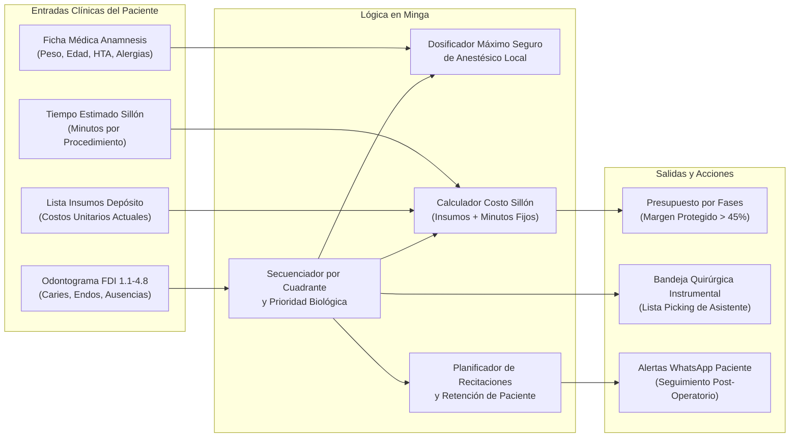

# Caso de Uso 10: Odontología y Clínicas Dentales
### Planes de Tratamiento por Cuadrante, Costeo Real de Sillón Dental y Alertas Clínicas

> **Área:** Odontología General, Ortodoncia & Gestión Clínica Dental  
> **Relevancia Demo Platanus Hack:** ⭐⭐⭐⭐⭐ *(Precisión médica, control financiero y seguridad del paciente en consultorios pymes)*

---

## 1. Resumen Ejecutivo para el Jurado y Pitch

En la odontología privada e institucional de América Latina, más del $70\%$ de las atenciones se realizan en clínicas pequeñas de 1 a 3 sillones dentales. Los cirujanos dentistas son profesionales de la salud altamente capacitados, pero carecen de formación en ingeniería de costos y gestión de procesos.

* **El Problema:** La mayoría de los odontólogos cotiza "a ciegas" o basándose en aranceles de convenios (FONASA, Isapres o aseguradoras privadas) que no cubren los costos reales de insumos (carpules de anestesia con vasoconstrictor, resinas compuestas nanohíbridas, fresas de diamante, biomateriales y barreras biológicas descartables) ni el costo fijo por minuto de sillón dental encendido ($/minuto). Además, el $45\%$ de los pacientes abandona los tratamientos a la mitad una vez que cesa el dolor agudo de la urgencia, dejando cuadrantes completos con infecciones silenciosas y arruinando el flujo financiero de la consulta.
* **La Solución Minga:** Un flujo clínico determinista que toma el odontograma digital (notación FDI), secuencia las intervenciones por cuadrante y prioridad biológica (Urgencia ➔ Infección endodóntica ➔ Periodoncia ➔ Operatoria restauradora ➔ Rehabilitación protésica), calcula el costo marginal exacto por sesión asegurando margen neto $> 45\%$, y programa recordatorios inteligentes según la fase biológica del tratamiento.
* **El Momento "¡Ajá!" de la Demo:** El **Nodo Dosificador de Seguridad de Anestésicos Locales**, que previene intoxicaciones sistémicas y arritmias en niños o pacientes hipertensos calculando los carpules máximos admisibles según peso y patología cardíaca previa.

---

## 2. Nivel 1: Aplicación Completa — Coordinador de Tratamiento por Cuadrantes y Costeo Clínico



### 2.1 Persona y Problema del Mundo Real
* **Autor Original:** Dr. Álvaro Matus (Cirujano Dentista, Director de Clínica Dental Andes, Providencia, Santiago, Chile).
* **El Problema en sus palabras:**  
  *"Llega un paciente con dolor en el molar 4.6, caries profundas en el cuadrante 2 y sarro subgingival generalizado. Le cobro $45.000 pesos por la urgencia. El paciente se va feliz porque ya no le duele y nunca más vuelve a terminar la endodoncia ni las restauraciones. Al mes vuelve con el diente fracturado verticalmente para exodoncia. Además, cuando hago restauraciones complejas con resina de última generación o silicona por adición para prótesis fija, los insumos importados suben de precio cada mes. Mi secretaria cobra lo que dice la lista de precios vieja de 2023. A fin de mes tengo la clínica llena de gente, pero la cuenta del banco está vacía porque los costos de sillón ($850 CLP por minuto) y los biomateriales se comen toda la ganancia."*

### 2.2 Entradas, Nodos del Flujo y Salidas

#### Entradas (Inputs)
1. **Odontograma Digital (`odontograma_piezas`):** Matriz de dientes en estándar FDI (Piezas 1.8 a 4.8) con estado de diagnóstico (`caries_oclusal`, `necrosis_pulpar`, `periodontitis_moderada`, `corona_desadaptada`).
2. **Anamnesis del Paciente (`paciente_medico`):** Peso corporal ($kg$), edad, presencia de hipertensión arterial (HTA), cardiopatías o embarazo.
3. **Catálogo de Procedimientos y Tiempos (`tiempos_clinicos`):** Duración media en minutos de cada procedimiento (ej. Endodoncia molar: 60 min, Resina compuesta clase II: 40 min, Destartraje con ultrasonido: 30 min).
4. **Matriz de Insumos Descartables y Costos (`deposito_dental_precios`):** Precio de carpules de lidocaína al 2%, carpules de mepivacaína al 3%, jeringas de resina nanohíbrida ($/gramo$), fresas diamantadas y kit de bioseguridad descartable.

#### Nodos del Flujo
1. **`Secuenciador Lógico por Cuadrante y Prioridad Biológica` (Nodo Nivel 3):** Organiza el plan en fases estrictas:
   * **Fase 1 (Urgencia e Infección Activa):** Trepanación de piezas con pulpitis/necrosis, drenaje de abscesos.
   * **Fase 2 (Saneamiento Básico):** Destartraje supra y subgingival por cuadrante (cuadrante 1 y 4 en sesión 1, cuadrante 2 y 3 en sesión 2) y exodoncias de restos radiculares no restaurables.
   * **Fase 3 (Operatoria Restauradora):** Curación de caries por cuadrante anatómico para optimizar el uso de anestesia y aislamiento absoluto con dique de goma.
   * **Fase 4 (Rehabilitación y Prótesis):** Coronas definitivas, incrustaciones cerámicas e implantes una vez que la encía está sana y libre de sangrado.
2. **`Dosificador Máximo Seguro de Anestésico Local`:** Cruza el peso corporal y condición de HTA para definir el tope de carpules y el tipo de vaso constrictor seguro.
3. **`Calculador de Costo por Procedimiento y Rendimiento de Sillón`:** Suma costo variable directo de insumos + costo fijo de minutos de sillón ($C_{fijo} = \text{minutos} \times \text{costo\_minuto}$), dividiendo por $(1 - \text{margen\_objetivo})$ para obtener el precio mínimo viable.
4. **`Planificador de Recitaciones y Retención`:** Automatiza el intervalo óptimo entre sesiones (ej. 7 días tras endodoncia para curación definitiva; 15 días post-destartraje para reevaluación periodontal).

#### Salidas (Outputs)
* **Presupuesto Estructurado por Fases Clínicas:** Propuesta visual para el paciente que desglosa el costo por sesión y explica el beneficio médico de no interrumpir el tratamiento.
* **Bandeja Quirúrgica de Picking:** Lista exacta de materiales e instrumental que la técnico en odontología (TENS) debe preparar antes de que el paciente se siente en el sillón.
* **Mensajes Automatizados de Cuidado Post-Operatorio y Cita:** WhatsApp automático 4 horas post-atención (*"¿Cómo sientes la anestesia? Recuerda no masticar hasta recuperar sensibilidad"*) y cita de la siguiente fase a los 7 días.

---

### 2.3 Diff de Dominio: De Odontología Integral a Ortodoncia Avanzada (Chile ➔ Colombia)

* **Adaptadora:** Dra. Claudia Benítez (Especialista en Ortodoncia y Ortopedia Maxilofacial, Medellín, Colombia).
* **El Contexto de Claudia:** En una consulta de ortodoncia, no se trabaja por caries ni cuadrantes independientes, sino por **arcos dentales completos (superior e inferior) a lo largo de un período de 18 a 24 meses**. Los costos críticos radican en la pérdida o desprendimiento recurrente de brackets (que atrasa el tratamiento entre 1 y 2 meses por cada desprendimiento) y en la secuencia de arcos de alambre de alta tecnología (Níquel-Titanio / NiTi termoactivado, arcos de Acero inoxidable y arcos de Beta-Titanio / TMA).
* **Interacción con el Agente:**  
  *Claudia:* *"Agente, quiero tomar el flujo del Dr. Matus pero para mi clínica de ortodoncia en El Poblado. No curo caries por cuadrantes; necesito planificar las citas mensuales por fases biomecánicas de arcos (alineación, cierre de espacios y detallado) y alertar cuando un paciente rompe brackets con frecuencia porque eso me destruye el margen de la cuota mensual."*

```
┌────────────────────────────────────────────────────────────────────────┐
│                   TARJETA DE DIFF DE DOMINIO                           │
│   Herramienta: "Coordinador de Tratamiento Odontológico & Costeo"      │
│   De: Dr. Álvaro Matus (Chile) ➔ A: Dra. Claudia Benítez (Colombia)    │
├────────────────────────────────────────────────────────────────────────┤
│ 1. Secuencia de Tratamiento Biológico ➔ Biomecánico:                  │
│    - Chile: Cuadrantes 1 al 4 (Urgencia ➔ Periodoncia ➔ Operatoria).  │
│    - Colombia: Fases de Ortodoncia en Arcos Completos:                 │
│      Fase A: Alineación y Nivelación (Arcos NiTi redondos .014/.016).  │
│      Fase B: Cierre de Espacios y Retracción (Arcos Acero .019x.025).   │
│      Fase C: Detallado e Intercuspidación (Arcos TMA y elásticos).     │
│      Fase D: Retención fija lingual y placas termomoldeadas Essix.     │
│                                                                        │
│ 2. Monitoreo de Eventos Críticos y Penalización:                       │
│    - Métrica añadida: Conteo de brackets caídos por paciente.          │
│    - Regla clínica: Más de 2 brackets desprendidos por semestre añade  │
│      automáticamente 45 días al tiempo de tratamiento y genera cargo   │
│      por reposición técnica de aditamento.                             │
│                                                                        │
│ 3. Estructura Financiera:                                              │
│    - Pago por sesión clínica ➔ Cuota mensual de control (COP $).       │
│                                                                        │
│ 4. Estado de Nodos:                                                    │
│    - Costeo de minuto de sillón: 100% conservado.                      │
│    - Módulo de alertas WhatsApp: Adaptado a recordatorios de uso de    │
│      elásticos intermaxilares y citas de activación mensual.          │
└────────────────────────────────────────────────────────────────────────┘
```
Claudia aprueba la adaptación. El flujo guía a sus pacientes de ortodoncia protegiendo los honorarios del especialista.

---

### 2.4 Smart Merge: La Mejora Comunitaria que Vuelve a Todos

* **El Aporte Comunitario:** Dr. Juan Pablo Correa, implantólogo y cirujano maxilofacial de Viña del Mar, nota un riesgo médico crítico en todas las clínicas dentales:
  *"Las fresas de diamante y de carburo tungsteno para turbina y pieza de mano, así como las fresas quirúrgicas de implantes, pierden su filo de corte tras 8 a 10 esterilizaciones en autoclave. Cuando un dentista usa una fresa gastada para no botarla, ejerce más presión sobre el diente: genera microfracturas en el esmalte, sobrecalienta la pulpa dental a más de 42°C provocando necrosis pulpar iatrogénica irreversible, o necrosa el hueso maxilar durante la perforación del lecho óseo."*
* **El Nuevo Nodo:**  
  `Trazabilidad de Esterilización y Desgaste de Fresas Dentales (Conteo de Ciclos de Autoclave)`.
* **Cómo opera el Smart Merge:**  
  Juan Pablo sube su nodo al Hub de Minga.
  1. Minga detecta que Álvaro (Santiago) y Claudia (Medellín) controlan consumos de instrumental en sus flujos.
  2. El agente notifica a Álvaro:
     > *"Un cirujano de Viña del Mar publicó un nodo que cuenta los ciclos de autoclave de las fresas dentales y bloquea su uso al llegar al límite de fatiga de corte para prevenir sobrecalentamiento pulpar. ¿Deseas integrarlo a tu bandeja de instrumental? Tus precios y aranceles no se modificarán."*
  3. Álvaro acepta la sugerencia. La clínica ahora descarta automáticamente fresas desgastadas antes de provocar daño biológico a los pacientes.

---

## 3. Nivel 2: Módulo Reutilizable — Calculador de Costo por Hora de Sillón Dental y Margen Neto de Procedimiento

### 3.1 Persona y Problema del Mundo Real
* **Autor Original:** Dra. Patricia Urzúa (Especialista en Rehabilitación Oral, Valdivia, Chile).
* **El Problema del Oficio:**  
  *"Un sillón dental no es una silla de peluquería: requiere compresor de aire grado médico libre de aceite, sistema de aspiración de alto vacío, esterilizador autoclave clase B, mantención de turbinas y contra-ángulos, sueldo de la asistente dental y arriendo con resolución sanitaria SEREMI. La mayoría cree que si cobra $30.000 pesos por una tapadura de resina que dura 45 minutos y gastó $3.000 en insumos, ganó $27.000. La realidad es que el sillón le costó $38.250 en esos 45 minutos: ¡perdió dinero trabajando!"*

### 3.2 Lógica del Módulo (Empaquetado como Flujo como Nodo - ADR 0016)
* **Puertos de Entrada:**
  * `Gastos_Fijos_Mensuales` (Arriendo, sueldos, servicios, mantención, seguros en $)
  * `Horas_Sillon_Disponibles_Mes` (Horas laborables reales al mes, típicamente 160 hrs por sillón)
  * `Ocupacion_Real_Porcentaje` (Factor de utilización de agenda, ej. $75\%$)
  * `Duracion_Procedimiento_Minutos` (Tiempo agendado para el procedimiento)
  * `Costo_Insumos_Directos` (Suma de biomateriales usados)
  * `Margen_Deseado_Porcentaje` (Margen neto objetivo, ej. $45\%$)
* **Sub-Nodos Internos:**
  1. `Calculador de Costo Minuto Sillón`:
     $$\text{Costo\_Minuto} = \frac{\text{Gastos\_Fijos\_Mensuales}}{\text{Horas\_Sillon} \times 60 \times (\text{Ocupacion} / 100)}$$
  2. `Costo Total del Procedimiento`:
     $$\text{Costo\_Total} = (\text{Costo\_Minuto} \times \text{Duracion\_Min}) + \text{Costo\_Insumos}$$
  3. `Fijador de Arancel con Margen Protegido`:
     $$\text{Precio\_Sugerido} = \frac{\text{Costo\_Total}}{1 - (\text{Margen\_Deseado} / 100)}$$
* **Puertos de Salida:**
  * `Costo_Base_Procedimiento` (Escalar $)
  * `Precio_Minimo_Sugerido` (Escalar $)
  * `Alerta_Inviabilidad` (Booleano: verdadero si el arancel de convenio está por debajo del costo base)

### 3.3 Adaptación (Diff de Dominio)
* **Adaptador:** Dr. Camilo (Consultorio Odontológico Solidario en San Cristóbal de Las Casas, Chiapas, México).
* **Diff:** Camilo atiende población rural con subsidio social. Ajusta el margen deseado al $10\%$ para cubrir únicamente reposición de insumos y mantenimiento de compresor, identificando el punto de equilibrio exacto para mantener abierto el consultorio sin quebrar.

---

## 4. Nivel 3: Nodo Individual — Dosis Máxima Segura de Anestésico Local por Peso y Condición Médica
### ⭐ Seguridad Crítica del Paciente en el Sillón Dental

### 4.1 El Dolor Técnico y de Negocio
Los anestésicos locales dentales (Lidocaína al 2%, Mepivacaína al 3%, Articaína al 4%) combinados con vasoconstrictores adrenérgicos (Epinefrina 1:100.000) son seguros si se respetan las dosis milimétricas.
* **El Peligro Real en Consulta:**  
  Un carpule dental contiene $1.8\text{ ml}$ de solución. En adultos sanos, la dosis máxima de lidocaína es de $4.4\text{ mg/kg}$ (hasta un tope de $300\text{ mg}$ o 8 carpules). Pero en un **niño de 18 kg**, la dosis máxima es de solo:
  $$18\text{ kg} \times 4.4\text{ mg/kg} = 79.2\text{ mg}$$
  Como cada carpule al 2% contiene $36\text{ mg}$ de lidocaína:
  $$\text{Máximo carpules para el niño} = \frac{79.2}{36} = 2.2\text{ carpules}$$
  Si el odontólogo aplica 3 carpules en un niño inquieto para "asegurar que no sienta dolor", **provoca toxicidad sistémica aguda**, convulsiones por depresión del SNC o paro cardiorrespiratorio. En pacientes cardiópatas o con hipertensión no controlada, la dosis máxima de epinefrina baja de $0.20\text{ mg}$ a **$0.04\text{ mg}$ (solo 2 carpules con epinefrina 1:100.000)**; inyectar más puede disparar un infarto agudo al miocardio en el sillón dental.

### 4.2 Manifiesto del Nodo en Minga (`dental_local_anesthesia_safety_dosage.json`)

```json
{
  "id": "node_dental_local_anesthesia_safety_dosage",
  "name": "Dosificador Seguro de Anestésico Dental",
  "category": "Odontología & Seguridad Médica",
  "version": "1.0.0",
  "author": "Sociedad de Cirugía Bucal y Anestesiología Odontológica",
  "description": "Calcula los carpules máximos seguros de anestesia dental según peso corporal del paciente, tipo de anestésico y presencia de patología cardiovascular.",
  "inputs": [
    {
      "id": "perfil_paciente",
      "name": "Datos del Paciente",
      "type": "Tabla",
      "description": "Tabla [id_paciente, peso_kg, edad, es_hipertenso_o_cardiopath]"
    }
  ],
  "params": [
    {
      "id": "farmaco_seleccionado",
      "title": "Tipo de Anestésico Dental",
      "type": "string",
      "default": "lidocaina_2_epi_100k",
      "enum": ["lidocaina_2_epi_100k", "mepivacaina_3_sin_vaso", "articaina_4_epi_100k"]
    }
  ],
  "outputs": [
    {
      "id": "maximo_carpules_seguros",
      "name": "Tope Máximo de Carpules (1.8ml)",
      "type": "Escalar",
      "description": "Cantidad máxima absoluta de tubos que pueden infiltrarse de forma segura."
    },
    {
      "id": "bloqueo_vasoconstrictor",
      "name": "Restricción de Epinefrina",
      "type": "Texto",
      "description": "Instrucción clínica de seguridad sobre el uso de vasoconstrictor."
    }
  ],
  "sqlTemplate": "SELECT id_paciente, CASE WHEN '{{params.farmaco_seleccionado}}' = 'lidocaina_2_epi_100k' THEN LEAST(FLOOR((peso_kg * 4.4) / 36.0), CASE WHEN es_hipertenso_o_cardiopath THEN 2 ELSE 8 END) WHEN '{{params.farmaco_seleccionado}}' = 'mepivacaina_3_sin_vaso' THEN FLOOR((peso_kg * 4.4) / 54.0) ELSE LEAST(FLOOR((peso_kg * 7.0) / 72.0), CASE WHEN es_hipertenso_o_cardiopath THEN 2 ELSE 7 END) END as maximo_carpules_seguros, CASE WHEN es_hipertenso_o_cardiopath THEN 'ALERTA CARDIO: Máximo 2 carpules con epinefrina (0.04mg límite). Preferir mepivacaína al 3% sin vasoconstrictor.' ELSE 'Cardiovascular normal: Límite regido por peso corporal.' END as bloqueo_vasoconstrictor FROM {{inputs.perfil_paciente}}"
}
```

### 4.3 Demostración de Ejecución en Vivo

```
PACIENTE: Mateo, 7 años, peso = 21 kg.
Procedimiento: Pulpotomía molar temporal 8.5.
Anestésico en bandeja: Lidocaína 2% con Epinefrina 1:100.000 (tubo 1.8ml = 36mg).

❌ CÁLCULO EMPÍRICO INFORMAL DEL ODONTÓLOGO:
   "Le pongo 2 carpules en la mandíbula y si sigue llorando le refuerzo con 1 carpule más".
   Dosis administrada: 3 carpules = 108 mg de lidocaína.
   Dosis por kg: 108 mg / 21 kg = 5.14 mg/kg.
   RESULTADO: SOBREDOSIS TOXICOLÓGICA (> 4.4 mg/kg límite de toxicidad en niños).
   Riesgo inminente de temblores, desvanecimiento y arritmia cardíaca.

✅ NODO MINGA DE SEGURIDAD ANESTÉSICA:
   Entrada: Mateo, 21 kg. Fármaco: Lidocaína 2%.
   Cálculo: Límite = (21 kg * 4.4 mg/kg) / 36 mg = 2.56 carpules.
   Tope Máximo Seguro Calculado: 2 carpules enteros.
   ALERTA EN PANTALLA: "TOPE MÁXIMO 2 CARPULES. REFUERZO ADICIONAL PROHIBIDO".
   RESULTADO: Anestesia segura y efectiva sin riesgo vital.
```

---

## 5. Ficha del Componente para el Hub de Minga

```json
{
  "id": "flow_dental_quadrant_treatment_and_costing_v1",
  "kind": "flow",
  "name": "Coordinador de Tratamiento Odontológico y Costeo de Sillón",
  "summary": "Estructura la atención dental por cuadrantes y fases biológicas, protegiendo el margen clínico por minuto y la seguridad anestésica del paciente.",
  "inputs": [
    { "name": "odontograma_piezas", "type": "Tabla" },
    { "name": "anamnesis_paciente", "type": "Tabla" },
    { "name": "gastos_clinica", "type": "Tabla" }
  ],
  "outputs": [
    { "name": "fases_tratamiento", "type": "Tabla" },
    { "name": "presupuesto_por_sesion", "type": "Tabla" },
    { "name": "dosis_anestesia_segura", "type": "Escalar" }
  ],
  "assumptions": [
    "La clínica opera con protocolos de aislamiento y bioseguridad estándar.",
    "El valor por minuto de sillón incluye amortización de instrumental y costo del asistente dental."
  ],
  "context": {
    "domain": "salud & odontología",
    "discipline": "gestión clínica & cirugía dental",
    "region": "Latinoamérica (Chile / Colombia)"
  },
  "lineage": {
    "author": "alvaro_matus",
    "forks_count": 8,
    "stars": 41
  }
}
```

---

## 6. Guía de Ejecución del Pitch de 45 Segundos

1. **Abre el flujo del Dr. Álvaro Matus:** Muestra el odontograma de un paciente con 6 caries y una pieza con pulpitis.
2. **Ejecuta la secuenciación:**
   * El flujo ordena automáticamente la urgencia endodóntica en la Sesión 1 y agrupa las caries por cuadrante en la Sesión 2 y 3, evitando pinchar 4 veces al paciente.
3. **Muestra el cálculo financiero:** El sistema advierte que el arancel de la aseguradora ($28.000 CLP) deja una pérdida de -$6.500 CLP por el costo real de sillón e insumos; sugiere el arancel viable ($48.000 CLP).
4. **Prueba el nodo de anestesia:** Cambia el paciente a un niño de 20 kg. El nodo bloquea la tercera inyección en rojo brillante.
5. **Haz el Fork a Ortodoncia en Medellín:** La Dra. Claudia adopta el flujo adaptándolo a arcos biomecánicos con el **Diff de Dominio**. ¡Salud bucal rigurosa, segura y rentable!
