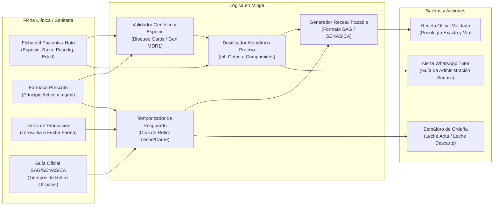

# Caso de Uso 11: Medicina Veterinaria y Pecuaria
### Dosificación Farmacológica Multiespecie, Seguridad Felina y Centinela de Retiro Sanitario en Ganadería

> **Área:** Veterinaria Mixta, Farmacología Animal & Trazabilidad Pecuaria  
> **Relevancia Demo Platanus Hack:** ⭐⭐⭐⭐⭐ *(Seguridad farmacológica crítica, bienestar animal y protección de la inocuidad alimentaria humana)*

---

## 1. Resumen Ejecutivo para el Jurado y Pitch

En la medicina veterinaria moderna de América Latina conviven dos realidades de alta exigencia: las **clínicas menores de mascotas de compañía** (perros y gatos en ciudades) y las **explotaciones pecuarias de clínica mayor** (lecherías bovinas, engordas y ganado ovino en el campo). Muchos médicos veterinarios en regiones intermedias (Osorno, Chillán, Boyacá, Jalisco) ejercen como profesionales mixtos, atendiendo ambas áreas a diario.

* **El Problema:**
  1. *En Animales Menores:* Los gatos no son perros pequeños. Los felinos tienen una deficiencia genética en la enzima hepática glucuroniltransferasa; fármacos de uso común en perros (paracetamol, permetrinas, ácido acetilsalicílico) provocan toxicidad letal en pocas horas. Además, razas caninas de pastoreo (Collie, Pastor Australiano) portan la mutación del gen MDR1 (*ABCB1*), que permite el paso libre de ivermectina al cerebro provocando coma neurotóxico.
  2. *En Ganadería y Lecherías:* El uso de antibióticos (betalactámicos, cefalosporinas) o desparasitantes en vacas lecheras exige respetar rigurosamente el **Período de Resguardo / Tiempo de Retiro Sanitario en Leche y Carne**. Si una lechería entrega un estanque con trazas microscópicas de antibiótico a la planta receptora (Colun, Soprole, Nestlé, Alpina), los tests rápidos de inhibición microbiológica (Delvotest) dan positivo. El camión cisterna completo de 15.000 litros se contamina y debe ser destruido, con multas millonarias para el productor y suspensión de su predio ante el Servicio Agrícola y Ganadero (SAG) o SENASICA.
* **La Solución Minga:** Un flujo clínico determinista que valida la especie y raza antes de autorizar cualquier prescripción, calcula dosis alométricas exactas en mililitros o gotas, y en ganado activa un temporizador de bloqueo sanitario que indica la fecha y hora exacta en que la leche o carne queda liberada para consumo humano.
* **El Momento "¡Ajá!" de la Demo:** El **Nodo Centinela de Toxicidad Felina y Mutación MDR1**, que intercepta prescripciones cruzadas letales antes de emitir la receta médica.

---

## 2. Nivel 1: Aplicación Completa — Calculador Farmacológico Multiespecie y Centinela Sanitario Pecuario



### 2.1 Persona y Problema del Mundo Real
* **Autor Original:** Dr. Felipe Arancibia (Médico Veterinario Mixto, Clínica y Asesoría Ganadera en Río Bueno, Región de Los Lagos, Chile).
* **El Problema en sus palabras:**  
  *"En la mañana atiendo la clínica en el pueblo: perros y gatos. En la tarde recorro lecherías en Río Bueno y La Unión tratando vacas con mastitis y metritis post-parto. En la clínica menor, el error más común de los tutores es que le dan a un gato de 3 kg un cuarto de comprimido de meloxicam de perro para un golpe, y me lo traen al día siguiente con fallo renal anúrico irreversible. En las lecherías, si inyectamos ceftiofur o penicilina a una vaca de alta producción (35 litros diarios) y el ordeñador se confunde de vaca o se le borra la marca de tiza en la ubre, esa leche entra al estanque de frío. A las 2 horas la planta procesadora hace el test de antibióticos en la recepción: 12 millones de pesos chilenos tirados al pozo purinero y una investigación sanitaria del SAG que puede cerrar la lechería. Necesito un sistema en el teléfono que no dependa de si el veterinario está cansado o si el ordeñador anotó en una libreta mojada."*

### 2.2 Entradas, Nodos del Flujo y Salidas

#### Entradas (Inputs)
1. **Ficha Animal (`animal_registro`):** Especie (`felino`, `canino`, `bovino_leche`, `bovino_carne`), raza, peso vivo ($kg$), estado fisiológico (`lactancia`, `gestante`, `pediatrico`).
2. **Medicamento a Administrar (`medicamento_solicitado`):** Principio activo, concentración comercial ($\text{mg/ml}$ o $\text{mg/comprimido}$), vía de administración (`intramuscular`, `subcutanea`, `intramamaria`, `oral`).
3. **Parámetros de Producción Predial:** Número de arete DIIO (Dispositivo de Identificación Individual Oficial del SAG), producción diaria de leche ($L/d\acute{\imath}a$) y turno de ordeña.
4. **Catálogo de Resguardos Oficiales (`resguardos_farmacologicos`):** Días obligatorios de retiro en leche y días de retiro en carne según registro ISP / SAG.

#### Nodos del Flujo
1. **`Validador Genético y de Especie (MDR1 / Felino)` (Nodo Nivel 3):** Bloquea de inmediato la ejecución si se detecta una contraindicación absoluta:
   * Especie = Felino + Fármaco $\in$ `{Paracetamol, Permetrina, Carprofeno, Aspirina}` ➔ **BLOQUEO ROJO FATAL**.
   * Especie = Canino + Raza $\in$ `{Collie, Pastor Ovejero Australiano, Border Collie}` + Fármaco $\in$ `{Ivermectina, Moxidectina altas dosis}` ➔ **BLOQUEO POR RIESGO MUTACIÓN MDR1**.
2. **`Dosificador Alométrico Multiespecie`:** Calcula la dosis terapéutica exacta en mililitros:
   $$\text{Volumen\_ml} = \frac{\text{Peso\_kg} \times \text{Dosis\_mg\_por\_kg}}{\text{Concentracion\_mg\_por\_ml}}$$
3. **`Temporizador de Resguardo Sanitario (Días de Retiro)`:** Calcula la fecha y hora exacta de liberación:
   $$\text{Fecha\_Liberacion} = \text{Fecha\_Ultima\_Dosis} + \text{Dias\_Retiro\_Leche}$$
   Emite estado de ordeña: **DESCARTE OBLIGATORIO** hasta cumplir la ventana.
4. **`Generador de Receta Médico-Veterinaria Retenida`:** Emite el documento legal con número de colegiado y trazabilidad SAG.

#### Salidas (Outputs)
* **Receta Oficial Digital:** Documento para el tutor o encargado de botiquín del predio con posología exacta (ej. "Administrar exactamente $0.12\text{ ml}$ cada 24 hrs por 3 días").
* **Semáforo y Alerta de Ordeña en Finca:** Cartel digital para la sala de ordeña: Arete #4520 en **ROJO** (Leche de descarte a terneros pasteurizada hasta el 26 de Noviembre a las 06:00 AM).
* **Guía de Cuidado por WhatsApp para el Tutor de Mascota:** Advertencias claras en lenguaje humano sobre efectos secundarios y signos de alarma.

---

### 2.3 Diff de Dominio: De Lechería Bovina Chilena a Caprinos y Equinos en Boyacá (Chile ➔ Colombia)

* **Adaptadora:** Dra. Jimena Paredes (Médica Veterinaria Especialista en Hatos Caprinos y Equinos Deportivos, Ubaté, Boyacá, Colombia).
* **El Contexto de Jimena:** En Boyacá, Jimena trabaja con rebaños caprinos lecheros (cabras Saanen y Alpina) para queserías artesanales gourmet, y criaderos de caballos de Paso Fino Colombiano. En cabras, el metabolismo hepático es significativamente más acelerado que en vacas, lo que suele requerir dosis más altas de antiparasitarios pero tiempos de retiro en leche caprina que no coinciden con los prospectos vacunos. En equinos deportivos, el control antidopaje de la Federación Ecuestre Internacional (FEI) prohíbe taxativamente la presencia de cualquier traza de AINEs (Flunixin meglumine o Fenilbutazona) durante competencias oficiales.
* **Interacción con el Agente:**  
  *Jimena:* *"Agente, tomo el flujo del Dr. Arancibia, pero quiero adaptarlo a mis cabras lecheras en Ubaté y a los caballos de paso fino. En cabras la ivermectina requiere 1.5 veces la dosis de oveja por su rápido metabolismo, pero el queso de cabra no puede llevar ni una pizca de antibiótico. Y en los caballos necesito calcular la ventana de aclaramiento FEI para que no nos descalifiquen por doping."*

```
┌────────────────────────────────────────────────────────────────────────┐
│                   TARJETA DE DIFF DE DOMINIO                           │
│   Herramienta: "Calculador Farmacológico Multiespecie & Retiro"        │
│   De: Dr. Felipe Arancibia (Chile) ➔ A: Dra. Jimena Paredes (Colombia) │
├────────────────────────────────────────────────────────────────────────┤
│ 1. Adaptación de Especies Zootécnicas:                                 │
│    - Chile: Bovinos de Leche y Carne (Holstein / Overo Colorado).      │
│    - Colombia: Caprinos Lecheros (Saanen/Alpina) y Equinos de Paso.   │
│                                                                        │
│ 2. Ajuste Farmacológico de Metabolismo Caprino:                        │
│    - Factor metabólico caprino: Dosis de antiparasitarios x 1.5.       │
│    - Retiro en leche caprina: Ajustado según normativa ICA Colombia.   │
│                                                                        │
│ 3. Módulo Antidopaje Equino Deportivo:                                 │
│    - Protocolo añadido: Ventana de eliminación FEI para Flunixin y     │
│      Fenilbutazona (mínimo 7 días pre-competencia).                    │
│    - Bloqueo automático de recetas con analgésicos 10 días antes de    │
│      la feria ecuestre registrada.                                     │
│                                                                        │
│ 4. Estado de Nodos:                                                    │
│    - Validador felino y canino: Conservado intacto para consulta.      │
│    - Temporizador de retiro: 100% reutilizado con constantes ICA.     │
└────────────────────────────────────────────────────────────────────────┘
```
Jimena acepta el Diff. El flujo queda adaptado para proteger tanto la inocuidad de los quesos de cabra como el cumplimiento antidopaje de los equinos.

---

### 2.4 Smart Merge: La Mejora Comunitaria que Vuelve a Todos

* **El Aporte Comunitario:** Dr. Cristián Valenzuela, médico veterinario de fauna silvestre en un centro de rescate de Temuco, aporta un desarrollo indispensable para emergencias no tradicionales:
  *"A veces nos traen a la clínica una lechuza atropellada, un pudú herido por perros o un conejo de mascota. Si calculas la dosis de un antibiótico o analgésico por simple regla de tres de peso ($mg/kg$) en un animal de $800\text{ gramos}$, lo subdosificas o intoxicas, porque la tasa metabólica basal no escala linealmente con el peso, sino según la ley de Kleiber de superficie metabólica ($Peso^{0.75}$)."*
* **El Nuevo Nodo:**  
  `Calculador Alométrico Exponencial para Fauna Silvestre y Exóticos ($BMR = k \cdot W^{0.75}$)`.
* **Cómo opera el Smart Merge:**  
  Cristián sube el nodo al Hub.
  1. Minga detecta que Felipe (Chile) y Jimena (Colombia) usan el dosificador alométrico base.
  2. El agente notifica a Felipe en Osorno:
     > *"Un especialista en fauna silvestre añadió el nodo de dosificación alométrica de Kleiber para aves, roedores y fauna no convencional. ¿Deseas incorporarlo como opción secundaria cuando el paciente no sea perro, gato ni bovino? Tus tablas de ganado lechero se mantendrán idénticas."*
  3. Felipe acepta. La próxima vez que un vecino le lleva un ave de corral o un pudú lesionado, el sistema calcula la dosis biológicamente correcta sin riesgo.

---

## 3. Nivel 2: Módulo Reutilizable — Monitoreo de Curva Sanitaria y Calendario Reproductivo en Ganado Bovino

### 3.1 Persona y Problema del Mundo Real
* **Autor Original:** Dr. Mauricio Neira (Asesor Veterinario de Cooperativas Lecheras, Osorno, Chile).
* **El Problema del Oficio:**  
  *"En una lechería de 300 vacas, el dinero se pierde si la vaca pasa muchos días vacía sin preñarse (Días Abiertos > 110) o si se atrasa la vacunación contra el Complejo Respiratorio Bovino (IBR, DVB) y la Leptospira. Si las vacas abortan en el segundo tercio de gestación, pierdes la lactancia completa del año siguiente. Necesitamos un calendario reproductivo automatizado que avise la fecha exacta de sincronización de celos, inseminación y vacunación pre-parto."*

### 3.2 Lógica del Módulo (Empaquetado como Flujo como Nodo - ADR 0016)
* **Puertos de Entrada:**
  * `Registro_Partos_Bovinos` (Tabla [arete_diio, fecha_ultimo_parto, numero_partos, dias_en_leche])
  * `Protocolo_Sincronizacion` (Texto: 'J-Synch', 'Ovsynch', 'Celo Natural')
  * `Resultados_Palpacion_Ecografia` (Tabla [arete_diio, estado_reproductivo: vacia / preñada])
* **Sub-Nodos Internos:**
  1. `Calculador de Intervalo Parto-Primer Servicio`: Verifica si la vaca superó el Período de Espera Voluntario (PEV = 50 días).
  2. `Programador de Dispositivo Progestágeno y Prostaglandina`: Genera el cronograma de inyección de hormonas con días y horas exactas.
  3. `Alerta de Vacunación Preparto (Secado de la Vaca)`: Programa la vacuna contra diarrea neonatal en terneros a los 60 días antes de la fecha probable de parto.
* **Puertos de Salida:**
  * `Lista_Manejo_Semanal` (Tabla de tareas para el veterinario y el inseminador)
  * `Indice_Dias_Abiertos_Promedio` (Escalar días, meta $\le 115\text{ días}$)
  * `Semaforo_Riesgo_Aborto` (Alerta si hay más del $3\%$ de pérdidas de preñez en el hato)

### 3.3 Adaptación (Diff de Dominio)
* **Adaptador:** Javier (Ganadero de Cría y Carne en Coyhaique, Patagonia Chilena).
* **Diff:** Javier cría ganado Angus a pastoreo extensivo en la cordillera, con monta natural estacional de 3 meses en verano. El agente adapta el módulo eliminando la inseminación artificial a tiempo fijo y programando la entrada y salida de toros marcadores, sincronizando el diagnóstico de preñez en otoño antes de las nevadas.

---

## 4. Nivel 3: Nodo Individual — Calculador de Dosis Segura y Alerta de Toxicidad Felina de AINEs
### ⭐ La Regla de Oro que Salva la Vida de Felinos

### 4.1 El Dolor Técnico y de Negocio
El meloxicam es un antiinflamatorio no esteroideo (AINE) excelente para el dolor osteoarticular, pero su margen terapéutico en gatos es sumamente estrecho:
* **El Peligro Real:**  
  La presentación comercial veterinaria estándar oral de meloxicam viene a **$1.5\text{ mg/ml}$** (formulada con jeringa dosificadora graduada en kilos para perros). La dosis segura felina de mantenimiento aprobada internacionalmente es de **solo $0.05\text{ mg/kg}$ cada 24 horas**.
  Para un gato adulto promedio de **$3.0\text{ kg}$**:
  $$\text{Dosis requerida} = 3.0\text{ kg} \times 0.05\text{ mg/kg} = 0.15\text{ mg}$$
  $$\text{Volumen exacto} = \frac{0.15\text{ mg}}{1.5\text{ mg/ml}} = 0.10\text{ ml}\quad (\approx 2 \text{ a } 3\text{ gotas})$$
* **El Error Fatal Tradicional:**  
  El veterinario novato o el dueño usa la jeringa con escala canina y marca "3 kg de perro". ¡La escala de perro dosifica a $0.10 - 0.20\text{ mg/kg}$! Le administra al gato **$0.30 - 0.40\text{ ml}$** (el triple o cuádruple de la dosis máxima). En 48 a 72 horas, el gato presenta necrosis papilar renal, vómitos urémicos y falla renal terminal aguda.
* **La Regla del Nodo Minga:** Bloquea cualquier dosis que supere $0.05\text{ mg/kg}$ en felinos, traduce la cantidad a gotas calibradas y emite una advertencia roja en pantalla exigiendo confirmación explícita de hidratación adecuada del paciente.

### 4.2 Manifiesto del Nodo en Minga (`veterinary_feline_nsaid_dosage_guard.json`)

```json
{
  "id": "node_veterinary_feline_nsaid_dosage_guard",
  "name": "Dosificador Seguro de AINEs y Alerta Felina",
  "category": "Farmacología Veterinaria",
  "version": "1.0.0",
  "author": "Asociación de Médicos Veterinarios de Felinos y Pequeños Animales",
  "description": "Calcula el volumen exacto en mililitros y gotas de meloxicam y otros analgésicos para gatos, previniendo sobredosis nefrotóxicas y bloqueando presentaciones comerciales peligrosas.",
  "inputs": [
    {
      "id": "paciente_mascota",
      "name": "Ficha del Paciente",
      "type": "Tabla",
      "description": "Tabla [id_mascota, nombre, especie, peso_kg, creatinina_serica_mg_dl]"
    }
  ],
  "params": [
    {
      "id": "farmaco_analgesico",
      "title": "Antiinflamatorio Seleccionado",
      "type": "string",
      "default": "meloxicam_oral",
      "enum": ["meloxicam_oral", "ketoprofeno_inyectable", "paracetamol_prohibido"]
    },
    {
      "id": "fase_tratamiento",
      "title": "Fase de Dosis",
      "type": "string",
      "default": "mantenimiento_dia_2_en_adelante",
      "enum": ["ataque_dia_1", "mantenimiento_dia_2_en_adelante"]
    }
  ],
  "outputs": [
    {
      "id": "volumen_seguro_ml",
      "name": "Volumen a Administrar (ml)",
      "type": "Escalar",
      "description": "Volumen exacto dosificable con jeringa de insulina o tuberculina (ml)."
    },
    {
      "id": "equivalencia_gotas",
      "name": "Dosis en Gotas",
      "type": "Escalar",
      "description": "Equivalencia para gotero calibrado de 20 gotas/ml."
    },
    {
      "id": "alerta_toxicidad",
      "name": "Semáforo Toxicológico",
      "type": "Texto",
      "description": "Advertencia crítica sobre función renal o bloqueo absoluto."
    }
  ],
  "sqlTemplate": "SELECT id_mascota, nombre, CASE WHEN LOWER(especie) = 'felino' AND '{{params.farmaco_analgesico}}' = 'paracetamol_prohibido' THEN 0.0 WHEN LOWER(especie) = 'felino' AND '{{params.farmaco_analgesico}}' = 'meloxicam_oral' THEN CASE WHEN '{{params.fase_tratamiento}}' = 'ataque_dia_1' THEN ROUND((peso_kg * 0.10) / 1.5, 3) ELSE ROUND((peso_kg * 0.05) / 1.5, 3) END ELSE ROUND((peso_kg * 0.10) / 1.5, 3) END as volumen_seguro_ml, CASE WHEN LOWER(especie) = 'felino' THEN ROUND((CASE WHEN '{{params.fase_tratamiento}}' = 'ataque_dia_1' THEN (peso_kg * 0.10) / 1.5 ELSE (peso_kg * 0.05) / 1.5 END) * 20.0, 0) ELSE 0.0 END as equivalencia_gotas, CASE WHEN LOWER(especie) = 'felino' AND '{{params.farmaco_analgesico}}' = 'paracetamol_prohibido' THEN 'BLOQUEO LETAL: Paracetamol es 100% mortal en gatos por deficiencia de glucuroniltransferasa.' WHEN LOWER(especie) = 'felino' AND creatinina_serica_mg_dl > 1.6 THEN 'ADVERTENCIA RENAL: Paciente con azoemia. Contraindicado uso de AINEs; preferir opioides (Buprenorfina).' ELSE 'Dosis felina segura calculada. Utilizar jeringa de tuberculina de 1ml, NUNCA jeringa con graduación de perro.' END as alerta_toxicidad FROM {{inputs.paciente_mascota}}"
}
```

### 4.3 Demostración de Ejecución en Vivo

```
PACIENTE: "Mishka", Gata mestiza hembra, 3.2 kg. Creatinina: 1.1 mg/dl (normal).
Motivo: Inflamación post-esterilización (Día 2).
Fármaco: Meloxicam oral (gotero comercial canino 1.5 mg/ml).

❌ ERROR CLÍNICO FRECUENTE (Uso de escala canina de la jeringa):
   El tutor toma la jeringa provista en la caja que dice "kg de perro" y sube el émbolo hasta la marca "3".
   La marca "3 kg de perro" descarga: 0.20 ml = 0.30 mg de meloxicam.
   Dosis real recibida por la gata: 0.30 mg / 3.2 kg = 0.094 mg/kg (casi el DOBLE de la dosis segura diaria).
   En 3 días: Gastritis ulcerativa, insuficiencia renal aguda secundaria.

✅ NODO MINGA DOSIFICADOR FELINO:
   Especie: Felino | Peso: 3.2 kg | Fase: Mantenimiento (0.05 mg/kg).
   Dosis objetivo en mg: 3.2 * 0.05 = 0.16 mg.
   Volumen calculado: 0.16 mg / 1.5 mg/ml = 0.107 ml.
   Equivalencia en gotas: 2 gotas exactas.
   INSTRUCCIÓN AUTOMÁTICA EN RECETA:
   "Administrar 2 gotas (0.1 ml) con jeringa de 1ml una vez al día con alimento.
    PROHIBIDO USAR LA JERINGA CANINA INCLUIDA EN LA CAJA".
   RESULTADO: Alivio perfecto del dolor, riñones 100% protegidos.
```

---

## 5. Ficha del Componente para el Hub de Minga

```json
{
  "id": "flow_veterinary_multispecies_dosing_and_withdrawal_v1",
  "kind": "flow",
  "name": "Calculador Farmacológico Multiespecie y Centinela Sanitario",
  "summary": "Protege a mascotas de toxicidades de especie (felinos/MDR1) y garantiza el cumplimiento estricto del período de retiro de fármacos en ganado lechero y de carne.",
  "inputs": [
    { "name": "datos_animal", "type": "Tabla" },
    { "name": "prescripcion_farmaco", "type": "Tabla" },
    { "name": "catalogo_retiros", "type": "Tabla" }
  ],
  "outputs": [
    { "name": "volumen_exacto_ml", "type": "Escalar", "unit": "ml" },
    { "name": "fecha_liberacion_leche", "type": "Texto" },
    { "name": "receta_sag_pdf", "type": "Texto" }
  ],
  "assumptions": [
    "La concentración del fármaco se especifica con precisión de marbete.",
    "Los días de resguardo se calculan a partir de la última dosis administrada."
  ],
  "context": {
    "domain": "veterinaria & agropecuaria",
    "discipline": "farmacología animal & clínica mixta",
    "region": "Latinoamérica (Chile / Colombia / México)"
  },
  "lineage": {
    "author": "felipe_arancibia",
    "forks_count": 13,
    "stars": 52
  }
}
```

---

## 6. Guía de Ejecución del Pitch de 45 Segundos

1. **Abre el flujo del Dr. Felipe Arancibia en Osorno:** Muestra la dualidad clínica: una gata en la sala de examen y una vaca lechera tratada con penicilina.
2. **Simula la prescripción para la gata:** Ingresa meloxicam canino de $1.5\text{ mg/ml}$. El nodo *Centinela Felino* recalcula al instante la dosis a $0.10\text{ ml}$ (2 gotas) y emite la alarma en rojo para no usar la jeringa canina graduada.
3. **Pasa a la vaca lechera:** Selecciona Ceftiofur intramuscular en una vaca de 30 litros. El nodo de resguardo calcula: *"Retiro en leche: 72 horas. Ordeña bloqueada hasta el Viernes a las 07:00 AM"*. Muestra cómo esto ahorra una multa de $12.000 USD por cisterna contaminada.
4. **Haz el Fork a Boyacá (Colombia):** La Dra. Jimena adapta el flujo a cabras lecheras y caballos de paso con el **Diff de Dominio** en segundos. ¡Ciencia veterinaria rigurosa que salva vidas y protege la comida de todos!
