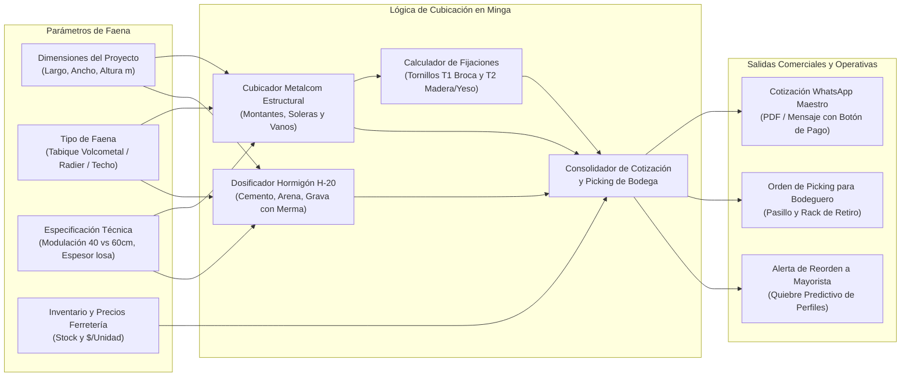

# Caso de Uso 12: Ferreterías y Materiales de Construcción
### Cubicación Rápida de Obra para Maestros y Contratistas, Cotización en Mesón y Reposición Predictiva

> **Área:** Ferreterías de Barrio, Corralones de Materiales & Edificación Ligera  
> **Relevancia Demo Platanus Hack:** ⭐⭐⭐⭐⭐ *(Ahorro de horas en el mesón de venta, fidelización de maestros de obra y reducción de devoluciones)*

---

## 1. Resumen Ejecutivo para el Jurado y Pitch

En América Latina, la autoconstrucción, la ampliación de viviendas y la remodelación residencial mueven más del $60\%$ de las ventas de materiales de construcción a través de la red capilar de ferreterías de barrio y corralones locales. El maestro carpintero, albañil o contratista pyme acude al mesón de la ferretería no con un plano CAD detallado, sino con un bosquejo a mano o las medidas del terreno en un pedazo de cartón.

* **El Problema:** La cubicación de materiales en el mesón es un cuello de botella caótico. El dependiente de la ferretería tarda 25 minutos con una calculadora manual intentando estimar cuántos perfiles de acero galvanizado (Metalcom / Steel Framing), placas de yeso-cartón (Volcanita), sacos de cemento, áridos y tornillos autoperforantes se necesitan para un radier o una ampliación. Si calcula de menos por olvidar los montantes dobles en vanos de puertas o las soleras estructurales, el maestro se queda sin material a mitad de jornada, pierde el jornal del ayudante y vuelve furioso. Si calcula de más, el cliente exige devolver perfiles doblados o placas astilladas, generando pérdidas de inventario y fricción comercial.
* **La Solución Minga:** Un asistente técnico ferretero determinista: el dependiente o el propio maestro ingresa en una tablet o celular las medidas básicas de la faena ($Largo, Ancho, Alto$), el tipo de terminación (cerámica requiere montantes a 40 cm; pintura a 60 cm) y el espesor del radier. En 5 segundos, Minga desglosa la lista exacta de materiales compensada con factores de despunte y fijaciones por metro cuadrado, cotiza con precios del stock de bodega y envía la orden por WhatsApp al maestro con código de barra para caja.
* **El Momento "¡Ajá!" de la Demo:** El **Nodo Cubicador de Tabique Metalcom con Factor de Encuentro y Dintel**, que corrige el error típico de la fórmula simplista de división, asegurando que nunca falte un perfil en obra.

---

## 2. Nivel 1: Aplicación Completa — Asistente Técnico Ferretero: Cubicación y Cotización en Mostrador



### 2.1 Persona y Problema del Mundo Real
* **Autor Original:** Don Hernán Poblete (Dueño de "Ferretería El Tornillo", San Bernardo, Santiago, Chile).
* **El Problema en sus palabras:**  
  *"A las 8:30 de la mañana tengo la ferretería llena con 8 maestros apurados haciendo fila. Llega don Lucho y me dice: 'Don Hernán, voy a hacer una ampliación de un segundo piso de 6 metros de largo por 3 de ancho y 2.40 de alto con Metalcom y Volcanita de 15mm; calcúleme al tiro todo lo que necesito para mandar la camioneta'. Me pongo a sacar cuentas con un lápiz pasta en una bolsa de clavos: calculo los montantes a la rápida dividiendo por 0.40, pero se me olvida sumar las esquinas de encuentro, las soleras de amarre y los refuerzos de la ventana. Don Lucho se lleva los perfiles, y a las 3 de la tarde me llama indignado desde la obra porque le faltaron 5 montantes C y 300 tornillos autoperforantes; tuvo que parar al carpintero y gastarse $10.000 pesos en un flete extra. El ferretero vecino ya le quitó dos clientes porque tiene un sistema más rápido. Necesito una herramienta que en 3 clics me entregue la cotización clavada, con los tornillos justos y la ganancia protegida."*

### 2.2 Entradas, Nodos del Flujo y Salidas

#### Entradas (Inputs)
1. **Geometría de la Faena (`geometria_faena`):** Longitud lineal de muros ($L\text{ en metros}$), altura de piso a cielo ($H\text{ en metros}$), número de esquinas en "L", número de intersecciones en "T" y cantidad de vanos de puertas y ventanas.
2. **Revestimiento y Modulación (`criterio_constructivo`):** Tipo de placa (Volcanita/Yeso-cartón estándar 10mm, 12.5mm o 15mm, o Fibrocemento Permanit), modulación entre ejes de perfiles ($40\text{ cm}$ si lleva revestimiento cerámico pesado o exterior; $60\text{ cm}$ para tabique interior pintado).
3. **Área de Pavimento Radier (`radier_dimensiones`):** Superficie en metros cuadrados ($m^2$) y espesor de la losa (habitualmente $8\text{ cm}$ para tránsito peatonal o $10-12\text{ cm}$ para entrada de autos).
4. **Catálogo de Precios y Stock (`inventario_ferreteria`):** Precio de lista de perfiles C de $60 \times 38 \times 0.85\text{ mm}$, soleras U de $61 \times 20 \times 0.85\text{ mm}$, placas de $1.20 \times 2.40\text{ m}$, sacos de cemento de 25 kg, metros cúbicos de arena y gravilla, y cajas de 1.000 tornillos T1 broca y T2 cabeza de trompeta.

#### Nodos del Flujo
1. **`Cubicador Metalcom Estructural con Encuentros y Vanos` (Nodo Nivel 3):** Calcula los montantes exactos:
   $$\text{Montantes} = \left(\frac{L}{\text{modulacion}} + 1\right) + (2 \times \text{esquinas\_L}) + (2 \times \text{cruces\_T}) + (2 \times \text{vanos})$$
   Calcula las soleras canal U (superior e inferior):
   $$\text{Soleras\_U} = \frac{2 \times L}{3.0\text{ m}} \times 1.10\quad (\text{con } 10\% \text{ despunte})$$
2. **`Dosificador de Radier de Hormigón H-20 con Mermas`:** Calcula el volumen de hormigón ($V = \text{Área} \times \text{Espesor} \times 1.08$) y dosifica en proporción estándar $1:2:3$:
   * Sacos de cemento Melón/Polpaico de 25 kg: $7.5\text{ sacos por } m^3$.
   * Arena gruesa lavada: $0.55\text{ } m^3\text{ por } m^3$.
   * Grava/gravilla: $0.75\text{ } m^3\text{ por } m^3$.
   * Agua: $180\text{ litros por } m^3$.
3. **`Calculador de Fijaciones y Sellantes`:**
   * Tornillos T1 cabeza de lenteja punta broca (para unir perfil con perfil): 4 tornillos por nudo solera/montante.
   * Tornillos T2 cabeza de trompeta para placa yeso-cartón: 28 tornillos por placa de $1.20 \times 2.40\text{ m}$ (espaciados cada 25 cm en bordes y 30 cm al centro).
   * Cinta para juntura y tinetas de masilla base / pasta muro.
4. **`Consolidador de Cotización Comercial con Descuento por Volumen`:** Aplica margen del $28\%$ al $35\%$, redondea a cajas enteras de tornillos y genera el total con IVA desglosado.

#### Salidas (Outputs)
* **Cotización WhatsApp para el Maestro:** Formato limpio y profesional con botón de transferencia bancaria directa:
  * *🏗️ Ferretería El Tornillo — Presupuesto Faena Don Lucho:*  
    *18 Montantes C 60x38, 8 Soleras U 61x20, 14 Placas Volcanita 12.5mm, 1 Criba 1.000 Tornillos T2, 1 Criba 500 Tornillos T1, 1 Tineta Pasta Muro 20kg. Total: $284.500 CLP (IVA incl).*
* **Vale de Entrega para Bodega:** Especificación con pasillo y nivel de rack para el bodeguero, acelerando la carga de la camioneta a 5 minutos.
* **Alerta Preventiva de Inventario:** Si el stock de montantes cae por debajo de 50 unidades, el flujo genera la sugerencia de compra semanal al distribuidor mayorista de perfiles de acero (Cintac / Tupemesa).

---

### 2.3 Diff de Dominio: De Metalcom en Chile a Albañilería Tradicional en México (Chile ➔ México)

* **Adaptador:** Carlos Mendoza (Dueño de "Materiales y Ferretería La Curva", Tlaquepaque, Guadalajara, Jalisco, México).
* **El Contexto de Carlos:** En México, la ampliación popular no se hace comúnmente con perfiles de acero galvanizado liviano (drywall/tabique ligero), sino con **albañilería tradicional húmeda pesada**: muros de **tabique rojo recocido** ($7 \times 14 \times 28\text{ cm}$) o bloque de concreto hueco, confinados con **castillos y cerramientos de concreto armado colados en obra** con 4 varillas corrugadas de acero de $3/8"$ ($f_y = 4200\text{ kg/cm}^2$) y estribos de alambrón liso de $1/4"$ cada 15 o 20 cm, amarrados con alambre recocido calibre 18. Además, los sacos de cemento gris en México son de **50 kg** (Tolteca, Moctezuma, Cemex), a diferencia de Chile donde por ley de ergonomía laboral son de 25 kg.
* **Interacción con el Agente:**  
  *Carlos:* *"Agente, quiero el cubicador de Don Hernán de Chile, pero aquí en Jalisco casi nadie usa Metalcom para ampliaciones de casa. Los maestros pegan tabique rojo recocido con mortero de cemento-arena o calhidra, y cuelan castillos con varilla de 3/8 y estribos de alambrón. Y los bultos de cemento aquí son de 50 kilos, no de 25."*

```
┌────────────────────────────────────────────────────────────────────────┐
│                   TARJETA DE DIFF DE DOMINIO                           │
│   Herramienta: "Asistente Técnico Ferretero de Cubicación de Obra"     │
│   De: Don Hernán (Chile) ➔ A: Carlos Mendoza (México)                  │
├────────────────────────────────────────────────────────────────────────┤
│ 1. Cambio de Sistema Constructivo Principal:                           │
│    - Chile: Tabique ligero Metalcom (Montantes/Soleras) + Volcanita.   │
│    - México: Mampostería de Tabique Rojo Recocido + Castillos de        │
│      concreto armado (15x15 cm o 15x20 cm).                            │
│                                                                        │
│ 2. Fórmulas de Rendimiento y Cubicación:                               │
│    - Piezas de tabique rojo por m² de muro: 55 a 58 piezas             │
│      (considerando junta de mortero de 1.5 cm y 5% de merma/rotura).   │
│    - Armadura de Castillo: 4 varillas de 3/8" por metro lineal +       │
│      6.5 estribos de alambrón 1/4" por metro + 25g alambre recocido.  │
│                                                                        │
│ 3. Unidad de Empaque y Presentación de Cemento:                        │
│    - Presentación: Bulto de 25 kg (Chile) ➔ Bulto de 50 kg (México).   │
│    - Mortero de pega: Cemento gris + Calhidra (hidratada) + Arena río. │
│                                                                        │
│ 4. Estado de Nodos:                                                    │
│    - Módulo de radier / firme de concreto: Adaptado a bultos de 50 kg. │
│    - Generador de cotización y mensaje WhatsApp: Conservado al 100%    │
│      con precios en MXN ($) y jerga de obra mexicana ('Maestro de obra│
│      / Fierrero').                                                     │
└────────────────────────────────────────────────────────────────────────┘
```
Carlos aprueba el Diff. La ferretería en Guadalajara ahora cotiza tabique rojo, varillas, alambrón y bultos de cemento de 50 kg con precisión quirúrgica en el mostrador.

---

### 2.4 Smart Merge: La Mejora Comunitaria que Vuelve a Todos

* **El Aporte Comunitario:** Don Héctor Cárdenas, dueño de una ferretería industrial en Antofagasta (norte costero de Chile), detecta un error técnico recurrente en techumbres y fijaciones:
  *"Muchos maestros compran tornillos autoperforantes zincados brillantes comunes para techos de zinc en ciudades costeras. A los 6 meses de neblina marina (camanchaca), el zinc electrolítico barato se corroe por la salinidad, la cabeza del tornillo se desprende y con la primera racha de viento fuerte de 60 km/h el techo sale volando. En zonas costeras o de viento, la norma exige fijaciones con recubrimiento Ruspert clase 3 o 4, golilla de acero galvanizado con goma EPDM vulcanizada y ganchos de anclaje de ala ancha."*
* **El Nuevo Nodo:**  
  `Factor de Corrosión Marina y Grado de Fijaciones para Viento y Costas`.
* **Cómo opera el Smart Merge:**  
  Héctor publica el nodo en el Hub de Minga.
  1. Minga analiza los flujos ferreteros de Don Hernán (San Bernardo) y Carlos Mendoza (Guadalajara). Detecta que ambos cotizan techumbres y tornillos.
  2. El agente notifica a Don Hernán:
     > *"Un colega de Antofagasta publicó el nodo de fijaciones resistentes a corrosión marina y viento. ¿Deseas incorporarlo como recomendación automática cuando el cliente elija techumbre metálica exterior? Tus tablas de tabiques y precios de stock no cambiarán."*
  3. Don Hernán lo aprueba. Ahora, si un cliente de San Bernardo menciona que construirá una cabaña en El Quisco o Pichilemu, el sistema sugiere automáticamente tornillos Ruspert clase 3 con golilla EPDM, evitando demandas por fallas de techo.

---

## 3. Nivel 2: Módulo Reutilizable — Punto de Reorden Predictivo de Perfiles de Acero y Fijaciones por Paquetes de Faena

### 3.1 Persona y Problema del Mundo Real
* **Autor Original:** Gabriel Astudillo (Jefe de Abastecimiento de Cadena Ferretera Comunal, Buin, Chile).
* **El Problema del Oficio:**  
  *"En la ferretería, las ventas de materiales de construcción no son independientes: son correlacionadas. Nadie compra 20 montantes de acero sin llevar soleras, placas de volcanita y cajas de tornillos T2. Si pides perfiles a la acería cuando ya no te queda ninguno en la estantería, el camión tarda 5 días hábiles en despachar. Durante esos 5 días dejas de vender no solo perfiles, sino todo el resto de la faena ($2.000.000 CLP en ventas perdidas). Necesitamos un módulo de reposición que mire el ritmo de ventas de paquetes completos de obra y lance la orden de compra antes de que se vacíe el rack."*

### 3.2 Lógica del Módulo (Empaquetado como Flujo como Nodo - ADR 0016)
* **Puertos de Entrada:**
  * `Ventas_Ultimos_14_Dias` (Tabla de boletas con ítems de construcción ligera)
  * `Stock_Actual_Bodega` (Tabla [sku, nombre, stock_unidades, punto_reorden_minimo])
  * `Tiempo_Entrega_Distribuidor_Dias` (Lead time del proveedor mayorista, ej. 4 días)
* **Sub-Nodos Internos:**
  1. `Extractor de Tasa de Consumo Correlacionado`: Modela la relación de consumo por cada $100\text{ metros lineales}$ de perfil estructural:
     $$\text{Tornillos\_T2} = 350 \times \left(\frac{\text{Perfiles\_C}}{18}\right), \quad \text{Placas} = 14 \times \left(\frac{\text{Perfiles\_C}}{18}\right)$$
  2. `Calculador de Días de Inventario Restante`:
     $$\text{Dias\_Stock} = \frac{\text{Stock\_Actual}}{\text{Consumo\_Diario\_Promedio}}$$
  3. `Generador de Alerta de Pedido Consolidado`: Si $\text{Dias\_Stock} \le \text{Lead\_Time} + 2\text{ días de seguridad}$, dispara orden de compra automática al mayorista.
* **Puertos de Salida:**
  * `Sugerencia_Compra_Distribuidor` (Tabla de cantidades óptimas a pedir para completar flete gratis en camión rampla)
  * `Semaforo_Riesgo_Quiebre` (Verde / Amarillo / Rojo por familia de producto)

### 3.3 Adaptación (Diff de Dominio)
* **Adaptador:** Samuel (Corralón de Materiales Pesados en Escobedo, Monterrey, México).
* **Diff:** Samuel adapta la correlación a camiones de volteo de arena y grava por cada tonelada de cemento gris a granel y paquetes de varilla de $3/8"$ en atados de 1 tonelada.

---

## 4. Nivel 3: Nodo Individual — Cubicador de Tabique Metalcom: Montantes a 40cm vs 60cm con Factor de Encuentro y Dintel
### ⭐ El Caso Clave en el Mesón Ferretero

### 4.1 El Dolor Técnico y de Negocio
El cálculo ingenuo del dependiente de mesón consiste en dividir el largo total del tabique por la modulación:
$$\text{Error Tradicional:} \quad \text{Montantes} = \frac{\text{Longitud}}{\text{Modulación}}$$
* **Por Qué Falla en Faena Real:**
  1. **Inicio y Cierre:** Un muro de 6 metros modulado a 40 cm necesita $\frac{6.0}{0.40} = 15$ espacios, lo que requiere **16 montantes** (se olvida el montante de remate inicial).
  2. **Encuentros Estructurales de Esquina:** Cada esquina en "L" requiere **2 montantes adicionales** agrupados para permitir atornillar la placa interior de yeso-cartón.
  3. **Vanos de Puertas y Ventanas:** Cada puerta necesita montantes dobles (jambas estructurales) y alfajías de dintel (+2 montantes por puerta).
* **El Costo del Error:** En una ampliación típica de 24 metros lineales de tabique con 2 puertas y 4 esquinas, la fórmula ingenua calcula $60$ montantes. La necesidad real en obra es de **$74$ montantes**. ¡Faltan 14 perfiles! El maestro interrumpe la obra, pierde la tarde y responsabiliza a la ferretería.

### 4.2 Manifiesto del Nodo en Minga (`hardware_drywall_stud_framing_calculator.json`)

```json
{
  "id": "node_hardware_drywall_stud_framing_calculator",
  "name": "Cubicador de Tabiquería Metalcom Estructural",
  "category": "Ferretería & Construcción",
  "version": "1.1.0",
  "author": "Gremio de Ferreteros y Contratistas Pyme",
  "description": "Calcula el número exacto de perfiles montantes C y soleras U para tabiquería en acero liviano, compensando esquinas en L, cruces en T y refuerzos de vanos.",
  "inputs": [
    {
      "id": "muros_faena",
      "name": "Geometría de Muros",
      "type": "Tabla",
      "description": "Tabla [id_muro, largo_metros, esquinas_l, cruces_t, puertas, ventanas]"
    }
  ],
  "params": [
    {
      "id": "modulacion_ejes",
      "title": "Separación entre Montantes",
      "type": "number",
      "default": 0.40,
      "enum": [0.40, 0.60],
      "unit": "m"
    },
    {
      "id": "largo_comercial_perfil",
      "title": "Longitud Comercial de Perfil",
      "type": "number",
      "default": 3.0,
      "unit": "m"
    }
  ],
  "outputs": [
    {
      "id": "total_montantes_c",
      "name": "Total Montantes C (Piezas)",
      "type": "Escalar",
      "description": "Número de perfiles verticales requeridos con refuerzos de encuentro."
    },
    {
      "id": "total_soleras_u",
      "name": "Total Soleras Canal U (Piezas)",
      "type": "Escalar",
      "description": "Perfiles horizontales superior e inferior con 10% de despunte."
    }
  ],
  "sqlTemplate": "WITH calculo_muro AS (SELECT SUM(CEIL(largo_metros / {{params.modulacion_ejes}}) + 1 + (esquinas_l * 2) + (cruces_t * 2) + (puertas * 2) + (ventanas * 2)) as montantes, SUM(largo_metros * 2) as metros_solera FROM {{inputs.muros_faena}}) SELECT CAST(montantes AS INTEGER) as total_montantes_c, CAST(CEIL((metros_solera * 1.10) / {{params.largo_comercial_perfil}}) AS INTEGER) as total_soleras_u FROM calculo_muro"
}
```

### 4.3 Demostración de Ejecución en Vivo

```
FAENA DEL MAESTRO: Tabique de 12.0 metros de largo, modulación a 40 cm (para recibir cerámica).
Contiene: 2 esquinas en "L", 1 puerta de 80 cm y 1 ventana de 1.20 m.

❌ CÁLCULO TRADICIONAL DEL DEPENDIENTE DE MESÓN:
   Montantes = 12.0 m / 0.40 m = 30 piezas.
   Soleras = (12.0 m * 2) / 3.0 m = 8 piezas.
   RESULTADO EN OBRA:
   - Faltó montante de cierre: +1
   - Faltaron refuerzos en las 2 esquinas en L: +4 (2 por esquina)
   - Faltaron jambas de refuerzo de puerta: +2
   - Faltaron jambas y soporte de ventana: +2
   TOTAL REAL REQUERIDO: 39 montantes.
   ¡FALTARON 9 MONTANTES C EN OBRA! Maestro furioso, faena paralizada.

✅ NODO MINGA CUBICADOR ESTRUCTURAL:
   Montantes base: CEIL(12.0 / 0.40) + 1 = 31 piezas.
   Compensación por 2 esquinas en L: +4 piezas.
   Compensación por 1 puerta: +2 piezas.
   Compensación por 1 ventana: +2 piezas.
   TOTAL MONTANTES C SUGERIDO: 39 piezas exactas.
   Soleras Canal U con 10% despunte: CEIL((24.0 * 1.10) / 3.0) = 9 piezas.
   RESULTADO: 100% de materiales completos en el primer viaje. Cero reclamos.
```

---

## 5. Ficha del Componente para el Hub de Minga

```json
{
  "id": "flow_hardware_store_construction_estimator_v1",
  "kind": "flow",
  "name": "Asistente Técnico Ferretero de Cubicación y Cotización",
  "summary": "Calcula materiales de obra (perfiles Metalcom, placas, radier y tornillos) en el mostrador en menos de 10 segundos con mermas y refuerzos reales.",
  "inputs": [
    { "name": "medidas_obra", "type": "Tabla" },
    { "name": "tipo_terminacion", "type": "Texto" },
    { "name": "precios_inventario", "type": "Tabla" }
  ],
  "outputs": [
    { "name": "cotizacion_cliente_pdf", "type": "Texto" },
    { "name": "lista_picking_bodega", "type": "Tabla" },
    { "name": "total_presupuesto_clp", "type": "Escalar", "unit": "CLP" }
  ],
  "assumptions": [
    "Los perfiles estructurales se suministran en largo comercial estándar de 3.0 metros.",
    "La modulación a 40cm es obligatoria si el tabique soporta peso cerámico o fachada."
  ],
  "context": {
    "domain": "ferretería & construcción",
    "trade": "materiales de obra & edificación ligera",
    "region": "Latinoamérica (Chile / México)"
  },
  "lineage": {
    "author": "hernan_poblete",
    "forks_count": 18,
    "stars": 67
  }
}
```

---

## 6. Guía de Ejecución del Pitch de 45 Segundos

1. **Presenta a Don Hernán en su ferretería en San Bernardo:** Muestra la fila matutina de maestros de obra esperando su turno en el mesón.
2. **Ingresa las medidas de Don Lucho:** Ampliación de 12 metros de tabique con 2 esquinas y 1 puerta.
3. **Muestra el comparador:**
   * La cuenta rápida tradicional entrega 30 perfiles (faltarán 9 en la obra).
   * Minga calcula instantáneamente las 39 piezas requeridas, las 9 soleras, 14 placas y 1.000 tornillos T1/T2 exactos.
4. **Muestra el mensaje de WhatsApp:** El presupuesto formateado se envía al celular del maestro en 2 segundos mientras se imprime el vale para bodega.
5. **Haz el Fork a Guadalajara (México):** El agente adapta perfiles Metalcom por tabique rojo recocido, castillos de concreto con varilla de $3/8"$ y sacos de cemento de 50 kg con el **Diff de Dominio**. ¡La ferretería tradicional transformada en un centro de ingeniería para la comunidad!
