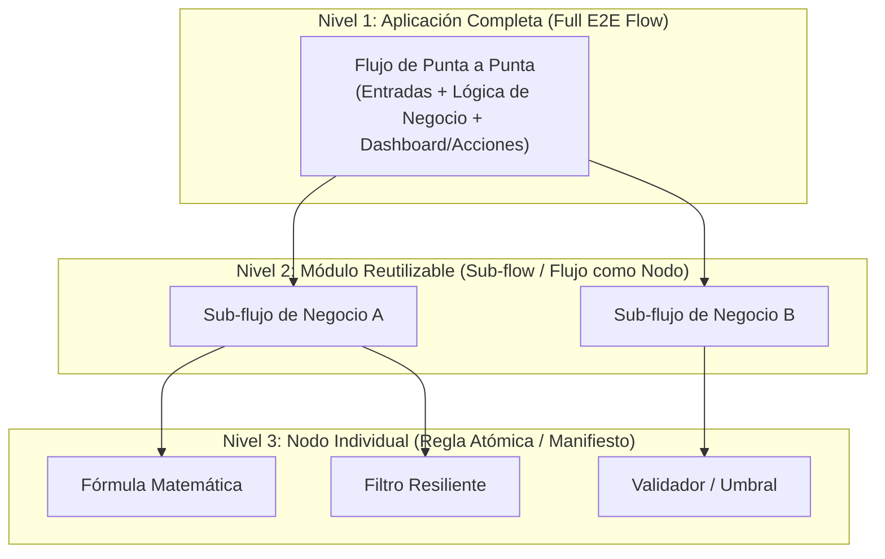

# Catálogo de Casos de Uso — Ecosistema Minga
### Especificación Oficial de Casos de Uso para Jurado, Pitch y Arquitectura Técnica
> **Hackathon Platanus Hack 26 — Proyecto Minga (Team 48)**  
> *"Análisis de datos y automatización que se arma como LEGO, se habla en tu propio oficio y se comparte como una Minga comunitaria."*

---

## 1. Manifiesto y Visión de Producto

En el sur de Chile y en gran parte de Latinoamérica, una **Minga** es una tradición comunitaria ancestral: cuando una familia necesita construir su casa, cosechar antes de que llueva o mover un granero completo por tierra o mar, toda la comunidad se reúne, aporta su fuerza y conocimiento especializado, y al final todos quedan con una infraestructura superior a la que cualquiera podría construir solo.

En el mundo moderno, el conocimiento más valioso de la sociedad reside en personas que conocen su oficio a fondo:
* La ingeniera agrónoma que sabe cuándo se pudre un arándano si la temperatura de pulpa sube de 20°C.
* La médica internista que reconoce el deterioro de un paciente en sala antes de que colapse.
* El profesor de ciencias que enseña a sus alumnos a medir el consumo vampiro de la escuela.
* El almacenero de barrio que sabe cuándo agrupar compras para ganarle al distribuidor mayorista.
* La geógrafa que cruza datos de calidad del aire con niños vulnerables en una comuna periférica.
* El director financiero de una pyme que calcula la morosidad real de los clientes para no quebrar el viernes de sueldos.

**La tragedia actual:** Ninguno de ellos es programador de software. Están atrapados en tres callejones sin salida:
1. **Planillas de Excel frágiles:** Sin trazabilidad, propensas a errores catastróficos, imposibles de colaborar en tiempo real.
2. **Software corporativo inaccesible (Alteryx, Dataiku, KNIME):** Costoso, con curvas de aprendizaje de meses, diseñado para ejércitos de ingenieros de datos en Silicon Valley.
3. **Chatbots de IA aislados (ChatGPT, Claude web):** Respuestas opacas en texto plano, "cajas negras" no reproducibles, alucinaciones silenciosas y silos donde lo que inventa uno nunca beneficia al vecino.

**La Solución Minga:**  
Minga es la plataforma visual colaborativa donde el usuario diseña flujos lógicos arrastrando bloques, asistido por un agente inteligente local que habla su misma jerga profesional. Lo que un profesional crea o mejora, queda encapsulado en un artefacto ejecutable determinista, reutilizable y gobernable, que puede compartirse con el resto de la red.

```
       ┌────────────────────────────────────────────────────────┐
       │                 EL VUELO DE MINGA                      │
       │                                                        │
       │    Profesional de Oficio (Agrónomo, Médico, Profe)     │
       │                         │                              │
       │               Habla en su propia jerga                 │
       │                         ▼                              │
       │           Agente Local de Minga (LLM)                  │
       │                         │                              │
       │              Crea/Modifica Nodos Visuales              │
       │                         ▼                              │
       │          Motor Determinista (Web / DuckDB)             │
       │                         │                              │
       │              Comunidad & Hub Global                    │
       │            (Diff de Dominio + Smart Merge)             │
       └────────────────────────────────────────────────────────┘
```

---

## 2. Taxonomía de Tres Niveles en Minga

Cada caso de uso en este catálogo está modelado en tres niveles arquitectónicos de granularidad:



### Nivel 1: Aplicación Completa (Full E2E Flow)
* **Qué es:** Una solución funcional integral lista para resolver una jornada laboral o un proceso crítico de negocio. Conecta fuentes de datos crudas (sensores, archivos CSV, grabaciones de voz, APIs públicas), procesa la lógica paso a paso y entrega un tablero visual interactivo o dispara acciones automáticas (alertas WhatsApp, reportes PDF, órdenes de compra).
* **Quién la opera:** El profesional final en su día a día.

### Nivel 2: Módulo Reutilizable (Sub-flow / Flujo como Nodo - ADR 0016)
* **Qué es:** Un subconjunto cohesivo de nodos que resuelve una función de dominio específica. Se empaqueta como un "bloque compuesto" con puertos de entrada y salida bien tipados y parámetros configurables. Cualquier flujo puede contraerse y publicarse como un nodo único para ser enchufado en flujos mayores.
* **Quién lo crea:** Analistas avanzados o profesionales que resuelven una sub-rutina estándar de su industria.

### Nivel 3: Nodo Individual (Regla Atómica / Manifiesto JSON)
* **Qué es:** La unidad indivisible de criterio técnico: una fórmula médica, un filtro de tolerancia de sensor, una tasa impositiva legal, un cálculo geométrico. Cada nodo tiene un manifiesto JSON formal con puertos tipados (`Tabla`, `Escalar`, `Texto`, `GeoTabla`, etc.) y un ejecutor determinista (SQL DuckDB o Python acotado).
* **Quién lo crea:** El profesional con su agente o desarrolladores especializados de la comunidad.

---

## 3. Los Dos Pilares Revolucionarios: Diff de Dominio & Smart Merge

Minga no es sólo un editor de nodos; es el primer sistema de control de versiones y colaboración **semántico para no programadores**.

### A. Diff de Dominio (Domain-Specific Visual Diff)
Cuando un profesional clona o adapta una herramienta existente, no ve un galimatías de líneas de código `+` y `-`. Su agente local analiza las alteraciones del grafo y le presenta una tarjeta en el vocabulario exacto de su oficio:

| Nivel Técnico (Git / JSON diff) | Diff de Dominio en Minga (Lo que ve el usuario) |
|---|---|
| `param.cooling_hours: 4 -> 2` | *"Se redujo la ventana crítica de enfriamiento de 4h (arándano) a 2h porque la fresa tiene pared celular más blanda."* |
| `node_replace: enel_chile_rate -> cfe_mx_rate` | *"Se actualizaron los cargos por kWh de Enel Distribución (Chile) a la tarifa doméstica DAC de CFE (México)."* |
| `threshold.spo2: 92 -> 88` | *"Se flexibilizó el umbral de desaturación de oxígeno porque el paciente tiene diagnóstico de EPOC."* |

### B. Smart Merge (Fusión Semántica Comunitaria)
¿Qué ocurre cuando la comunidad en el Hub mejora un nodo (por ejemplo, corrigiendo cómo maneja sensores desconectados), pero 500 agrónomos locales ya han personalizado sus propios umbrales de temperatura y tiempos de cosecha?
* **En el software tradicional:** O se congela la versión y nadie recibe mejoras, o una actualización sobreescribe las personalizaciones locales, arruinando el trabajo.
* **En Minga con Smart Merge:** El motor de grafos desacopla la **lógica estructural del nodo** de los **parámetros de contexto local**. Cuando el nodo base se actualiza en el Hub, el agente evalúa la compatibilidad semántica, aplica el parche algorítmico y preserva intactas las variables locales del profesional, notificándole en lenguaje natural:
  > *"Tu vecino transportista añadió una verificación para camiones con aislamiento térmico. Se ha integrado a tu flujo sin tocar tus horas de corte ni tus umbrales de fruta."*

---

## 4. Matriz Maestra de Casos de Uso Documentados

| Archivo | Industria / Dominio | Autor / Persona | Región | Aplicación Completa | Módulo Reutilizable | Nodo Individual |
|---|---|---|---|---|---|---|
| [01-agronomia.md](file:///Users/gabriels/Proyectos/Jules/platanus-hack-26-cl-team-48/docs/casos-de-uso/01-agronomia.md) | **Agronomía & Frío** | Camila Vergara (Ing. Agrónoma) | Maule, Chile ➔ Zamora, México | Cadena de Frío y Ventana de Cosecha | Monitoreo de Microclima y Heladas Tardías | Filtro Resiliente de Sensores (Null vs 0) ⭐ *Demo Key* |
| [02-salud.md](file:///Users/gabriels/Proyectos/Jules/platanus-hack-26-cl-team-48/docs/casos-de-uso/02-salud.md) | **Salud & Clínica** | Dra. Marcela Baeza (Médica Internista) | Santiago, Chile | Scribe Clínico & Traspaso de Guardia SOAP | Triage NEWS2 & Alerta de Deterioro | Calculador de Dosis por Superficie Corporal |
| [03-educacion.md](file:///Users/gabriels/Proyectos/Jules/platanus-hack-26-cl-team-48/docs/casos-de-uso/03-educacion.md) | **Educación & STEM** | Prof. Andrés Navarro (Prof. de Ciencias) | Temuco, Chile ➔ Puebla, México | Laboratorio Escolar de Consumo Eléctrico | Agrupador Temporal por Bloques Académicos | Detector Robusto de Outliers Escolares (MAD) |
| [04-ventas.md](file:///Users/gabriels/Proyectos/Jules/platanus-hack-26-cl-team-48/docs/casos-de-uso/04-ventas.md) | **Comercio de Barrio** | Matías Pinto (Red de Almacenes) | Valparaíso, Chile ➔ Guadalajara, MX | Radar de Demanda & Compras Colectivas | Punto de Reorden (ROP) con Stock Dinámico | Validador de Margen Neto Tributario (IVA) |
| [05-datos-publicos.md](file:///Users/gabriels/Proyectos/Jules/platanus-hack-26-cl-team-48/docs/casos-de-uso/05-datos-publicos.md) | **Urbanismo & Aire** | Dra. Pamela Smith (Geógrafa Urbana) | Santiago, Chile ➔ Monterrey, México | Observatorio Comunal de Calidad del Aire (SINCA) | Indexador Espacial Hexagonal Uber H3 | Calculador de Isla de Calor Urbano (NDVI vs LST) |
| [06-finanzas.md](file:///Users/gabriels/Proyectos/Jules/platanus-hack-26-cl-team-48/docs/casos-de-uso/06-finanzas.md) | **Finanzas Pyme** | Carlos Henríquez (Director Finanzas Pyme) | Concepción, Chile ➔ Bogotá, Col | Centinela de Flujo de Caja y Cobranza Predictiva | Scoring Dinámico y Curva Real de Pagadores | Calculador de Interés Moratorio Legal Diario |
| [07-energia.md](file:///Users/gabriels/Proyectos/Jules/platanus-hack-26-cl-team-48/docs/casos-de-uso/07-energia.md) | **Energía & BESS** | Ignacio Retamal (Ing. Eléctrico) | Paine, Chile ➔ Querétaro, México | Arbitraje Tarifario en Horas Punta & BESS | Optimizador de Vida Útil BESS (SoH) | Integrador Ventana Móvil 15 Minutos (Tarifa Punta) |
| [08-ingenieria-civil.md](file:///Users/gabriels/Proyectos/Jules/platanus-hack-26-cl-team-48/docs/casos-de-uso/08-ingenieria-civil.md) | **Ingeniería Civil** | Rodrigo Sanhueza (Ing. Civil Estructural) | Concepción, Chile ➔ CDMX, México | Evaluador Post-Sismo de Vulnerabilidad y Daño | Asentamiento por Consolidación (Terzaghi) | Cubicador de Hormigón con Pérdidas de Bombeo |
| [09-tiendas-abarrotes.md](file:///Users/gabriels/Proyectos/Jules/platanus-hack-26-cl-team-48/docs/casos-de-uso/09-tiendas-abarrotes.md) | **Comercio de Barrio** | Doña Rosa Huenteo (Almacenera) | Maipú, Chile ➔ Coyoacán, México | Centinela de Merma de Frescos & Reposición | Canasta de Compra Barrial (Market Basket) | Descuento Dinámico por Vida Útil Residual |
| [10-dentistas.md](file:///Users/gabriels/Proyectos/Jules/platanus-hack-26-cl-team-48/docs/casos-de-uso/10-dentistas.md) | **Odontología & Clínica** | Dr. Álvaro Matus (Cirujano Dentista) | Providencia, Chile ➔ Medellín, Colombia | Coordinador de Tratamiento por Cuadrantes | Calculador Costo Hora Sillón Dental | Dosificador Máximo Seguro de Anestésico Local |
| [11-veterinarias.md](file:///Users/gabriels/Proyectos/Jules/platanus-hack-26-cl-team-48/docs/casos-de-uso/11-veterinarias.md) | **Veterinaria & Pecuaria** | Dr. Felipe Arancibia (Médico Veterinario) | Los Lagos, Chile ➔ Boyacá, Colombia | Calculador Farmacológico Multiespecie & Retiro | Monitoreo de Curva Sanitaria y Reproductiva | Dosificador Seguro de AINEs y Alerta Felina |
| [12-ferreterias.md](file:///Users/gabriels/Proyectos/Jules/platanus-hack-26-cl-team-48/docs/casos-de-uso/12-ferreterias.md) | **Ferretería & Obra** | Don Hernán Poblete (Ferretero de Barrio) | San Bernardo, Chile ➔ Guadalajara, México | Asistente Técnico Ferretero de Cubicación de Obra | Punto de Reorden Predictivo de Fijaciones | Cubicador Metalcom Estructural (Montantes 40/60) |
| [13-arquetipos-globales.md](file:///Users/gabriels/Proyectos/Jules/platanus-hack-26-cl-team-48/docs/casos-de-uso/13-arquetipos-globales.md) | **Meta-Arquetipos Globales** | Red de Especialistas Internacionales | Sevilla, Monterrey, Nevada, Phoenix, Guayaquil | Plantillas Universales de Dominio (Calor Urbano, Sondajes, Deporte, Megaproyectos, Drenaje, Seguridad IA) | Módulos Espaciales, Kriging y Sandbox Forense | Adaptación Transnacional con Diff de Dominio |
| [VOCABULARIO-HILO.md](file:///Users/gabriels/Proyectos/Jules/platanus-hack-26-cl-team-48/docs/casos-de-uso/VOCABULARIO-HILO.md) | **Gramática del Hilo** | Comunidad Minga | Transversal | Las 6 Conexiones: Se cruza, Se trenza, Se enreda, Se desenreda, Se triza, Se empalma | Feed y Genealogía de Soluciones | Estado y Validación Comunitaria |

---

## 5. Guía Estratégica para el Jurado de Platanus Hack 26

Cuando los jueces evalúen el proyecto Minga, deben buscar los siguientes factores de diferenciación radical:

1. **Determinismo vs Alucinación:**  
   Minga no genera texto libre para tomar decisiones críticas de negocio; genera **grafos de ejecución deterministas**. Si el médico o el agrónomo ejecutan el flujo 100 veces con los mismos datos, obtendrán exactamente el mismo resultado numérico auditado.
2. **El Agente como Constructor, no como Caja Negra:**  
   El agente de IA actúa como el arquitecto de software de cabecera: traduce necesidades verbales en nodos gráficos y explica cambios técnicos en lenguaje de campo.
3. **Composición Modular Real (Lego):**  
   Cualquier flujo puede convertirse en un nodo con un clic (ADR 0016). Esto democratiza la ingeniería de datos: los no programadores no sólo consumen, sino que producen componentes que otros reutilizan.
4. **Resistencia de Red y Efecto Flywheel:**  
   Cuantos más profesionales usan Minga en su rubro, más rica se vuelve la biblioteca comunitaria de nodos validados. Una mejora en Maule beneficia de inmediato a un productor en Michoacán.

---

## 6. Guía para el Pitch (Estructura de 3 Minutos)

* **Minuto 0:00 - 0:45 (El Dolor):**  
  Presentar a Camila en el Maule con 10 toneladas de arándanos cosechados bajo el sol. Mostrar la planilla de Excel que colapsó y la pérdida de $15.000 USD por fruta que se pudrió en el camión.
* **Minuto 0:45 - 1:30 (La Solución Minga en Vivo):**  
  Camila abre Minga y le dice a su agente: *"Necesito calcular la ventana de frío antes de que se me ablande la fruta con el calor de hoy"*. El agente genera el flujo visual al instante. Mostramos el nodo estrella: **Filtro de Sensores Resiliente (Null vs 0)**. Demostramos cómo los sensores con batería baja que envían `null` romperían un promedio en Excel arrojando 0°C (falsa alerta de congelamiento), mientras que el nodo Minga detecta la anomalía y preserva el cálculo real.
* **Minuto 1:30 - 2:15 (El Fork y el Diff de Dominio):**  
  Valeria en Zamora (México) encuentra el flujo de Camila en el Hub de Minga. Lo clona para sus fresas. El agente le muestra el **Diff de Dominio**: *"Adaptamos la ventana de 4 a 2 horas y ajustamos la temperatura a 18°C para fresa"*. Un clic y listo.
* **Minuto 2:15 - 3:00 (La Comunidad y el Cierre):**  
  Un transportista de Jalisco aporta el nodo de aislamiento térmico de camiones. A través de **Smart Merge**, tanto Camila en Chile como Valeria en México reciben la actualización sin perder sus parámetros locales. Cierre: *"Minga transforma a cada profesional de América Latina en un desarrollador de software para su propio oficio."*
