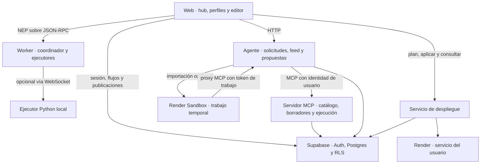

# Nodomics por dentro

Referencia para quien revisa el repositorio por primera vez. Describe el código de `origin/main` en `ee9de48` y contrasta las ramas remotas disponibles en esa revisión. Las observaciones sobre producción se atribuyen a pruebas documentadas por el equipo. Una migración en Git, un servicio en el blueprint o un adaptador de prueba acreditan cosas distintas.

## Qué se construye

Nodomics combina una red para encontrar personas y herramientas con un editor donde el trabajo compartido se puede ejecutar, adaptar y volver a publicar. El usuario puede ser quien usa una solución completa, quien aporta una sola transformación o quien conecta herramientas de varias disciplinas. Por ejemplo, un especialista en agua puede buscar una forma de incorporar condiciones sociales a un análisis territorial. El feed le ayuda a encontrar a alguien que ofrece ese conocimiento. El hub distribuye la herramienta. El editor permite probar su lógica y el agente propone cambios sobre un borrador. Son subsistemas distintos incluso cuando forman parte de un mismo recorrido.

El repositorio incluye [casos de uso por disciplina](../casos-de-uso/README.md), desde agronomía, educación y energía hasta veterinaria y comercios, [flujos de demostración](../../apps/web/src/demo) y una [migración del catálogo](../../supabase/migrations/20261122210000_seed_production_catalog.sql). Un caso narrado expresa una necesidad; un flujo sembrado permite inspeccionar un ejemplo. Para afirmar que un recorrido está disponible a usuarios reales también hay que verificar el servicio, los datos y la configuración que utiliza.

## Mapa de ejecución

El [punto de composición web](../../apps/web/src/main.tsx) elige las dependencias según URL, sesión y entorno. Para analizar una función, sigue primero esa selección. La misma pantalla puede usar un adaptador en memoria, un servicio HTTP o Supabase. Las reglas de desarrollo y dependencias están en [AGENTS.md](../../AGENTS.md), la [arquitectura](arquitectura.md) y los [ADR](../decisions).

## Conceptos que se parecen y se guardan por separado

| Entidad | Qué representa y dónde seguirla |
| --- | --- |
| Manifiesto de nodo | Define tipo, versión, parámetros, puertos e implementación. El [catálogo oficial](../../packages/nodes-core/nodes) incluye fuentes CSV y API, transformaciones, SQL, Python, vistas, composición y recursos de hosteo. |
| Instancia y flujo | Una instancia tiene identificador, tipo, versión, parámetros y posición. Una conexión enlaza el puerto de una instancia con el de otra. El documento `.nodo.json` usa el formato `nodomics/flow@0` y puede llevar manifiestos propios. [Grafo](../../packages/protocol/src/graph.ts) · [Formato de flujo](../../packages/protocol/src/flow.ts) |
| Resultado de ejecución | El motor conserva los resultados. La web recibe referencias y solicita páginas, perfiles o figuras. Una vista del lienzo y un archivo fuente pertenecen a ámbitos de estado diferentes. [Coordinador](../../packages/coordinator/src) |
| Flujo privado y publicación | El propietario edita su flujo guardado. Publicar crea una versión pública y conserva una referencia en el documento privado para indicar si hay cambios pendientes. Una publicación admite versiones sucesivas. [ADR del hub](../decisions/0024-hub-principal-y-estado-de-publicacion.md) |
| App, flujo y nodo publicados | `app` identifica una solución completa para un proyecto; `flow`, una secuencia reutilizable; `node`, una pieza. Una publicación `app` usa la misma representación de flujo e instantánea que `flow`. El hosteo de un servicio tiene su propio ciclo. [ADR 0033](../decisions/0033-publicaciones-de-tipo-app.md) |
| Borrador MCP y propuesta | El borrador es el grafo privado editable. La propuesta es la decisión pendiente sobre diferencias concretas, con propietario, revisión y versión. Una respuesta del agente puede incluir resumen y borrador aunque no se haya construido una propuesta. [Solicitud](../../apps/agent/src/requests/handle-request.ts) · [Decisión](../../apps/agent/src/proposals/decide.ts) |

## Recorridos para leer el código

### 1. Abrir, ejecutar y componer un flujo

La raíz abre el hub. El editor admite `/editor?new` y `/editor?flow=<id>`. Las publicaciones tienen ruta `/hub/<handle>/<slug>` y los perfiles `/u/<handle>`. Los enlaces antiguos con `/#flow=` siguen abriendo el editor. El arranque también contempla un flujo compartido por URL y trabajo pendiente tras iniciar sesión. [Rutas](../../apps/web/src/routing/routes.ts) · [Arranque y guardado](../../apps/web/src/main.tsx)

La interfaz usa el cliente NEP. El coordinador expande subflujos, ordena dependencias, determina qué resultados de la caché siguen vigentes y asigna tareas según las capacidades de cada ejecutor. Los eventos llevan la revisión del flujo para que la web pueda descartar resultados anteriores a la edición actual. En navegador se usan DuckDB-WASM para SQL y Pyodide para Python. El modo Python local conserva el coordinador y conecta un ejecutor mediante WebSocket. El registro también ofrece un motor simulado. [Cliente](../../packages/client/src) · [Planificación](../../packages/coordinator/src/plan-execution.ts) · [Registro de motores](../../apps/web/src/engine-registry.ts) · [Ejecutor local](../../engines/python-local/README.md)

Una herramienta compuesta puede exponer solo determinados parámetros y puertos como un nodo reutilizable. Para un problema de composición, empieza por la [biblioteca del editor](../../apps/web/src/library) y la [expansión de subflujos](../../packages/coordinator/src/expand-subflows.ts). La vía MCP `flows.declare_as_node` todavía devuelve «no disponible» en la revisión analizada, aun cuando la biblioteca web sí tiene operaciones de composición. [Implementación MCP](../../apps/mcp/src/tools-drafts.ts)

### 2. Publicar, explorar y reutilizar

El adaptador del hub elige Supabase cuando están configuradas su URL y su clave publicable. En local puede crear una cuenta de prueba y un catálogo en memoria. El editor combina almacenamiento en la cuenta y biblioteca local. Al investigar pérdida de datos al recargar, identifica primero el adaptador y si el usuario tenía sesión. [Selección del hub](../../apps/web/src/hub/create-app-hub.ts) · [Persistencia y versiones](../../packages/hub/src)

Una publicación contiene una instantánea de los manifiestos utilizados y, si se incluye el estado, muestras paginadas, perfiles, vistas o figuras. Esto permite mostrar una previsualización sin iniciar el motor. Ver una tabla en una publicación demuestra que puede leerse la instantánea. Para demostrar reproducibilidad hay que abrir una copia, proporcionarle las fuentes necesarias y ejecutarla de nuevo. [Grabación y reproducción de instantáneas](../../apps/web/src/hub/snapshot-replay.ts)

El hub permite explorar por tipo y etiquetas, visitar perfiles y abrir copias. El lenguaje visual del hilo comunica el origen de una publicación. En la revisión analizada, `lineageFromSummary` devuelve únicamente `origin`: el hub todavía no registra en ese recorrido quién adaptó cada copia. La memoria del agente y el historial de versiones de una publicación tampoco reconstruyen por sí solos esa genealogía. [Linaje del hub](../../apps/web/src/hub/hub-lineage.ts) · [Sistema de diseño](../design-system/README.md)

### 3. Encontrar personas y explicar decisiones

El perfil público del hub y la ficha de colaboración del feed tienen funciones distintas. La ficha describe, entre otras cosas, **qué ofrece y qué busca** la persona. El servicio genera representaciones vectoriales de esos textos. Para sugerir colaboradores parte de lo que el usuario busca y consulta las ofertas de otros perfiles; por eso un resultado de otra disciplina puede ser relevante. El feed dispone de registro asistido, búsqueda, mapa y recomendaciones. La ruta de registro admite la carga de un CV con un límite de cuerpo específico, comprobado en la [prueba del registro](../../apps/agent/test/registration-body-limit.test.ts). La lectura de una ficha por handle está habilitada para visitantes; guardar la ficha es una operación autenticada. Sin URL de agente el feed de la web usa fichas de demostración. [Contrato de perfil](../../packages/profile/src) · [Servicio](../../apps/agent/src/feed/feed-service.ts) · [Rutas y visibilidad](../../apps/agent/src/feed/feed-routes.ts) · [Adaptadores web](../../apps/web/src/feed/create-app-feed.ts)

El agente también registra episodios de uso de herramientas y decisiones sobre propuestas. La memoria representa relaciones con intervalos de validez, indexa contenido y da soporte a la búsqueda y a las explicaciones sobre un componente. Para averiguar por qué se tomó una decisión, sigue la evidencia por identidad, componente y momento; para averiguar quién publicó una versión, parte del hub. [Memoria](../../apps/agent/src/memory) · [Ruta de explicación](../../apps/agent/src/http/routes/why.ts)

### 4. Del lenguaje natural a un cambio aceptado

1. El panel web obtiene el token de sesión y envía la solicitud al agente configurado. Puede consumir eventos de progreso. [Panel y cliente HTTP](../../apps/web/src/agent)
2. El servicio resuelve la identidad, limita solicitudes, interpreta el objetivo e inicia el bucle con herramientas permitidas. El modelo consulta el catálogo, crea un borrador, lo modifica y puede pedir su ejecución. El bucle tiene límites de pasos y tiempo. [Bucle](../../apps/agent/src/loop/agent-loop.ts) · [Lista permitida](../../apps/agent/src/requests/allowlists.ts)
3. El MCP valida los argumentos y usa almacenes asociados al usuario. Una edición por lote puede construir varias operaciones sobre el borrador. Para ejecutar, el servicio usa un worker terminable con límite de 60 segundos y Python deshabilitado. Un nodo Python que funciona en el navegador necesita otro contexto de ejecución para probarse. [Herramientas](../../apps/mcp/src/tools.ts) · [Arranque del MCP](../../apps/mcp/src/start.ts) · [Worker real](../../apps/mcp/src/runner-worker.ts)
4. El agente convierte el diff en tarjetas de cambios. Al decidir, el servicio comprueba propietario, versión esperada y revisión de origen. Aplica los cambios seleccionados a través de MCP y guarda el estado de la propuesta. El manejo de una propuesta obsoleta es un caso distinto de un fallo de ejecución de nodo. [Construcción de propuestas](../../apps/agent/src/proposals/build-proposal.ts) · [Decisiones](../../apps/agent/src/proposals/decide.ts) · [Persistencia al aplicar](../../apps/mcp/src/tools-apply.ts)

### 5. Importar una funcionalidad desde GitHub

`import.from_github` es una herramienta del agente. Recibe la necesidad y opcionalmente repositorio y referencia. El servicio la registra cuando tiene configuración para Render Sandbox y una clave dedicada para el agente del sandbox. Durante el trabajo, un proxy limita el acceso MCP mediante un token temporal asociado al usuario. El entorno externo necesita poder alcanzar la URL del agente y disponer del script de importación. [Registro condicional](../../apps/agent/src/requests/wiring.ts) · [Adaptador Render](../../apps/agent/src/sandbox/render-sandbox.ts) · [Script](../../apps/agent/sandbox/run-import.sh)

El resultado incluye repositorio, SHA de commit, rutas, licencia si se conoce, correspondencia con nodos, casos de prueba y partes fuera de alcance. El servicio compara las filas esperadas y observadas **declaradas en el reporte del sandbox**. Distingue `verified`, `partial`, `unverified` e `incompatible`. La etiqueta «comprobado por el agente en el sandbox» delimita la evidencia: el servidor compara el reporte y no repite la ejecución original por su cuenta. La existencia del adaptador y sus pruebas tampoco demuestra que cualquier aplicación de GitHub pueda desplegarse o importarse completa. [Esquema del reporte](../../apps/agent/src/import/import-report.ts) · [Decisión del estado](../../apps/agent/src/import/import-status.ts) · [Pruebas](../../apps/agent/test/import-tool.test.ts)

### 6. Desplegar un servicio para personas fuera de Nodomics

Los nodos `core.deploy.repo` y `core.deploy.service` describen recursos. El servicio de despliegue lee el flujo guardado bajo la identidad del usuario, calcula un plan y requiere su huella al aplicar. El proveedor gestiona Render y guarda el estado de los despliegues en Supabase. La API cubre consulta, actualización, redespliegue y eliminación. Hay límites por usuario y globales. Las credenciales del proveedor pertenecen al backend. Publicar una ficha de tipo app y aprovisionar infraestructura son operaciones separadas. [Servicio de despliegue](../../apps/deploy/README.md) · [Casos de uso](../../apps/deploy/src/deploy-use-cases.ts) · [Especificación de recursos](../../apps/deploy/src/spec)

El equipo documentó una prueba contra Render y Supabase con un sitio estático: creación, actualización, redespliegue y borrado. En ese mismo informe dejó pendientes la prueba con repositorios reales para Docker y runtime nativo y la del panel web con una cuenta real. Esa es la cobertura reportada, no una comprobación actual de disponibilidad. [Informe del equipo](../anuncios/2026-11-22-1530-hosteo-activo.md)

## Cómo reproducir una revisión

Desde la raíz, con Node.js 24 o superior y pnpm 10.28.1, ejecuta `pnpm install --frozen-lockfile` y `pnpm dev`. Este último inicia la web y el catálogo en desarrollo. Los procesos de agente, MCP y despliegue se configuran por separado. Para verificar el recorrido que te interesa, consulta los [valores públicos de la web](../../apps/web/.env.example), las guías de [agente](../../apps/agent/README.md), [MCP](../../apps/mcp/README.md) y [despliegue](../../apps/deploy/README.md), el [blueprint](../../render.yaml) y las [migraciones SQL](../../supabase/migrations). Para conocer las capacidades activas del proceso prevalece el código de arranque de esa revisión.

| Pregunta de revisión | Comprobación que aporta evidencia |
| --- | --- |
| ¿El cambio respeta tipos, dependencias y pruebas del monorepo? | `pnpm check` ejecuta tipos, lint, reglas de dependencia y nombres, formato y Vitest. Las etapas se definen en [package.json](../../package.json). |
| ¿Un nodo conserva sus resultados al cambiar de motor? | Revisa su manifiesto y sus casos en el catálogo, las [pruebas de conformidad de motores](../../tests/conformance/README.md) y la [conformidad de ejecutores](../../tests/executor-conformance). |
| ¿Se puede recorrer la interacción en la web? | `pnpm e2e` usa Playwright en una suite separada. Consulta sus requisitos de Chromium, red y ejecutor Python local. [Guía E2E](../../tests/e2e/README.md) |
| ¿El usuario puede leer o modificar ese registro? | Contrasta el adaptador seleccionado, la identidad que llega al backend, la migración y las [pruebas SQL](../../supabase/tests). Un almacén en memoria no comprueba las políticas de Postgres. |
| ¿Qué evidencia existe de producción? | Distingue pruebas unitarias, integraciones con dobles, ejecución local real y ensayos contra servicios externos. Los [anuncios](../anuncios) indican qué comprobó el equipo y cuándo. |

## Qué aporta el resto del remoto

Al contrastar las ramas con la revisión base, tres tenían commits sin integrar por ascendencia. Las ramas son referencias móviles. Estos commits sirven para recuperar el contexto exacto con `git show <commit>`:

- **Onboarding** (`bc8fd5d`). La rama de incorporación añade extracción a partir de fotos y resumen de negocio confirmado, y sesiones invitadas restringidas a esas rutas. En la base analizada ya existe registro asistido; este recorrido ampliado pertenece a la rama.
- **Revisión general de web y hosteo** (`f633041`). Gran parte de sus parches tiene equivalentes en `main`; `git cherry` distingue esas equivalencias del cambio restante sobre consulta periódica del estado de despliegues. Mirar solo el nombre de la rama sobrestima el trabajo pendiente.
- **Narrativa de presentación** (`d3096ee`, archivo `docs/presentacion.md` de esa revisión). Su contenido ya está integrado en [la presentación de main](../presentacion.md) mediante commits equivalentes. Propone cinco recorridos: índice hídrico con conocimiento social, métodos de estudiantes en un lienzo común, adaptación entre cultivos, conexión de especialistas con métodos complementarios y composición de herramientas para un servicio comunal. La propia presentación identifica como pendientes el perfil que se actualiza desde conversaciones, avisos al autor por reutilización, linaje con nombres y edición simultánea. Son criterios para evaluar la visión multiplayer, no resultados demostrados por el editor de una sola sesión.

Para actualizar esta guía, contrasta primero `git fetch origin`, `git branch -r --no-merged origin/main` y el diff de las ramas relevantes. Para cada función, sigue la ruta de usuario hasta el adaptador que realmente se instancia y la prueba que ejerce ese recorrido.
